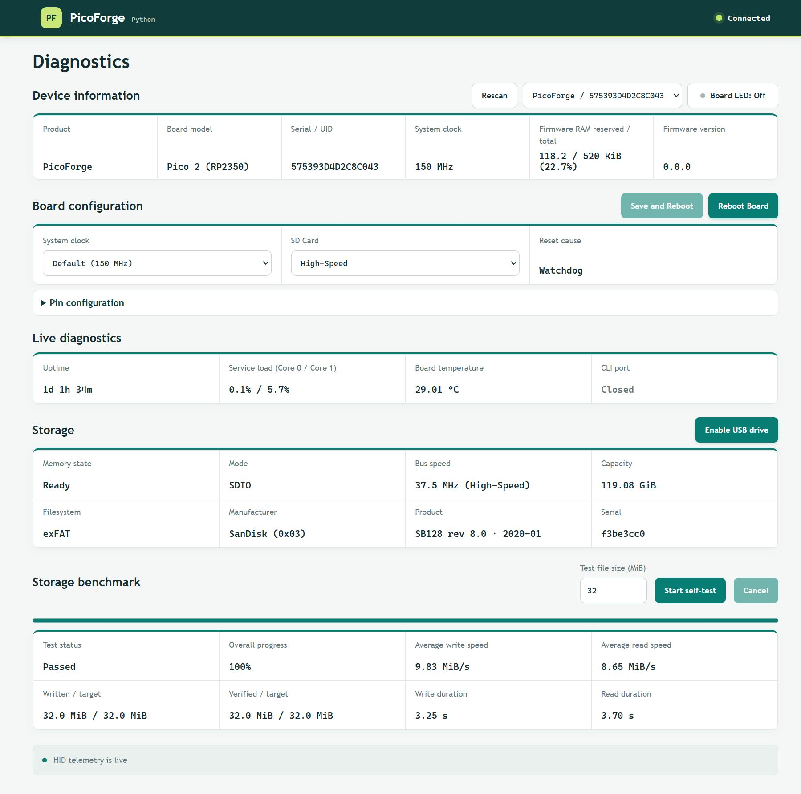

# PicoForge

**A reusable firmware-and-host foundation for Raspberry Pi Pico-family products.**

Start a specialized device with board management, diagnostics, USB communication, persistent configuration, and
optional SD storage and W-board wireless already integrated. Keep the services your application needs, then add its
own hardware behavior and host controls.

PicoForge also runs as a standalone board-management and storage tool. Product-specific hardware behavior belongs in
downstream projects, not this project's feature scope.

**Start here:** [Get started](docs/guides/getting-started.md) · [Build on PicoForge](docs/project-scope.md) ·
[Architecture](docs/reference/architecture.md) · [Documentation](#documentation)

## Available Today

| Foundation | Included |
| --- | --- |
| **Board management** | Identity, live diagnostics, persistent settings, LED control, and reboot. |
| **SD storage** | SPI or SDIO-PIO, FAT/exFAT file access, USB drive handoff, and optional I/O self-test. |
| **Host access** | USB HID management, CDC console, and Direct, Python, or .NET dashboards. |
| **W-board wireless** | Wi-Fi TCP CLI and BLE diagnostics with key-authenticated LED/benchmark control. |

Storage requires an external 3.3 V SD-card breakout; basic board management does not.
See the [storage guide](docs/guides/console.md) and [wireless scope](docs/guides/wireless.md) for operation and limits.

### Why SD Storage?

Pico-family boards' native USB connection operates at Full Speed: 12 Mbit/s signaling, with lower usable application
throughput. Data-heavy applications can generate information faster than the host connection can carry it.
SD storage provides a local destination, separating data collection from later retrieval.

This supports downstream acquisition tools, not an implemented capture engine or a guaranteed recording rate.
Sustained recording requires adequate buffering, handling SD-card write stalls, and measured end-to-end performance.
Local storage does not make USB downloads faster.

### Validation Status

Implemented does not mean fully hardware-qualified. Radio qualification, sustained SD reliability, USB mass-storage
compatibility, and power-loss recovery remain limited; see [qualification gaps](docs/validation/qualification-gaps.md)
and the configuration-specific [test records](docs/validation/records/README.md).
The Wi-Fi TCP CLI is unauthenticated and unencrypted, for trusted LANs only. BLE diagnostics are public; control-key
authentication does not encrypt the BLE link.

## Get Started

1. Get firmware for your board and SD transport from [Releases](https://github.com/djwinter29-oss/PicoForge/releases/latest),
   or [build it from source](docs/guides/getting-started.md#1-get-or-build-the-firmware).
2. Flash the board and, if using storage, connect a compatible 3.3 V SD-card breakout.
3. Open the [Direct dashboard](https://djwinter29-oss.github.io/PicoForge/) in desktop Chrome or Edge, or use a local
   [Python](host/python/README.md) or [.NET](host/dotnet/PicoForge/README.md) dashboard or the USB serial console.

Follow the [getting-started guide](docs/guides/getting-started.md) for detailed setup and safety precautions.
Publication links may be unavailable until the first successful publication; source setup is also covered.
GPIO signals are **3.3 V only**. Back up card data, never allow simultaneous firmware/host file access, and safely
eject before returning USB storage to the board.

## See It in Action

The Python dashboard connected to a real Pico 2: live board telemetry, configuration controls, and SDIO/exFAT storage.
See the [capture details](docs/validation/records/dashboard-capture.md#captured-dashboard) for the recorded configuration and scope.

## Use It or Extend It

- **Use it:** manage the board and attached storage through a dashboard or USB console.
- **Build a product:** pin a tested PicoForge revision, retain useful services, and add application-specific firmware
  and host behavior. Start with [project scope](docs/project-scope.md) and
  [layer responsibilities](docs/reference/architecture.md#layer-responsibilities).
- **Budget resources:** define GPIO, PIO, DMA, IRQ, memory, and timing ownership before combining a new workload with
  USB, storage, or radios. Reuse does not guarantee arbitrary combinations or unchanged application protocols.

Low-cost Pico hardware provides the starting point; reusable services aim to reduce repeated integration work.
FreeRTOS SMP manages both cores, allowing application tasks alongside platform services without implying dedicated-core
isolation or hard real-time guarantees. SD transport is selected at build time.
Direct and the Python/.NET dashboard must not share components. Python and .NET share only their own frontend;
see [dashboard isolation](docs/development/host-tools.md#dashboard-component-isolation).

## Project Direction

Feature expansion is closed. This project focuses on maintaining, documenting, and qualifying the existing foundation;
new product features belong in downstream projects. See [project scope](docs/project-scope.md) for the maintenance
boundary and [demonstration records](docs/validation/records/dashboard-capture.md) for observed behavior.

## Documentation

See [reading order and document ownership](docs/README.md) for the folder layout and authoritative topic boundaries.

### Use PicoForge

- [Getting started](docs/guides/getting-started.md): firmware, flashing, dashboard connections, and first storage operations.
- [Hardware setup](docs/guides/hardware.md): supported boards, wiring, power, and bring-up.
- [Direct](host/direct/README.md), [Python](host/python/README.md), and [.NET](host/dotnet/PicoForge/README.md):
  host-specific setup and usage.
- [Console guide](docs/guides/console.md): USB/Wi-Fi terminals, file commands, mounting, and recovery.
- [SD-card self-test guide](docs/guides/sdcard-benchmark.md): safe test procedure and result interpretation.
- [Wi-Fi and BLE](docs/guides/wireless.md): provisioning, radio operation, access restrictions, and qualification limits.

### Build a Specialized Product

- [Project scope](docs/project-scope.md): maintained baseline and downstream responsibilities.
- [Architecture](docs/reference/architecture.md): firmware layers, runtime, and storage ownership.
- [Persistent settings](docs/reference/settings.md): supported profiles, persistence, and API.
- [SD-card driver design](docs/reference/sdcard/driver.md): driver layers, protocol, and ownership.
- [SD-card physical links](docs/reference/sdcard/physical-links.md): transport engines, wiring, and clock planning.
- [USB HID report reference](docs/reference/usb-hid.md): report layouts and command semantics.
- [Wireless reference](docs/reference/wireless.md): radio integration, USB provisioning, and BLE authorization.
- [Host tools development](docs/development/host-tools.md): frontend ownership, dashboard isolation, and host tests.

### Develop and Validate

- [Demonstration records](docs/validation/records/dashboard-capture.md): captured interface and its evidence limits.
- [Firmware development and testing](docs/development/firmware-testing.md): build, unit tests, and hardware limits.
- [Console integration](docs/development/console-integration.md): dependency, command registration, and transport internals.
- [Test ownership index](tests/README.md): which suite owns a check and how to run it.
- [Qualification gaps](docs/validation/qualification-gaps.md): development status and limits of existing validation.
- [Test records](docs/validation/records/README.md): dated measurements and reviews, not current-firmware qualification.
- [SD remediation matrix](docs/validation/sd-review.md): current review dispositions.
- [Contributing](CONTRIBUTING.md): development and validation guidance.

### Release and Maintain

- [Release guide](docs/release.md): readiness checks, packages, publication setup, and release validation.
- [Security reporting](SECURITY.md): report vulnerabilities privately.

## License

PicoForge is licensed under the [BSD 3-Clause License](LICENSE). Third-party components retain their own licenses.
