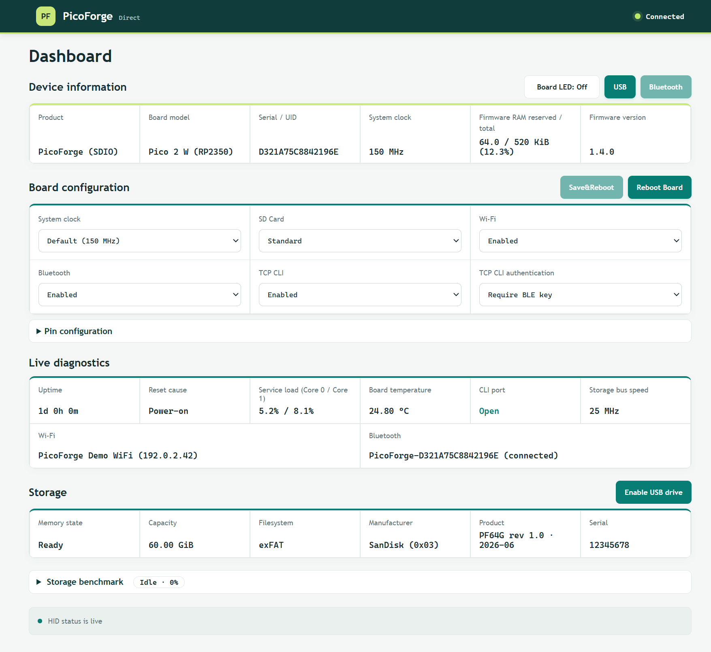

# PicoForge

**Quick links:** [Releases](https://github.com/djwinter29-oss/PicoForge/releases) ·
[Hardware setup](docs/guides/hardware.md) ·
[Direct Dashboard](https://djwinter29-oss.github.io/PicoForge/) ·
[PyPI package](https://pypi.org/project/picoforge/)

**Skip rebuilding board identity, diagnostics, settings, and host control for your RP2040 or RP2350 product.**

PicoForge provides those foundations, with optional SD storage and wireless on Pico W / Pico 2 W, so you can focus
on your product's own hardware and behavior.

## What You Get

| Foundation | Included |
| --- | --- |
| **Board management** | Identity, diagnostics, settings, and LED/reboot controls. |
| **SD storage** | SPI or native four-bit SDIO over PIO, FAT/exFAT files, USB drive handoff, and optional I/O self-test. |
| **Host tools** | USB HID control and Direct, Python, and .NET dashboards. |
| **Command-line interface** | [USB CDC command line](docs/guides/console.md#terminal) on supported boards; [Wi-Fi TCP command line](docs/guides/console.md#wi-fi-tcp-terminal) on Pico W / Pico 2 W when enabled and connected. |
| **Pico W / Pico 2 W wireless** | Bluetooth LE diagnostics and key-authenticated control. |

Basic board management needs no SD card. Storage requires a compatible external 3.3 V SD-card breakout.
It can provide a local destination for downstream applications, but PicoForge does not include a capture engine
or guarantee recording rates; sustained recording needs buffering and end-to-end hardware validation.

The hosted Direct dashboard runs in desktop Chrome or Edge and connects to a USB-connected PicoForge board; no host
installation is needed.

**Simulated preview:** The dashboard uses mocked HID reports; no board, SD card, Wi-Fi, or Bluetooth device was
connected. All displayed values are illustrative, not measurements or hardware qualification. See the
[capture notes](docs/evidence/records/dashboard-capture.md#simulated-direct-dashboard-preview).

[Ready to try PicoForge?](#try-picoforge)

## Try PicoForge

Follow [Getting Started](docs/getting-started.md) to download or build firmware, flash your board, and check its first
connection. Basic monitoring needs only a board and a data-capable USB cable.

The hosted [Direct dashboard](https://djwinter29-oss.github.io/PicoForge/) needs no host installation in supported
desktop browsers. Prefer a local app? [Choose a dashboard](docs/guides/README.md#dashboards).

## Build on PicoForge

| PicoForge provides | Your product adds |
| --- | --- |
| Board identity, diagnostics, settings, USB control, and the optional services listed above. | Product-specific hardware behavior, processing, commands, and host UI. |

PicoForge's documented firmware reuse path is a forked source checkout; it is not a separate firmware library or
drop-in product API. [Fork this repository](https://github.com/djwinter29-oss/PicoForge/fork) for downstream product
features, and pin the PicoForge revision and dependencies you have tested.

Start with the [firmware workflow](docs/development/firmware-testing.md) and
[build configuration](docs/reference/build-configuration.md) to choose board, transport, and optional modules.
Add product behavior in the application layer, keep board assignments in
[`firmware/src/config/board.c`](firmware/src/config/board.c), and follow the
[layer responsibilities](docs/reference/architecture.md#layer-responsibilities) for reusable services and drivers.

For example, a sensor product can keep PicoForge's board identity, settings, and dashboards, add sensor sampling
and commands in its application layer, and place product-specific pin assignments in board configuration. This is
an integration pattern, not a separately supported extension API.

### Project Scope

Upstream work focuses on bug fixes, reliability, compatibility, documentation, and qualification. Feature expansion
is closed upstream; downstream products remain free to build their own capabilities around the maintained services.

## Qualification and Security

Implemented features are not blanket hardware qualification. Radio qualification, sustained SD reliability, USB
mass-storage compatibility, and power-loss recovery remain limited. Review the
[qualification gaps](docs/evidence/README.md) and [test records](docs/evidence/records/README.md).

The Wi-Fi TCP CLI is unencrypted and serves only with a saved control key. Use it only on trusted LANs.
Bluetooth also runs only with a saved control key, and that key does not encrypt the BLE link.

## Documentation

Open the [documentation home](docs/README.md) for task-based navigation.

| Reader | Start here |
| --- | --- |
| First-time user | [Getting Started](docs/getting-started.md) |
| Board or dashboard user | [User guides](docs/guides/README.md) |
| Contributor or downstream developer | [Development](docs/development/README.md) |
| Protocol or driver implementer | [Technical reference](docs/reference/README.md) |
| Evaluator or maintainer | [Known limits and evidence](docs/evidence/README.md) |

See also [Contributing](CONTRIBUTING.md) and [security reporting](SECURITY.md).

## License

PicoForge is licensed under the [BSD 3-Clause License](LICENSE). Third-party components retain their own licenses.
