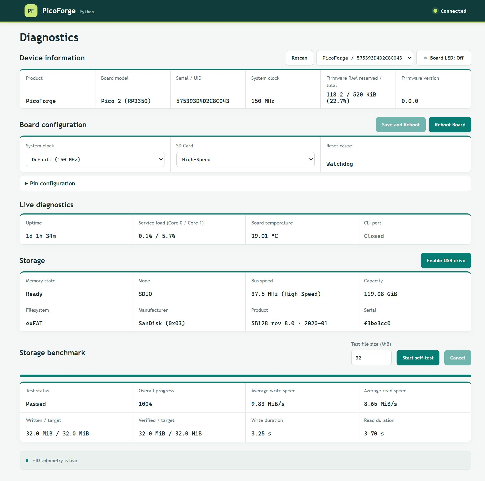

# PicoForge

**A host-controlled development platform for Raspberry Pi Pico-family boards.**

PicoForge bridges embedded hardware and host applications through reusable firmware services and a common device
interface. It helps developers monitor, configure and control their boards while reducing the need to build custom
firmware and host-side tooling for every project.

Start with board management, diagnostics and storage operations, then extend the platform towards host-controlled
peripheral access and hardware experimentation.

**Explore the project:** [Firmware](firmware/) · [Host tools](docs/development/host-tools.md) ·
[Planned APIs and examples](docs/design/vision.md) ·
[Architecture](docs/design/architecture.md) · [Getting Started](docs/guides/getting-started.md)

## Available Today

| Capability | What you get today |
| --- | --- |
| **Board status at a glance** | Board identity, uptime, system clock, temperature, runtime metrics, and SD-card state. |
| **Configuration and control** | Board LED control, reboot, and persistent system-clock and storage-speed settings. |
| **Storage without removing the card** | Automatically mount existing FAT/exFAT storage at startup for file access through the USB console. |
| **Use the card from your computer** | Temporarily share an attached card as a USB mass-storage drive, with explicit ownership handoff. |
| **Check card I/O** | On supporting firmware, test the mounted filesystem by writing and verifying a temporary file, with measured speeds. |
| **Choose your interface** | Use the hosted WebHID dashboard, local Python or .NET dashboard, or USB serial console. |

SD storage uses either SDIO-PIO or SPI, selected when building firmware. An external SD-card breakout is required for
storage features; basic board monitoring and LED control do not require one.

USB HID carries management commands and status, CDC provides the console, and optional MSC provides host block access.
The browser, Python, and .NET dashboards are companion interfaces to the same firmware.

## Get Started

1. Get firmware for your board and SD transport from [Releases](https://github.com/djwinter29-oss/PicoForge/releases/latest),
   or [build it from source](docs/guides/getting-started.md#1-get-or-build-the-firmware).
2. Flash the board and, if using storage, connect a compatible 3.3 V SD-card breakout.
3. Open the [WebHID dashboard](https://djwinter29-oss.github.io/PicoForge/) in desktop Chrome or Edge, or use a local
   [Python](host/python/README.md) or [.NET](host/dotnet/PicoForge/README.md) dashboard or the USB serial console.

Follow the [getting-started guide](docs/guides/getting-started.md) for detailed setup and safety precautions.
Publication links may be unavailable until the first successful publication; source setup is also covered.
GPIO signals are **3.3 V only**. Back up card data, never allow simultaneous firmware/host file access, and safely
eject before returning USB storage to the board.

## See It in Action

The Python dashboard connected to a real Pico 2: live board telemetry, configuration controls, and SDIO/exFAT storage.
See the [capture details](docs/development/demonstrations.md#captured-dashboard) for the recorded configuration and scope.

## Use It or Extend It

- **Use it:** manage the board and attached storage through a dashboard or USB console.
- **Extend it:** build on the Pico SDK, FreeRTOS, and existing firmware/host interfaces for a specialized application.
  SD transport is selectable today; broader capability selection and peripheral host libraries are future goals.

Low-cost Pico hardware provides the starting point; reusable services aim to reduce repeated integration work.
FreeRTOS SMP manages both cores, allowing application tasks alongside platform services without implying dedicated-core
isolation or hard real-time guarantees. See the [architecture](docs/design/architecture.md) for runtime boundaries.

## Project Direction

The lead use case is **evaluate one I²C sensor from Python or C#**: follow documented wiring, configure the sensor,
read measurements, and diagnose transaction errors without custom firmware. This workflow is planned.

SPI access is also planned. Recording, PWM, broader build selection, and wireless are optional future extensions,
not prerequisites. Sensor-specific logic belongs in host examples or application extensions.

See the [project vision](docs/design/vision.md) for intended workflows and scope, and the
[demonstration plan](docs/development/demonstrations.md) for walkthroughs and examples still to add.

## Documentation

**Set up and use**

- [Getting started](docs/guides/getting-started.md): firmware, flashing, dashboard connections, and first storage operations.
- [Hardware setup](docs/guides/hardware-setup.md): supported boards, wiring, power, and bring-up.
- [WebHID](host/webhid/README.md), [Python](host/python/README.md), and [.NET](host/dotnet/PicoForge/README.md):
  host-specific setup and usage.
- [USB CDC console guide](docs/guides/usb-cdc-cli.md): terminal setup, file commands, mounting, and recovery.
- [SD-card self-test guide](docs/guides/sdcard-performance-test.md): safe test procedure and result interpretation.

**Design and implementation**

- [Project vision](docs/design/vision.md): developer experience, intended capabilities, and scope boundaries.
- [Architecture](docs/design/architecture.md): firmware layers, runtime, and storage ownership.
- [Persistent settings](docs/design/settings.md): supported profiles, persistence, and API.
- [SD-card driver design](docs/design/sdcard/sdcard-driver-design.md): driver layers, protocol, and ownership.
- [SD-card physical links](docs/design/sdcard/sdcard-physical-links.md): transport engines, wiring, and clock planning.
- [USB HID report reference](docs/design/usb/usb-hid-report-reference.md): report layouts and command semantics.

**Development and validation**

- [Demonstration plan](docs/development/demonstrations.md): screenshots, walkthroughs, and runnable examples to add.
- [Firmware development and testing](docs/development/firmware-testing.md): build, unit tests, and hardware limits.
- [Host tools development](docs/development/host-tools.md): dashboards, tests, and shared frontend boundaries.
- [Qualification gaps](docs/tests/qualification-gaps.md): development status and limits of existing validation.
- [Test records](docs/tests/records/README.md): dated measurements and reviews, not current-firmware qualification.
- [SD remediation matrix](docs/tests/sd-design-remediation.md): current review dispositions.
- [Release guide](docs/deployment/release.md): packages, publication setup, and release validation.
- [Contributing](CONTRIBUTING.md): development and validation guidance.
- [Security reporting](SECURITY.md): report vulnerabilities privately.

## License

PicoForge is licensed under the [BSD 3-Clause License](LICENSE). Third-party components retain their own licenses.
