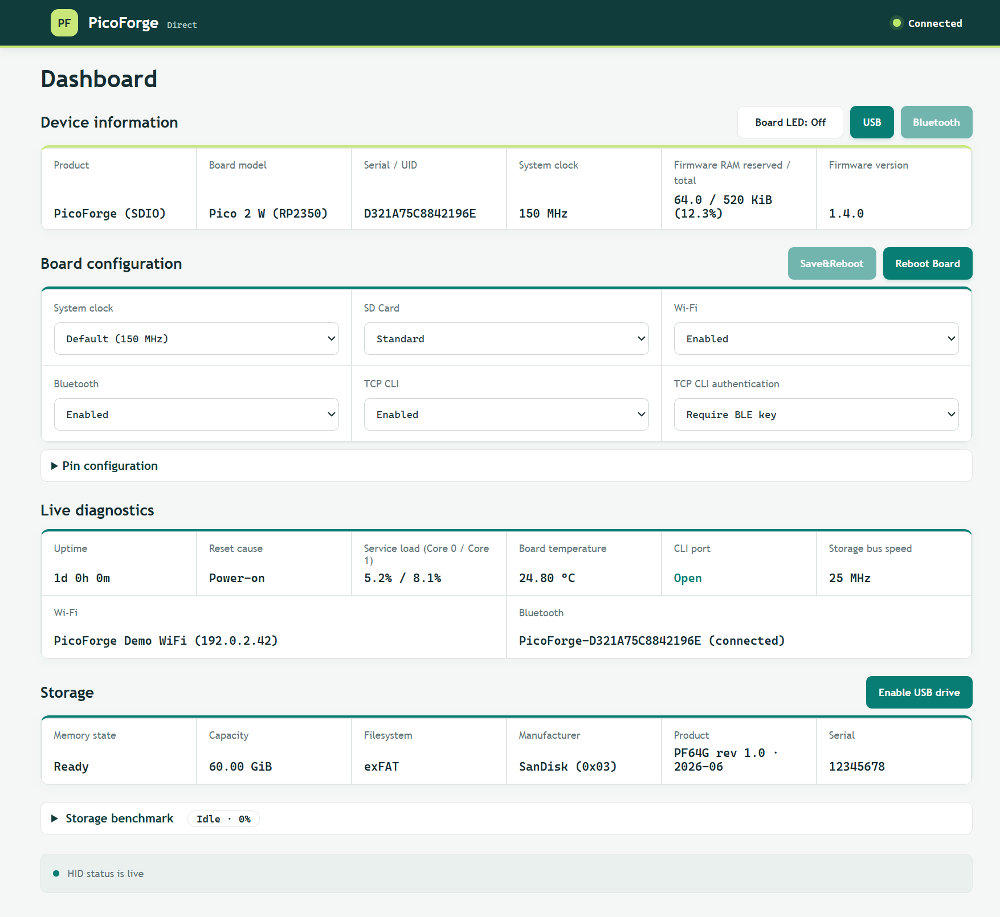

# PicoForge

[](https://github.com/djwinter29-oss/PicoForge/actions/workflows/pr-check.yml)
[](https://github.com/djwinter29-oss/PicoForge/actions/workflows/release.yml)
[](LICENSE)


**Skip rebuilding board identity, diagnostics, settings, and host control for your RP2040 or RP2350 product.**

PicoForge provides those foundations, with optional SD storage and wireless on Pico W / Pico 2 W, so you can focus
on your product's own hardware and behavior.

**Start here:** [Firmware releases (choose board + SD transport)](https://github.com/djwinter29-oss/PicoForge/releases/latest) ·
[Direct dashboard (firmware required)](https://djwinter29-oss.github.io/PicoForge/) ·
[Python host app on PyPI (firmware required)](https://pypi.org/project/picoforge/) ·
[Build with PicoForge](#build-on-picoforge)

## What You Get

| Foundation | Included |
| --- | --- |
| **Board management** | Identity, diagnostics, settings, and LED/reboot controls. |
| **SD storage** | SPI or native four-bit SDIO over PIO, FAT/exFAT files, USB drive handoff, and optional I/O self-test. |
| **Host tools** | USB HID control and Direct, Python, and .NET dashboards. |
| **Command-line interface** | [USB CDC command line](docs/guides/console.md#terminal) on supported boards; [Wi-Fi TCP command line](docs/guides/console.md#wi-fi-tcp-terminal) on Pico W / Pico 2 W when enabled and connected. |
| **Pico W / Pico 2 W wireless** | Bluetooth LE diagnostics and key-authenticated control. |

Basic board management needs no SD card. Storage requires a compatible external 3.3 V SD-card breakout.
It can provide a local destination for downstream applications, but PicoForge does not include a capture engine
or guarantee recording rates; sustained recording needs buffering and end-to-end hardware validation.

The hosted Direct dashboard runs in desktop Chrome or Edge and connects to a USB-connected PicoForge board; no host
installation is needed.



**Simulated preview:** The dashboard uses mocked HID reports; no board, SD card, Wi-Fi, or Bluetooth device was
connected. All displayed values are illustrative, not measurements or hardware qualification. See the
[capture notes](docs/validation/records/dashboard-capture.md#simulated-direct-dashboard-preview).

[Ready to try PicoForge?](#try-picoforge)

## Try PicoForge

Try the board-management tools on Pico, Pico W, Pico 2, or Pico 2 W. Download matching firmware from
[Releases](https://github.com/djwinter29-oss/PicoForge/releases/latest), or follow the
[getting-started guide](docs/guides/getting-started.md) to build it:

1. Flash the firmware for your board and selected SD transport, then connect it over USB.
2. Open the hosted [Direct dashboard](https://djwinter29-oss.github.io/PicoForge/) in desktop Chrome or Edge, or
   choose a local host below. Direct needs no host installation.

For the Python dashboard (Python 3.10+), install from [PyPI](https://pypi.org/project/picoforge/) and launch:

```sh
python -m pip install picoforge
picoforge web
```

See the [Python host guide](host/python/README.md) for virtual-environment setup and OS-specific HID requirements,
or the [.NET host guide](host/dotnet/PicoForge/README.md). Basic monitoring does not require an SD card. For storage,
use a compatible 3.3 V breakout; back up card data, avoid simultaneous firmware/host access, and safely eject before
returning USB storage to the board.

## Build on PicoForge

| PicoForge provides | Your product adds |
| --- | --- |
| Board identity, diagnostics, settings, USB control, and the optional services listed above. | Product-specific hardware behavior, processing, commands, and host UI. |

PicoForge's documented firmware reuse path is a forked source checkout; it is not a separate firmware library or
drop-in product API. [Fork this repository](https://github.com/djwinter29-oss/PicoForge/fork) for downstream product
features, and pin the PicoForge revision and dependencies you have tested.

For a first build-and-flash milestone:

1. Fork and clone the repository, then initialize its pinned dependencies with
   `git submodule update --init --recursive`.
2. Build for your target board and storage transport. For a Pico 2 with SDIO-PIO:

   ```sh
   tools/firmware/build.sh --board pico2 --sdcard-transport SDIO_PIO
   ```

3. Flash the resulting UF2 and connect by USB. Confirm that Direct identifies a Pico 2 as **Pico 2 (RP2350)** and
   reports live status; see [flashing](docs/guides/getting-started.md#2-flash-the-board) and
   [dashboard connection](docs/guides/getting-started.md#4-choose-a-dashboard-or-console).
4. Add product behavior in the firmware application layer. Keep board assignments in
   [`firmware/src/config/board.c`](firmware/src/config/board.c), and follow the documented
   [layer responsibilities](docs/reference/architecture.md#layer-responsibilities) when adding reusable services
   or drivers.

For example, a sensor product can keep PicoForge's board identity, settings, and dashboards, add sensor sampling
and commands in its application layer, and place product-specific pin assignments in board configuration. This is
an integration pattern, not a separately supported extension API.

This smoke check demonstrates a source build and dashboard connection, not compatibility with arbitrary workload
combinations or hard real-time behavior.

### Project Scope

Upstream work focuses on bug fixes, reliability, compatibility, documentation, and qualification. Feature expansion
is closed upstream; downstream products remain free to build their own capabilities around the maintained services.

## Qualification and Security

Implemented features are not blanket hardware qualification. Radio qualification, sustained SD reliability, USB
mass-storage compatibility, and power-loss recovery remain limited. Review the
[qualification gaps](docs/validation/qualification-gaps.md) and [test records](docs/validation/records/README.md).

The Wi-Fi TCP CLI is unencrypted and serves only with a saved control key. Use it only on trusted LANs.
Bluetooth also runs only with a saved control key, and that key does not encrypt the BLE link.

## Documentation

See the [documentation index](docs/README.md) for reading order and authoritative document ownership.

- **Use PicoForge:** [getting started](docs/guides/getting-started.md) ·
  [hardware setup](docs/guides/hardware.md) · [Direct](host/direct/README.md) ·
  [Python](host/python/README.md) · [.NET](host/dotnet/PicoForge/README.md) ·
  [console](docs/guides/console.md) · [wireless](docs/guides/wireless.md)
- **Build and develop:** [architecture](docs/reference/architecture.md) ·
  [settings](docs/reference/settings.md) · [SD-card driver](docs/reference/sdcard/driver.md) ·
  [USB HID reference](docs/reference/usb-hid.md) · [Bluetooth LE protocol](docs/reference/bluetooth.md) ·
  [host tools](docs/development/host-tools.md) ·
  [firmware testing](docs/development/firmware-testing.md)
- **Maintain and release:** [contributing](CONTRIBUTING.md) ·
  [release guide](docs/deployment/release.md) · [security reporting](SECURITY.md)

## License

PicoForge is licensed under the [BSD 3-Clause License](LICENSE). Third-party components retain their own licenses.
