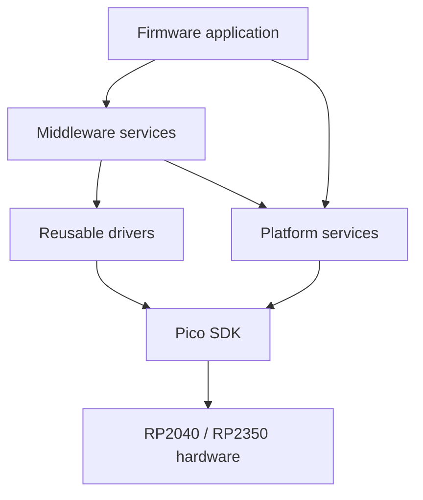

# PicoForge Architecture

> **Status:** The firmware configures two-core FreeRTOS SMP for RP2040 and RP2350. UART logging has been verified through a Raspberry Pi Debug Probe. Basic system, internal-temperature, board-LED, SDIO-PIO and SPI SD-card transports, FatFs integration, and conditional USB MSC exist. `firmware/src/config/config.h` statically selects the transport. MSC is disabled at boot. The idle storage worker automatically initializes and mounts detected cards, with paced retries; see [the mounting policy](cdc-cli.md). With card detect enabled it debounces removal/insertion and unmounts stale FatFs state. Recovery never formats media. MSC ownership is exclusive; dashboard Disable requests confirmed [Pico-side detach/remount](usb-protocol.md#confirmed-force-return), while legacy safe-disable commands require host eject. See [the hardware validation record](../firmware/src/drivers/storage/README.md#sd-card-breakout) for verified SDIO and SPI filesystem CLI read/write operations; complete MSC workflows and power-loss recovery remain unverified.

## Current Firmware

`firmware/CMakeLists.txt` imports the Pico SDK selected by `PICO_SDK_PATH`, initializes the SDK, imports the platform-specific FreeRTOS-Kernel port, and builds `pico_forge` for the selected `PICO_BOARD`; see [artifact naming](../README.md#1-build-the-firmware). The TinyUSB configuration lives under `firmware/src/integration/usb`; USB descriptors, HID report helpers, and the statically allocated USB task live under `firmware/src/app/usb`. The composite device exposes one CDC ACM interface and one vendor-defined HID interface. Board startup assigns, initializes and selects the monitor UART for stdio before enabling the logger; USB stdio stays disabled so log messages remain separate from CDC. The `middleware/logging` library provides serialized severity-tagged lines. The USB task services the [CDC CLI](cdc-cli.md) and publishes a versioned HID status report every 250 ms. HID Feature report 1 carries stable product, MCU, and USB serial identity; Input report 2 carries dynamic uptime, system clock, USB/CDC state, internal temperature, and LED state; Feature report 4 accepts LED set-state commands. Hosts read identity once per connection and receive changing values through the periodic input report. The temperature driver reads the on-chip ADC temperature sensor on channel 4, not GPIO 4. The onboard LED uses the selected SDK board's `PICO_DEFAULT_LED_PIN` (GPIO 25 for the current `pico` and `pico2` targets). Simple system, temperature, and LED drivers live flat under `firmware/src/drivers/`; native and SPI SD protocols live together under `drivers/sd_card/`, above the physical engines in `drivers/storage/`. The shared protocol is documented in [usb-protocol.md](usb-protocol.md). The development VID/PID is `0xCAFE:0x4011` and is not for product release. `firmware/src/main.c` initializes board UART and logging, temperature, and an available board LED, starts the USB task, and launches the scheduler. The PR workflow and `tools/validation/validate.sh` build the `pico` and `pico2` targets; physical HID, temperature, and LED behavior still require board validation.

Input Report 3 publishes SD-card detection/initialization state, selected bus mode, effective bus speed, CSD-derived capacity, and CID identity every second. Input Report 5 reports MSC ownership transitions, while Feature Report 5 requests enable/disable. In MSC mode the USB descriptor appends MSC after CDC and HID, preserving the PID and HID interface number; see [usb-protocol.md](usb-protocol.md). The owner gate rejects firmware block calls while the host owns the card. Enabling queues a worker-owned FatFs unmount before acquisition and is rejected if CLI storage work is pending. The legacy safe-disable command requires host eject. Dashboard **Disable USB drive** instead requests confirmed [Pico-side detach/remount](usb-protocol.md#confirmed-force-return), with one worker mount attempt and explicit failure reporting; host apps never run OS eject commands.

CDC storage commands are queued to a statically allocated FreeRTOS storage worker,
which is the sole FatFs caller for this workflow. USB/CLI and storage communicate
through bounded request/reply queues; filesystem calls do not execute in the USB
task. MSC transitions are rejected while a storage command is outstanding. Files
are closed before command completion, and enabling MSC automatically queues filesystem
unmount on the worker before acquiring USB ownership. See [the CDC CLI guide](cdc-cli.md) for commands, safeguards,
resource budgets, and validation limits.

This is a buildable starting point, not yet the complete application framework. The example currently uses Pico SDK and FreeRTOS APIs directly; future modules should establish the boundaries below before more hardware and application behavior is added.

HID Report 6 starts/cancels a large-file [SD self-test](sd-self-test.md) and
publishes verification progress and phase timings. Its RTOS-independent engine
lives in `app/storage` and runs in the same sole FatFs worker, with
exclusive ownership, explicit replacement of the reserved `/PFTEST.BIN` file, and checked cleanup.
See the [self-test safeguards](sd-self-test.md#running). Browser, Python, and
.NET dashboards expose the controls and calculate average read/write metrics.

## Core and Runtime Policy

Before starting the scheduler, USB startup disconnects for 250 ms using the SDK busy wait, then reconnects.
This boot-only delay must not depend on alarm or RTOS wakeups; an alarm-backed sleep stalled RP2040 startup.

`integration/freertos/runtime_stats.c` samples FreeRTOS idle runtime and SDK-linked SRAM reservations for HID
Input Report 2. See [runtime telemetry](usb-protocol.md#input-report-2) for metric definitions, sampling limits
and host compatibility. Both dashboards show these metrics in Runtime status.

FreeRTOS-Kernel 11.3.1 runs with `configNUMBER_OF_CORES=2`. The Pico port launches core 1 when the scheduler
starts on core 0; applications must not launch a second independent core entry point. USB, storage, timer and
idle tasks use the kernel's all-core affinity default and may migrate. Different priorities may execute
simultaneously. Affinity capability remains enabled for Pico SDK boot-flash-safe execution, which temporarily uses a
core-specific lockout task; application tasks are not pinned. Task/ISR kernel critical sections exclude both cores,
while existing media reservations serialize physical storage operations. FatFs retains one executor.
SMP schedules tasks, not arbitrary hardware resources: board setup and IRQ installation still occur before scheduler
startup, and IRQ routing stays on its initialization core. Peripheral ownership remains explicit rather than being
inferred from the executing core. Two-core scheduling is not a hard real-time guarantee.

The project-owned [DCD guard](../firmware/src/integration/usb/dcd_guard.c) interposes the pinned TinyUSB RP2040/RP2350
driver entry points and its shared USB IRQ handler. A dedicated SDK spinlock and local interrupt masking exclude
endpoint/reset/setup/SOF mutations across cores; same-core nested driver calls retain the outer reservation.
Only low-level DCD operations hold this lock, never USB application callbacks or synchronous MSC media I/O.
TinyUSB must retain the Pico OS adapter, whose event queue has its own cross-core critical section.
The IRQ copies controller events into a static 16-entry queue under the same gate. The `tud_task_ext` interposition
drains the upstream queue, forwards one bounded controller batch without holding the gate, then runs TinyUSB task
dispatch. Thus the upstream queued-SETUP counter and device flags are only mutated on the USB task, not concurrently
by the IRQ. Event order is retained; consecutive SOFs are coalesced to the newest frame so idle frame traffic cannot
fill the queue while MSC blocks. Queue overflow asserts explicitly rather than losing controller events silently.
The task-readiness query includes both queues; deinitialization discards pending controller events before reuse.
There is no new heap allocation; the queue adds `16 * sizeof(dcd_event_t)` bytes plus indices to linked SRAM.
Event/SOF hooks now run in task context; PicoForge defines no ISR event hooks or per-frame SOF consumer.
Adding such hooks or USB classes requires revisiting the batching and coalescing contract.
Initialization runs before the scheduler on core 0. NVIC enable/disable, deinitialization and reinitialization must
remain on that IRQ-owning core; wrong-core lifecycle calls assert rather than silently mask another core's NVIC.
Normal USB task processing does not change IRQ ownership or require task affinity. These safeguards have host
concurrency tests; sustained concurrent USB/media workloads still require target qualification.
Dependency upgrades must pass the pinned-driver surface contract before the guard can be considered compatible.
Sustained dual-core stress remains unqualified; the one-off Pico 2 observation is in the
[earlier qualification record](tests/records/earlier-sdio-qualification-undated.md#pico-2-dual-core-msc-handoff-observation).

The example uses static allocation for its application task and the port-provided idle-task memory. Software timers are enabled because the Pico port uses the timer-pend API for SDK synchronization interoperation. Additional tasks should document their stack, priority, ownership, and whether allocation is static or dynamic. The current firmware disables dynamic task allocation.

## Intended Dependency Direction

Application code orchestrates middleware and platform services. Middleware composes reusable drivers and platform services. Drivers and platform services adapt Pico SDK and board-specific hardware details.

Dependencies should flow toward the hardware-facing layers. Avoid circular dependencies between middleware, drivers, and platform services; use explicit interfaces when a lower layer needs an application-provided callback.

## Layer Responsibilities

### Application

Own product behavior, startup, and composition of the services needed by a firmware target. Keep policy and hardware register details out of application code where a reusable service or driver is appropriate.

### Middleware

Provide reusable application-facing services. Storage middleware adapts FatFs disk I/O to the logical block-device
API; the application owns the FatFs volume, SD-card configuration, ownership, and mounting policy.
The firmware currently uses the USB device role; a USB host role is not selected.

### Drivers

Encapsulate reusable peripheral operations and Pico SDK hardware APIs. Simple system, temperature, and LED drivers are flat under `firmware/src/drivers/`; multi-file drivers are grouped by subsystem under `firmware/src/drivers/sd_card/`. Reusable filesystem adaptation belongs in middleware; media lifecycle and firmware/USB ownership policy belongs in the application. Keep board pin/power setup and controller resource selection in board support under `firmware/src/board/`. FatFs consumes the [logical block interface](../firmware/src/middleware/storage/block_device.h) through an application owner-gated descriptor; transport configuration lives in [board support](../firmware/src/board/board.h). See the [hardware setup options](hardware-setup.md).

### SD-Card Driver Structure

See [SD-Card Driver Design](sdcard-design.md) for the authoritative layer
boundaries, SDIO-PIO and SPI interfaces, initialization/read/write/ownership
workflows, explicitly selected FreeRTOS/bare-metal ports, and hardware resource
inventory. The default USB/storage application remains FreeRTOS-only; the
bare-metal configuration builds the reusable driver and its link-smoke target.
Board wiring and physical
qualification records remain in the [storage transport guide](../firmware/src/drivers/storage/README.md#sd-card-breakout).

### Platform

Own board support, configuration, logging, version metadata, and integration with the selected MCU and SDK. The board topology/configuration API lives in `firmware/src/board/`; board-specific pin mapping belongs here and must agree with [the hardware setup baseline](hardware-setup.md) and the board schematic. The selected Pico profile exposes SDIO-PIO and SPI wiring for explicit transport selection; physical card operation still needs board validation.

## External Components

Pico SDK 2.3.0 and FreeRTOS-Kernel V11.3.1 are pinned as Git submodules under `firmware/third_party/`. Initialize them with `git submodule update --init --recursive`. The build defaults to the SDK submodule, with `PICO_SDK_PATH` available as an override. The kernel's Pico SDK import selects the RP2040 or RP2350 port based on `PICO_PLATFORM`. The SD memory-card protocols are implemented in `firmware/src/drivers/sd_card/`; their reusable SPI and PIO engines live in `firmware/src/drivers/storage/`. FatFs R0.16 with upstream patches 1 and 2 is vendored under `firmware/third_party/fatfs/` and compiled into the firmware.
Its upstream disk interface and configuration live under `firmware/src/integration/fatfs/`; project-owned disk
adaptation lives under `firmware/src/middleware/storage/`, while the singleton volume lifecycle lives in
`firmware/src/app/storage/`.

Embedded CLI is also pinned as a Git submodule. Its application session module is independent
of the USB transport and RTOS; see [CDC CLI](cdc-cli.md) for the dependency pin,
session lifecycle, command-extension rules, memory budget, and validation plan.

The application storage-owner task initializes the SD-card interface and mounts its existing volume through the
device-independent `pf_fatfs_volume_mount()` service; mounting never formats media. FatFs uses a logical block device,
selected by the application. The SD API uses 32-bit sector addresses (`FF_LBA64=0`), limiting volumes
to fewer than 4,294,967,296 512-byte sectors (2 TiB); larger exFAT volumes are not supported. Mount, unmount, and file
operations require caller serialization because FatFs is configured without cross-task locking. See the
[filesystem block-device boundary](sdcard-design.md#filesystem-block-device-boundary) for authoritative layering,
binding lifetimes, and ownership contracts.

Application storage policy stays in `app/storage`: `fatfs_volume.c/.h` owns the singleton FatFs instance,
mount registration and format telemetry; `storage_commands.c/.h` executes CDC storage commands,
`file_benchmark.c/.h` verifies and times a dedicated file, `storage_worker.c/.h` serializes requests and owns
automount/recovery policy, and `sd_media.c/.h` owns the application media lifecycle and firmware/USB ownership.
SD driver dispatch, protocol, telemetry and execution-port locks remain below the application;
retained ownership/operation diagnostics belong to `sd_media`. Its static firmware descriptor gates FatFs I/O,
while the middleware SD adapter is explicitly raw and has no application ownership policy.
The worker asks `sd_media` to obtain SD configuration and initialize its execution port before task startup;
the USB task no longer configures SD. Command and worker headers do not expose SD configuration.
The firmware build includes the SD protocol/port targets and SD block adapter. Common FatFs/logical-block middleware
uses the SD block adapter.
Automatic mount failures retain SD initialization, volume and FatFs result codes and log the first or changed failure;
identical retries remain paced and do not repeat that worker warning. Successful mounting resets warning suppression.
Mount registration and format are independent atomic telemetry snapshots; neither grants filesystem access.
Worker presence fields remain worker-owned: readers inspect them only while the kernel-protected
`media_service_busy` gate is clear, and the worker publishes changes before releasing that gate.

Product-specific USB behavior lives under `app/usb`: `usb_task.c/.h` owns task startup, CDC command sessions and report
scheduling; `usb_hid.c/.h` owns the product HID protocol; `usb_msc.c/.h` owns SCSI callbacks and application handoff
coordination; `msc_storage.h` maps MSC operations to the SD media service. `usb_descriptors.c` defines product interfaces.
TinyUSB configuration remains under `integration/usb`; the pinned TinyUSB stack supplies reusable USB machinery.
No extra middleware forwarding layer or runtime backend registry is introduced.

The product CLI instance, prompt, built-in commands and buffer/history settings live in `app/cli`, using Embedded
CLI directly. USB owns CDC transport and connection sessions. Middleware storage retains only logical block dispatch,
device adapters and FatFs disk callbacks; middleware logging retains formatting and severity filtering, with stdio
output selection performed by board startup. Neither middleware service depends on application headers.

### Storage Handoff Invariants

- Only the storage worker executes firmware FatFs operations; per-block reservations do not serialize file transactions.
- MSC acquisition reserves media across the worker-idle and unmounted checks and ownership transition.
  Worker admission and transition coordination run on the USB task; these APIs are not arbitrary multi-task entry points.
- Owner-gated I/O holds the same recursive reservation through backend completion; USB partial-sector
  read-modify-write also holds it across the full operation.
- Normal release requires checked eject/sync. Fault release requires detached, unavailable USB-owned media and queues
  worker recovery without claiming a clean eject. Recovery logs its result and never mounts automatically.
- Confirmed force return disconnects before normal owner release and holds worker admission through one mount
  attempt; failure leaves the volume unmounted and blocks automatic retries. It never claims host-cache durability.
- Uncertain failed writes are not replayed. Host tests cover exclusion, failed sync retention, no-replay and recovery
  rejection/completion; they do not establish physical USB BOT or power-loss qualification.

### Storage Worker State

Admission and ownership transitions are coordinated by the USB task, not arbitrary concurrent callers. The worker
and USB task publish admission/completion state under critical sections; command cancellation is atomic.

| Activity | Admission state | Completion rule |
|---|---|---|
| Idle | `busy=false`, `media_service_busy=false` | USB may admit a request or transfer ownership under reservation. |
| Background media service | `media_service_busy=true`, `busy=false` | Worker releases the service gate after the serialized lifecycle operation. |
| Command queued/executing/reply draining | `busy=true`, `benchmark_active=false` | USB must drain the done reply, even for a disconnected session. |
| Benchmark queued/executing/cleanup | `busy=true`, `benchmark_active=true`, `benchmark_finished=false` | Cancellation requests cleanup; it does not release admission. |
| Benchmark completion published | `busy=true`, `benchmark_active=true`, `benchmark_finished=true` | USB polling observes completion and clears all three flags; the result persists. |
| Explicit recovery queued/executing | `busy=true`, `benchmark_active=false` | Worker reports recovery outcome and releases admission without a command reply. |
| Forced return queued/executing | `busy=true`, `benchmark_active=false` | Worker attempts one mount; USB pending/rejected reflects completion. |

`busy` and `media_service_busy` exclude each other. `benchmark_finished` implies `benchmark_active`, which implies
`busy` until USB observes completion. Recovery and commands share the admission gate but not reply completion:
recovery has no CDC session. Mount-policy flags are independent of operation admission. Recovery sets
`auto_mount_blocked`; a successful explicit `fs mount` or confirmed force-return mount clears it.
A failed initialization or mount leaves it set.
Per-block reservations alone never authorize USB takeover while file cleanup or reply draining is outstanding.

## Testing and Validation

Ceedling is configured by the repository-root `project.yml`. Host unit tests belong under `firmware/tests/` and mirror
host-testable application, board, driver, integration and middleware modules. The configuration excludes `main.c`;
board tests use scoped SDK fakes.

`host/python/tests/`, `host/dotnet/tests/`, and `host/webhid/tests/` contain hardware-free host protocol/API tests. `tools/validation/validate.sh` checks shell syntax, validates the Ceedling project, runs firmware unit tests when present, and builds both MCU targets. Run the Python, .NET, and WebHID tests using the commands in the README. `tools/validation/coverage-firmware.sh` generates gcovr reports for firmware unit tests; it does not measure target timing or prove hardware behavior.

Physical wiring, pinout qualification, and tests requiring a board or probe belong in the hardware documentation and validation flow.
The pinout document records standard Pico/Pico 2 targets and the SD breakout mappings. Board support constructs the
selected SDIO-PIO or SD-SPI transport configuration. Physical timing, card compatibility, USB interoperability, and
power-loss qualification remain subject to the limits recorded in the SD validation guide.