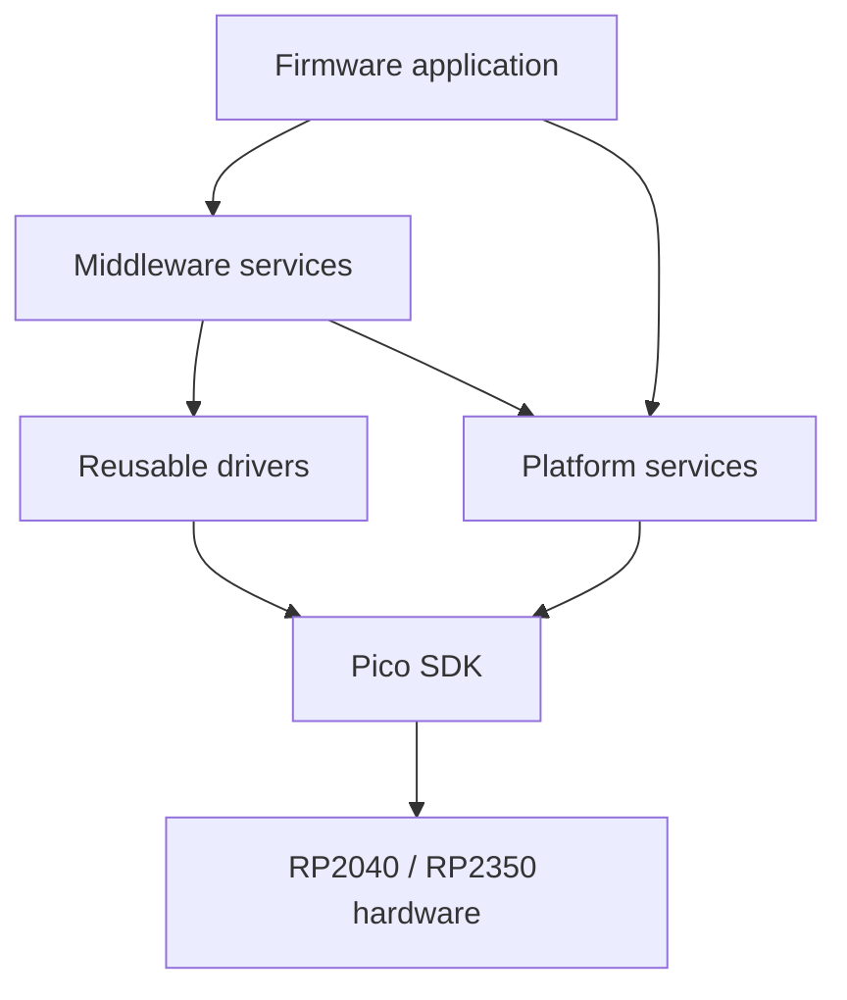

# PicoForge Architecture

> **Status:** The firmware builds for RP2040 and RP2350 and runs single-core FreeRTOS tasks. UART logging has been verified through a Raspberry Pi Debug Probe. Basic system, internal-temperature, board-LED, SDIO-PIO and SPI SD-card transports, FatFs integration, and conditional USB MSC exist. `firmware/src/config/config.h` statically selects the transport. MSC is disabled at boot. The idle storage worker automatically initializes and mounts detected cards, with paced retries; see [the mounting policy](cdc-cli.md). With card detect enabled it debounces removal/insertion and unmounts stale FatFs state. Recovery never formats media. MSC ownership is exclusive and requires host safe-eject before firmware regains the card. See [the hardware validation record](../firmware/src/drivers/storage/README.md#sd-card-breakout) for verified SDIO and SPI filesystem CLI read/write operations; complete MSC workflows and power-loss recovery remain unverified.

## Current Firmware

`firmware/CMakeLists.txt` imports the Pico SDK selected by `PICO_SDK_PATH`, initializes the SDK, imports the platform-specific FreeRTOS-Kernel port, and builds `pf_hello_world` for the selected `PICO_BOARD`. The TinyUSB configuration lives under `firmware/src/integration/usb`; USB descriptors, HID report helpers, and the statically allocated USB task live under `firmware/src/app/usb`. The composite device exposes one CDC ACM interface and one vendor-defined HID interface. Board topology assigns and initializes the monitor UART before the logger selects it for output; USB stdio stays disabled so log messages remain separate from CDC. The `middleware/logging` library provides serialized severity-tagged lines. The USB task services the [CDC CLI](cdc-cli.md) and publishes a versioned HID status report every 250 ms. HID Feature report 1 carries stable product, MCU, and USB serial identity; Input report 2 carries dynamic uptime, system clock, USB/CDC state, internal temperature, and LED state; Feature report 4 accepts LED set-state commands. Hosts read identity once per connection and receive changing values through the periodic input report. The temperature driver reads the on-chip ADC temperature sensor on channel 4, not GPIO 4. The onboard LED uses the selected SDK board's `PICO_DEFAULT_LED_PIN` (GPIO 25 for the current `pico` and `pico2` targets). Simple system, temperature, and LED drivers live flat under `firmware/src/drivers/`; native and SPI SD protocols live together under `drivers/sd_card/`, above the physical engines in `drivers/storage/`. The shared protocol is documented in [usb-protocol.md](usb-protocol.md). The development VID/PID is `0xCAFE:0x4011` and is not for product release. `firmware/src/main.c` initializes board UART and logging, temperature, and an available board LED, starts the USB task, and launches the scheduler. The PR workflow and `tools/validation/validate.sh` build the `pico` and `pico2` targets; physical HID, temperature, and LED behavior still require board validation.

Input Report 3 publishes SD-card detection/initialization state, selected bus mode, effective bus speed, CSD-derived capacity, and CID identity every second. Input Report 5 reports MSC ownership transitions, while Feature Report 5 requests enable/disable. In MSC mode the USB descriptor appends MSC after CDC and HID, preserving the PID and HID interface number; see [usb-protocol.md](usb-protocol.md). The owner gate rejects firmware block calls while the host owns the card. Enabling is rejected if FatFs is mounted or CLI storage work is pending; disabling is rejected until storage work is complete and the host ejects and allows removal. The Python, .NET, and WebHID dashboards expose the toggle and decode both reports.

CDC storage commands are queued to a statically allocated FreeRTOS storage worker,
which is the sole FatFs caller for this workflow. USB/CLI and storage communicate
through bounded request/reply queues; filesystem calls do not execute in the USB
task. MSC transitions are rejected while a storage command is outstanding. Files
are closed before command completion, and enabling MSC still requires explicit
filesystem unmount. See [the CDC CLI guide](cdc-cli.md) for commands, safeguards,
resource budgets, and validation limits.

This is a buildable starting point, not yet the complete application framework. The example currently uses Pico SDK and FreeRTOS APIs directly; future modules should establish the boundaries below before more hardware and application behavior is added.

HID Report 6 starts/cancels a large-file [SD self-test](sd-self-test.md) and
publishes verification progress and phase timings. Its RTOS-independent engine
lives beside storage middleware and runs in the same sole FatFs worker, with
exclusive ownership and create-new/cleanup safeguards. Browser, Python, and
.NET dashboards expose the controls and calculate average read/write metrics.

## Core and Runtime Policy

The initial runtime uses FreeRTOS-Kernel 11.3.1 with `configNUMBER_OF_CORES=1`. PicoForge starts its scheduler on core 0 and does not launch framework work on core 1. Core 1 is left unused by this baseline and may be assigned by a product application in a future, explicitly designed mode.

The FreeRTOS port itself is SMP-capable, but that does not mean this build runs SMP: the configured scheduler core count is one. Do not treat this as a hard real-time guarantee. Any core-1 application mode will need defined startup ownership, peripheral/IRQ affinity, cross-core synchronization, and measured timing.

The example uses static allocation for its application task and the port-provided idle-task memory. Software timers are enabled because the Pico port uses the timer-pend API for SDK synchronization interoperation. Additional tasks should document their stack, priority, ownership, and whether allocation is static or dynamic. The current firmware disables dynamic task allocation.

## Intended Dependency Direction

Application code orchestrates middleware and platform services. Middleware composes reusable drivers and platform services. Drivers and platform services adapt Pico SDK and board-specific hardware details.

Dependencies should flow toward the hardware-facing layers. Avoid circular dependencies between middleware, drivers, and platform services; use explicit interfaces when a lower layer needs an application-provided callback.

## Layer Responsibilities

### Application

Own product behavior, startup, and composition of the services needed by a firmware target. Keep policy and hardware register details out of application code where a reusable service or driver is appropriate.

### Middleware

Provide reusable application-facing services. Storage middleware mounts FatFs over the logical block-device API;
the application selects SD or translated external NOR and remains responsible for board-approved configuration and
mounting policy. See [build-selected NOR storage](nor-flash.md#build-selected-fatfs-and-usb-msc).
The firmware currently uses the USB device role; a USB host role is not selected.

### Drivers

Encapsulate reusable peripheral operations and Pico SDK hardware APIs. Simple system, temperature, and LED drivers are flat under `firmware/src/drivers/`; multi-file drivers are grouped by subsystem under `firmware/src/drivers/sd_card/`. Reusable filesystem adaptation belongs in middleware; media lifecycle and firmware/USB ownership policy belongs in the application. Keep board pin/power setup and controller resource selection in board support under `firmware/src/board/`. FatFs consumes the [logical block interface](../firmware/src/middleware/storage/block_device.h) through an application owner-gated descriptor; transport configuration lives in [board support](../firmware/src/board/board.h). See the [hardware setup options](hardware-setup.md).

### SD-Card Driver Structure

See [SD-Card Driver Design](sdcard-design.md) for the authoritative layer
boundaries, SDIO-PIO and SPI interfaces, initialization/read/write/ownership
workflows, explicitly selected FreeRTOS/bare-metal ports, and hardware resource
inventory. The default USB/storage application remains FreeRTOS-only; the
bare-metal configuration builds the reusable driver and its link-smoke target.
Board wiring and physical
qualification records remain in the [storage transport guide](../firmware/src/drivers/storage/README.md#sd-card-breakout).

### Platform

Own board support, configuration, logging, version metadata, and integration with the selected MCU and SDK. The board topology/configuration API lives in `firmware/src/board/`; board-specific pin mapping belongs here and must agree with [the hardware setup baseline](hardware-setup.md) and the board schematic. The selected Pico profile exposes SDIO-PIO and SPI wiring for explicit transport selection; physical card operation still needs board validation.

## External Components

Pico SDK 2.3.0 and FreeRTOS-Kernel V11.3.1 are pinned as Git submodules under `firmware/third_party/`. Initialize them with `git submodule update --init --recursive`. The build defaults to the SDK submodule, with `PICO_SDK_PATH` available as an override. The kernel's Pico SDK import selects the RP2040 or RP2350 port based on `PICO_PLATFORM`. The SD memory-card protocols are implemented in `firmware/src/drivers/sd_card/`; their reusable SPI and PIO engines live in `firmware/src/drivers/storage/`. FatFs R0.16 with upstream patches 1 and 2 is vendored under `firmware/third_party/fatfs/` and compiled into the firmware.
Its upstream disk interface and configuration live under `firmware/src/integration/fatfs/`; project-owned disk
adaptation and volume lifecycle live under `firmware/src/middleware/storage/`.

Embedded CLI is also pinned as a Git submodule. Its middleware is independent
of the USB transport and RTOS; see [CDC CLI](cdc-cli.md) for the dependency pin,
session lifecycle, command-extension rules, memory budget, and validation plan.

The application storage-owner task initializes the selected SD or LevelX NOR backend and mounts its existing volume through the
device-independent `pf_fatfs_volume_mount()` service; mounting never formats media. FatFs uses a logical block device,
selected by the application. The SD API uses 32-bit sector addresses (`FF_LBA64=0`), limiting volumes
to fewer than 4,294,967,296 512-byte sectors (2 TiB); larger exFAT volumes are not supported. Mount, unmount, and file
operations require caller serialization because FatFs is configured without cross-task locking. See the
[filesystem block-device boundary](sdcard-design.md#filesystem-block-device-boundary) for authoritative layering,
binding lifetimes, and ownership contracts.

Application storage policy stays in `app/storage`: `storage_commands.c/.h` executes CDC storage commands,
`file_benchmark.c/.h` verifies and times a dedicated file, `storage_worker.c/.h` serializes requests and owns
automount/recovery policy, and `sd_media.c/.h` and `nor_media.c/.h` own their respective application lifecycle and
firmware/USB ownership. SD driver dispatch, protocol, telemetry and execution-port locks remain below the application;
retained ownership/operation diagnostics belong to `sd_media`. Its static firmware descriptor gates FatFs I/O,
while the middleware SD adapter is explicitly raw and has no application ownership policy.
The worker asks `sd_media` to obtain SD configuration and initialize its execution port before task startup;
the USB task no longer configures SD. Backend-independent command and worker headers do not expose SD configuration.
Automatic mount failures retain backend, volume and FatFs result codes and log the first or changed failure;
identical retries remain paced and do not repeat that worker warning. Successful mounting resets warning suppression.

Product-specific USB behavior lives under `app/usb`: `usb_task.c/.h` owns task startup, CDC command sessions and report
scheduling; `usb_hid.c/.h` owns the product HID protocol; `usb_msc.c/.h` owns SCSI callbacks and application handoff
coordination; `msc_storage.h` selects the application media service. `usb_descriptors.c` defines product interfaces.
TinyUSB configuration remains under `integration/usb`; the pinned TinyUSB stack supplies reusable USB machinery.
No extra middleware forwarding layer or runtime backend registry is introduced.

## Testing and Validation

Ceedling is configured by the repository-root `project.yml`. Host unit tests belong under `firmware/tests/` and should mirror hardware-independent source modules in platform, drivers, and middleware. The configuration intentionally excludes `main.c` and board support from host builds.

`host/python/tests/`, `host/dotnet/tests/`, and `host/webhid/tests/` contain hardware-free host protocol/API tests. `tools/validation/validate.sh` checks shell syntax, validates the Ceedling project, runs firmware unit tests when present, and builds both MCU targets. Run the Python, .NET, and WebHID tests using the commands in the README. `tools/validation/coverage-firmware.sh` generates gcovr reports for firmware unit tests; it does not measure target timing or prove hardware behavior.

Physical wiring, pinout qualification, and tests requiring a board or probe belong in the hardware documentation and validation flow.
The pinout document records standard Pico/Pico 2 targets and the SD breakout mappings. Board support constructs the
selected transport configuration. External NOR SPI/QSPI-PIO support is implemented; its physical timing, USB interoperability,
and power-loss qualification remain outstanding. See [NOR flash](nor-flash.md) for supported parts and region safety.