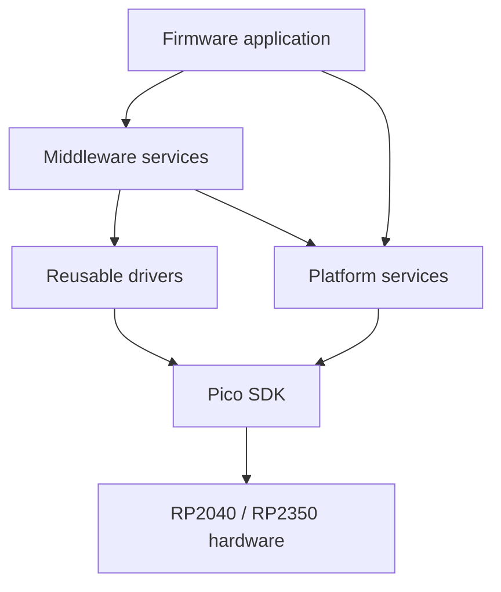

# PicoForge Architecture

> **Status:** This document defines the intended module boundaries. The current firmware is only a Pico SDK Hello World; the platform, driver, and middleware layers below are planned and not yet implemented.

## Current Firmware

`firmware/CMakeLists.txt` imports the Pico SDK selected by `PICO_SDK_PATH`, initializes the SDK, and builds `picoforge_hello_world` for the selected `PICO_BOARD`. `firmware/src/main.c` initializes USB stdio and prints a greeting once per second. The PR workflow and `tools/validation/validate.sh` build the `pico` and `pico2` targets.

This is a buildable starting point, not yet the application framework architecture. The current `main.c` uses `pico_stdlib` directly; future modules should establish the boundaries below before more hardware and application behavior is added.

## Intended Dependency Direction

Application code orchestrates middleware and platform services. Middleware composes reusable drivers and platform services. Drivers and platform services adapt Pico SDK and board-specific hardware details.

Dependencies should flow toward the hardware-facing layers. Avoid circular dependencies between middleware, drivers, and platform services; use explicit interfaces when a lower layer needs an application-provided callback.

## Layer Responsibilities

### Application

Own product behavior, startup, and composition of the services needed by a firmware target. Keep policy and hardware register details out of application code where a reusable service or driver is appropriate.

### Middleware

Provide reusable application-facing services. Planned examples include CLI, storage, USB services, and FatFs. A filesystem should use a storage/block-device interface rather than own SDIO pin assignments or board setup. The USB device/host role is not selected yet.

### Drivers

Encapsulate reusable peripheral operations and Pico SDK hardware APIs. Drivers should expose project-level interfaces instead of leaking board connector numbers or unrelated application policy.

### Platform

Own board support, configuration, logging, version metadata, and integration with the selected MCU and SDK. Board-specific pin mapping belongs here and must agree with [the pinout baseline](pinout.md) and the board schematic.

## External Components

Pico SDK is checked out at a pinned revision by `tools/firmware/setup-sdk-env.sh`; firmware CMake consumes it through `PICO_SDK_PATH`. Use SDK-provided components rather than maintaining duplicate copies.

FreeRTOS, FatFs, and other external components are not integrated yet. Before adding one, select and pin its source revision, record its license, and keep vendor sources separate from PicoForge adapters. If an RTOS is selected, keep its kernel integration behind the platform/runtime boundary so middleware does not depend on scheduler-specific APIs without an explicit interface.

## Testing and Validation

Ceedling is configured by the repository-root `project.yml`. Host unit tests belong under `firmware/tests/` and should cover hardware-independent modules in platform, drivers, and middleware. The configuration intentionally excludes `main.c` and board support from host builds. No unit-test source files exist yet.

`tools/validation/validate.sh` checks shell syntax, validates the Ceedling project, runs unit tests when present, and builds both MCU targets. `tools/validation/coverage-firmware.sh` generates gcovr reports for those host unit tests; it does not measure target timing or prove hardware behavior.

Physical wiring, pinout qualification, and tests requiring a board or probe belong in the hardware documentation and validation flow. The current pinout document is a draft with no approved GPIO assignments.