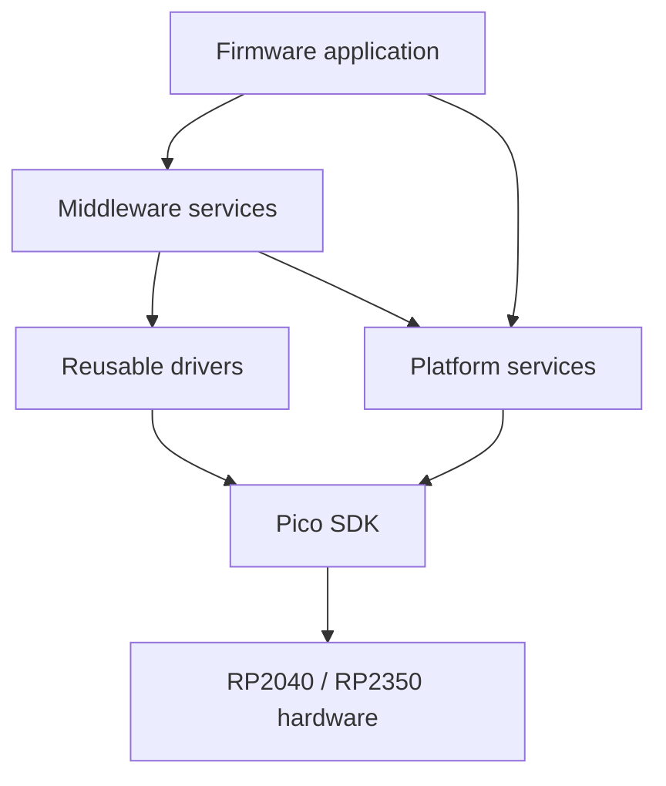

# PicoForge Architecture

> **Status:** The initial firmware now runs a single-core FreeRTOS task. The reusable platform, driver, and middleware layers below remain planned and are not yet implemented.

## Current Firmware

`firmware/CMakeLists.txt` imports the Pico SDK selected by `PICO_SDK_PATH`, initializes the SDK, imports the platform-specific FreeRTOS-Kernel port, and builds `picoforge_hello_world` for the selected `PICO_BOARD`. The TinyUSB configuration lives under `firmware/src/integration/usb`; USB descriptors, HID report helpers, and the statically allocated USB task live under `firmware/src/usb`. The composite device exposes one CDC ACM interface and one vendor-defined HID interface. The USB task sends a CDC greeting when the host opens the port and publishes a versioned HID status report every 250 ms. HID Feature report 1 carries product name, MCU identity, and system clock; Input report 2 carries uptime and USB/CDC state. The shared protocol is documented in [usb-protocol.md](usb-protocol.md). The development VID/PID is `0xCAFE:0x4011` and is not for product release. `firmware/src/main.c` starts the USB task and scheduler. The PR workflow and `tools/validation/validate.sh` build the `pico` and `pico2` targets; host enumeration still requires physical-board validation.

This is a buildable starting point, not yet the complete application framework. The example currently uses Pico SDK and FreeRTOS APIs directly; future modules should establish the boundaries below before more hardware and application behavior is added.

## Core and Runtime Policy

The initial runtime uses FreeRTOS-Kernel 11.3.1 with `configNUMBER_OF_CORES=1`. PicoForge starts its scheduler on core 0 and does not launch framework work on core 1. Core 1 is left unused by this baseline and may be assigned by a product application in a future, explicitly designed mode.

The FreeRTOS port itself is SMP-capable, but that does not mean this build runs SMP: the configured scheduler core count is one. Do not treat this as a hard real-time guarantee. Any core-1 application mode will need defined startup ownership, peripheral/IRQ affinity, cross-core synchronization, and measured timing.

The example uses static allocation for its application task and the port-provided idle-task memory. Software timers are enabled because the Pico port uses the timer-pend API for SDK synchronization interoperation. Additional tasks should document their stack, priority, ownership, and whether allocation is static or dynamic. The current firmware disables dynamic task allocation.

## Intended Dependency Direction

Application code orchestrates middleware and platform services. Middleware composes reusable drivers and platform services. Drivers and platform services adapt Pico SDK and board-specific hardware details.

Dependencies should flow toward the hardware-facing layers. Avoid circular dependencies between middleware, drivers, and platform services; use explicit interfaces when a lower layer needs an application-provided callback.

## Layer Responsibilities

### Application

Own product behavior, startup, and composition of the services needed by a firmware target. Keep policy and hardware register details out of application code where a reusable service or driver is appropriate.

### Middleware

Provide reusable application-facing services. Planned examples include CLI, storage, higher-level USB services, and FatFs. The firmware currently uses the USB device role; a USB host role is not selected. A filesystem should use a storage/block-device interface rather than own SDIO pin assignments or board setup.

### Drivers

Encapsulate reusable peripheral operations and Pico SDK hardware APIs. Drivers should expose project-level interfaces instead of leaking board connector numbers or unrelated application policy.

### Platform

Own board support, configuration, logging, version metadata, and integration with the selected MCU and SDK. Board-specific pin mapping belongs here and must agree with [the pinout baseline](pinout.md) and the board schematic.

## External Components

Pico SDK 2.3.0 and FreeRTOS-Kernel V11.3.1 are pinned as Git submodules at `firmware/third_party/pico-sdk` and `firmware/third_party/FreeRTOS-Kernel`. Initialize dependencies with `git submodule update --init --recursive`. The build defaults to the SDK submodule, with `PICO_SDK_PATH` available as an override. The kernel's Pico SDK import selects the RP2040 or RP2350 port based on `PICO_PLATFORM`. Use SDK-provided components rather than maintaining duplicate copies.

FatFs and other external components are not integrated yet. Before adding one, select and pin its source revision, record its license, and keep vendor sources separate from PicoForge adapters. Keep middleware independent of FreeRTOS task APIs where practical; put scheduler and port-specific integration behind the platform/runtime boundary.

## Testing and Validation

Ceedling is configured by the repository-root `project.yml`. Host unit tests belong under `firmware/tests/` and should cover hardware-independent modules in platform, drivers, and middleware. The configuration intentionally excludes `main.c` and board support from host builds. No unit-test source files exist yet.

`host/python/tests/`, `host/dotnet/tests/`, and `host/webhid/tests/` contain hardware-free host protocol/API tests. `tools/validation/validate.sh` checks shell syntax, validates the Ceedling project, runs firmware unit tests when present, and builds both MCU targets. Run the Python, .NET, and WebHID tests using the commands in the README. `tools/validation/coverage-firmware.sh` generates gcovr reports for firmware unit tests; it does not measure target timing or prove hardware behavior.

Physical wiring, pinout qualification, and tests requiring a board or probe belong in the hardware documentation and validation flow. The current pinout document is a draft with no approved GPIO assignments.