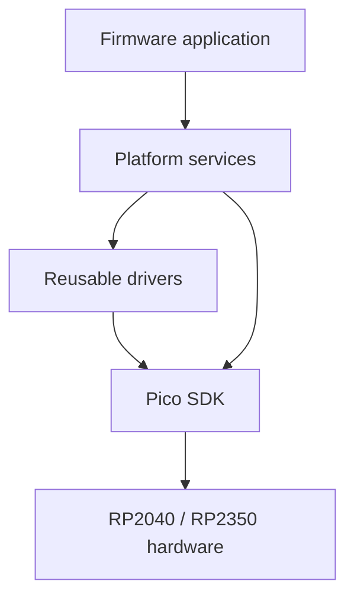
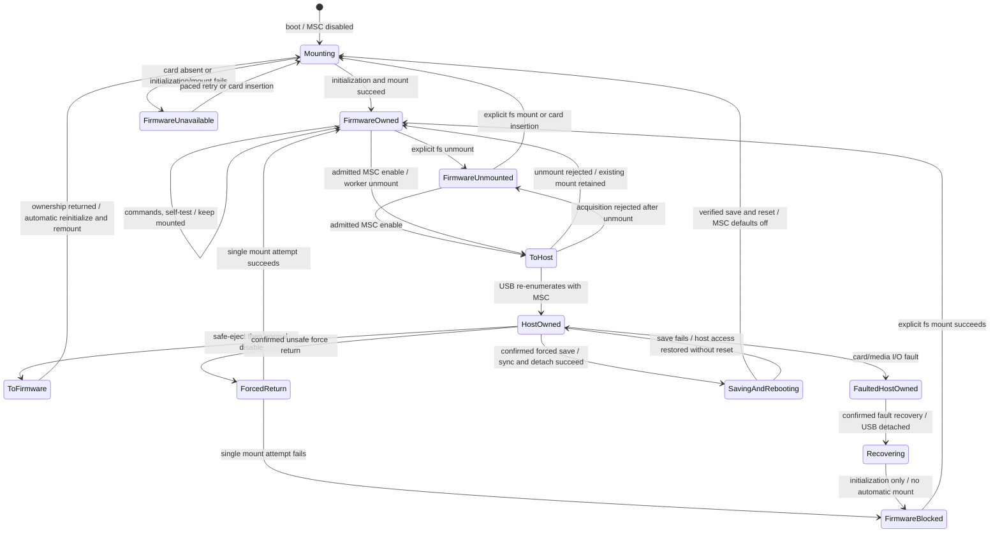

# PicoForge Architecture

## Current Firmware

`firmware/CMakeLists.txt` imports the Pico SDK selected by `PICO_SDK_PATH`, initializes the SDK, imports the
platform-specific FreeRTOS-Kernel port, and builds `pico_forge` for the selected `PICO_BOARD`; see
[artifact naming](../guides/getting-started.md#1-get-or-build-the-firmware). The TinyUSB configuration lives under
`firmware/src/integration/usb`; USB descriptors, HID report helpers, and the statically allocated USB task live
under `firmware/src/app/usb`. The composite device exposes one CDC ACM interface and one vendor-defined HID
interface. Board startup passes its monitor UART assignment to `platform/logging`, which initializes and selects
it for stdio and emits serialized, severity-tagged lines at the board-configured default severity. USB stdio stays disabled so
log messages remain separate from CDC. The USB task services the [CDC CLI](../guides/usb-cdc-cli.md) and publishes HID Input
report `3` telemetry every 250 ms, plus storage and capability-gated self-test reports `10` and `11` every 500 ms.
Feature report `1` carries stable product, MCU, board, capability, and SRAM information; Feature report `2` carries
persisted profiles and board GPIO configuration. Feature report `20` handles LED, reboot, MSC, self-test, and
settings transactions. The [HID Report Reference](usb/usb-hid-report-reference.md) defines the wire contract and
validation. The temperature driver reads the on-chip ADC temperature sensor on channel 4, not GPIO 4.
The shared Pico-family profile in `firmware/src/config/board.c` uses the SDK's default UART and direct-LED
assignments; CMake selects `config/board_spi.c` or `config/board_sdio.c` for storage connector wiring.
Pico, Pico 2, and Pico 2 W use the
same monitor UART pins; boards without a direct GPIO LED do not advertise one. This follows PicoUart's
[board-configuration approach](https://github.com/djwinter29-oss/PicoUart/blob/main/docs/hardware-setup.md) without
adopting its UART-channel map or hardware features. Other layouts require a matching board profile; see
[hardware setup](../guides/hardware-setup.md). Platform services (system, temperature, LED, logging, boot config)
live flat under `firmware/src/platform/`; native and SPI SD protocols live together under `drivers/sdcard/`, above
the physical engines in `drivers/sdcard/`. USB interface roles, descriptors, and lifecycle are documented in the
[HID Report Reference](usb/usb-hid-report-reference.md). The development VID/PID is `0xCAFE:0x4011` and is not for product
release. `firmware/src/main.c` initializes logging output, temperature, and an available board LED, starts the USB
task, and launches the scheduler.
The PR workflow and `tools/validation/validate.sh` build the `pico` and `pico2` targets; physical HID, temperature,
and LED behavior still require board validation.

Input report `10` publishes SD detection/initialization, selected bus mode, effective bus speed, capacity, CID,
filesystem format, and MSC ownership state every 500 ms. In MSC mode the USB descriptor appends MSC after CDC and HID,
preserving the HID interface number; see the [HID Report Reference](usb/usb-hid-report-reference.md). The owner gate rejects
firmware block calls while the host owns the card. Enabling queues a worker-owned FatFs unmount before acquisition
and is rejected if CLI storage work is pending. Normal disable requires host eject; the dashboard's confirmed
**Disable USB drive** action requests [Pico-side detach/remount](usb/usb-hid-report-reference.md#msc-force-return-safety),
with one worker mount attempt and explicit failure reporting. Host apps never run OS eject commands.

CDC storage commands are queued to a statically allocated FreeRTOS storage worker,
which is the sole FatFs caller for this workflow. USB/CLI and storage communicate
through bounded request/reply queues; filesystem calls do not execute in the USB
task. MSC transitions are rejected while a storage command is outstanding. Files
are closed before command completion, and enabling MSC automatically queues filesystem
unmount on the worker before acquiring USB ownership. See [the CDC CLI guide](../guides/usb-cdc-cli.md) for commands, safeguards,
resource budgets, and validation limits.

The firmware separates application policy, reusable drivers, and the platform (services and storage) as described below.
New modules should preserve these boundaries as hardware and application behavior grows.

Feature Report `20` and Input report `11` implement the [SD self-test](../guides/sdcard-performance-test.md). Its RTOS-independent engine lives
in `app/storage` and runs in the sole FatFs worker. The worker checks ownership,
the mounted filesystem, available space, and the reserved `/PFTEST.BIN` path
before accepting a run; existing files are left untouched. See the
[performance-test safeguards](../guides/sdcard-performance-test.md#running). Browser, Python, and
.NET dashboards expose the controls and calculate average read/write metrics.

## Core and Runtime Policy

Before starting the scheduler, USB startup disconnects for 250 ms using the SDK busy wait, then reconnects.
This boot-only delay must not depend on alarm or RTOS wakeups; an alarm-backed sleep stalled RP2040 startup.

`app/runtime_stats.c` samples per-core FreeRTOS idle runtime and SDK-linked SRAM reservations for HID Feature report
`1` and Input report `3`. Both dashboards show the current metrics in Runtime status.

FreeRTOS-Kernel 11.3.1 runs with `configNUMBER_OF_CORES=2`. The Pico port launches core 1 when the scheduler
starts on core 0; applications must not launch a second independent core entry point. USB, storage and timer
 tasks use the kernel's all-core affinity default and may migrate. Idle tasks are pinned to their corresponding
physical cores (`configIDLE_AFFINITY=1`) so idle-runtime CPU telemetry remains per-core. Different priorities may execute
simultaneously. Affinity capability remains enabled for Pico SDK boot-flash-safe execution, which temporarily uses a
core-specific lockout task; application tasks are not pinned. Task/ISR kernel critical sections exclude both cores,
while existing media reservations serialize physical storage operations. FatFs retains one executor.
SMP schedules tasks, not arbitrary hardware resources: board setup and IRQ installation still occur before scheduler
startup, and IRQ routing stays on its initialization core. Peripheral ownership remains explicit rather than being
inferred from the executing core. Two-core scheduling is not a hard real-time guarantee.

Project `configASSERT` uses the SDK's `hard_assert`, so kernel and project invariants remain active under
`NDEBUG` in Release builds. Host checks compile the real configuration and SDK assertion header both with and
without `NDEBUG`; they do not qualify target fault handling.

The project-owned [DCD guard](../../firmware/src/integration/usb/dcd_guard.c) interposes the pinned TinyUSB RP2040/RP2350
driver entry points and its shared USB IRQ handler. A dedicated SDK spinlock and local interrupt masking exclude
endpoint/reset/setup/SOF mutations across cores; same-core nested driver calls retain the outer reservation.
Only low-level DCD operations hold this lock, never USB application callbacks or synchronous MSC media I/O.
TinyUSB must retain the Pico OS adapter, whose event queue has its own cross-core critical section.
The IRQ copies controller events into a static 16-entry queue under the same gate. The `tud_task_ext` interposition
drains the upstream queue, forwards one bounded controller batch without holding the gate, then runs TinyUSB task
dispatch. Thus the upstream queued-SETUP counter and device flags are only mutated on the USB task, not concurrently
by the IRQ. Event order is retained; consecutive SOFs are coalesced to the newest frame so idle frame traffic cannot
fill the queue while MSC blocks. Queue overflow asserts explicitly rather than losing controller events silently.
The task-readiness query includes both queues; deinitialization discards pending controller events before reuse.
There is no new heap allocation; the queue adds `16 * sizeof(dcd_event_t)` bytes plus indices to linked SRAM.
Event/SOF hooks now run in task context; PicoForge defines no ISR event hooks or per-frame SOF consumer.
Adding such hooks or USB classes requires revisiting the batching and coalescing contract.
Initialization runs before the scheduler on core 0. NVIC enable/disable, deinitialization and reinitialization must
remain on that IRQ-owning core; wrong-core lifecycle calls assert rather than silently mask another core's NVIC.
Normal USB task processing does not change IRQ ownership or require task affinity. These safeguards have host
concurrency tests; sustained concurrent USB/media workloads still require target qualification.
Dependency upgrades must pass the pinned-driver surface contract before the guard can be considered compatible.
Sustained dual-core stress remains unqualified; the one-off Pico 2 observation is in the
[earlier qualification record](../tests/records/earlier-sdio-qualification-undated.md#pico-2-dual-core-msc-handoff-observation).
The 16-entry event queue is a bounded design assumption, not a measured worst-case guarantee. Hardware qualification
must stress concurrent USB events and slow MSC media callbacks, verify that event order and task readiness remain
correct, and demonstrate that the queue does not overflow under the supported workload. Overflow remains an explicit
assertion/fault, not a recoverable event loss; changes to event sources, callback latency, or USB classes require
revalidating the bound.

The example uses static allocation for its application task and the port-provided idle-task memory. Software timers are enabled because the Pico port uses the timer-pend API for SDK synchronization interoperation. Additional tasks should document their stack, priority, ownership, and whether allocation is static or dynamic. The current firmware disables dynamic task allocation.

## Intended Dependency Direction

Application code orchestrates platform services. The platform, which includes storage, composes reusable drivers. Drivers and platform services adapt Pico SDK and board-specific hardware details.

Dependencies should flow toward the hardware-facing layers. Avoid circular dependencies between drivers and platform services; use explicit interfaces when a lower layer needs an application-provided callback.

## Layer Responsibilities

### Application

Own product behavior, startup, and composition of the services needed by a firmware target. Keep policy and hardware register details out of application code where a reusable service or driver is appropriate.

### Platform storage

PicoForge is a platform that forks reuse, so `firmware/src/platform/storage/` is part of it. Storage adapts FatFs disk I/O to the logical block-device
API; the application owns the FatFs volume, SD-card configuration, ownership, and mounting policy.
The firmware currently uses the USB device role; a USB host role is not selected.

### Drivers

Encapsulate reusable peripheral operations and Pico SDK hardware APIs. Multi-file drivers are grouped by subsystem under `firmware/src/drivers/sdcard/`. Reusable filesystem adaptation belongs in platform storage; media lifecycle and firmware/USB ownership policy belongs in the application. Board support only supplies numbers: sources in `firmware/src/config/` define assignment objects, declared `extern` in driver headers. CMake selects the storage assignment source alongside its transport binding. Each driver initializes its own hardware (`pf_led_init()`, `pf_logging_init()`), and [sd_board.c](../../firmware/src/drivers/sdcard/sd_board.c) binds the selected SD transport, boot-config clock, and card detect. FatFs consumes the [logical block interface](../../firmware/src/platform/storage/block_device.h) through an application owner-gated descriptor. See the [hardware setup options](../guides/hardware-setup.md).

### SD-Card Driver Structure

See [SD-Card Driver Design](sdcard/sdcard-driver-design.md) for the authoritative layer
boundaries, SDIO-PIO and SPI interfaces, initialization/read/write/ownership
workflows, explicitly selected FreeRTOS/bare-metal ports, and hardware resource
inventory. The default USB/storage application remains FreeRTOS-only; the
bare-metal configuration builds the reusable driver and its link-smoke target.
Board wiring and physical
qualification records remain in the [SD-card driver guide](sdcard/sdcard-physical-links.md#sd-card-breakout).

### Platform

Own board support, logging, version metadata, and integration with the selected MCU and SDK.
The board pin/peripheral profile is immutable and selected at build time; firmware trusts this project-owned profile
instead of repeating pin-range, mux, and collision validation at runtime. Wiring must agree with
[the hardware setup baseline](../guides/hardware-setup.md) and the board schematic. Boot-applied settings and their public
load/save API and private RP2 flash persistence with FreeRTOS-safe access live in
`firmware/src/platform/boot_config.c/.h`. Board pin mapping lives in `firmware/src/config/` as plain data; CMake
selects the storage connector's SDIO-PIO or SPI assignment source. Both transports request the saved
storage speed; card negotiation and hardware divider rounding determine the actual clock. Physical card operation
still needs board validation.

## External Components

Pico SDK 2.3.0 and FreeRTOS-Kernel V11.3.1 are pinned as Git submodules under `firmware/third_party/`. Initialize them with `git submodule update --init --recursive`. The build defaults to the SDK submodule, with `PICO_SDK_PATH` available as an override. The kernel's Pico SDK import selects the RP2040 or RP2350 port based on `PICO_PLATFORM`. The SD memory-card protocols are implemented in `firmware/src/drivers/sdcard/`; their reusable SPI and PIO engines live in `firmware/src/drivers/sdcard/`. FatFs R0.16 with upstream patches 1 and 2 is vendored under `firmware/third_party/fatfs/` and compiled into the firmware.
Its upstream disk interface and configuration live under `firmware/src/integration/fatfs/`; project-owned disk
adaptation lives under `firmware/src/platform/storage/`, while the singleton volume lifecycle lives in
`firmware/src/app/storage/`.

Embedded CLI is also pinned as a Git submodule. Its application session module is independent
of the USB transport and RTOS; see [CDC CLI](../guides/usb-cdc-cli.md) for the dependency pin,
session lifecycle, command-extension rules, memory budget, and validation plan.

The application storage-owner task initializes the SD-card interface and mounts its existing volume through the
device-independent `pf_fatfs_volume_mount()` service; mounting never formats media. FatFs uses a logical block device,
selected by the application. The SD API uses 32-bit sector addresses (`FF_LBA64=0`), limiting volumes
to fewer than 4,294,967,296 512-byte sectors (2 TiB); larger exFAT volumes are not supported. Mount, unmount, and file
operations require caller serialization because FatFs is configured without cross-task locking. See the
[filesystem block-device boundary](sdcard/sdcard-driver-design.md#filesystem-block-device-boundary) for authoritative layering,
binding lifetimes, and ownership contracts.

`platform/storage/fatfs_volume.c/.h` owns the singleton FatFs instance, mount registration and format telemetry.
`platform/storage/storage.c/.h` is the storage service over the SD driver: it obtains SD configuration, owns the media
lifecycle, presence debounce, paced automount, recovery and forced-USB-return policy, the last failed operation, and
exclusive firmware/USB MSC ownership. Its static firmware descriptor gates FatFs I/O. `pf_storage_get_status()` is a
backend-neutral snapshot (state, medium, bus and pins, presence, clock, capacity, identity, last failure); its header
includes no driver headers so another medium can implement the same API.
Layers above platform storage treat storage as a filesystem that can be exported as USB MSC, and use only this service:
the CLI `storage status` and the HID board/storage reports are built from that snapshot.
The CDC `storage`/`fs` commands live in `app/cli/cli_storage.c/.h`; the USB task registers `pf_cli_storage_execute`
with `pf_storage_worker_init()`, so the worker runs commands without depending on the CLI. Application storage
stays in `app/storage`: `file_benchmark.c/.h` verifies and times a dedicated file, and `storage_worker.c/.h` is the sole FatFs executor that
serializes requests and runs the storage policy while idle.
The worker calls `pf_storage_setup()` before task startup; the USB task no longer configures SD. Command and worker
headers do not expose SD configuration.
Automatic mount failures retain SD initialization, volume and FatFs result codes and log the first or changed failure;
identical retries remain paced and do not repeat that warning. Successful mounting resets warning suppression.
Mount registration and format are independent atomic telemetry snapshots; neither grants filesystem access.
Presence and automount state is mutated only on the worker while holding the SD reservation; the worker's
kernel-protected `media_service_busy` gate excludes admission while the policy runs.

Product-specific USB behavior lives under `app/usb`: `usb_task.c/.h` owns task startup, CDC command sessions and report
scheduling; `usb_hid.c/.h` owns the product HID protocol; `usb_msc.c/.h` owns SCSI callbacks and application handoff
coordination; MSC block access and handoff use the `pf_storage_msc_*` export API in `storage.h`. `usb_descriptors.c` defines product interfaces.
TinyUSB configuration remains under `integration/usb`; the pinned TinyUSB stack supplies reusable USB machinery.
No extra storage forwarding layer or runtime backend registry is introduced.

The product CLI instance, prompt, built-in commands and buffer/history settings live in `app/cli`, using Embedded
CLI directly. USB owns CDC transport and connection sessions. Platform storage retains only logical block dispatch,
device adapters and FatFs disk callbacks. The logging driver owns severity filtering, formatting, and stdio output
selection. Neither platform storage service depends on application headers.

### Storage Handoff Invariants

- Only the storage worker executes firmware FatFs operations; per-block reservations do not serialize file transactions.
- MSC acquisition reserves media across the worker-idle and unmounted checks and ownership transition.
  Worker admission and transition coordination run on the USB task; these APIs are not arbitrary multi-task entry points.
- Owner-gated I/O holds the same recursive reservation through backend completion; USB partial-sector
  read-modify-write also holds it across the full operation.
- Normal release requires checked eject/sync. Fault release requires detached, unavailable USB-owned media and queues
  worker recovery without claiming a clean eject. Recovery logs its result and never mounts automatically.
- Confirmed force return disconnects before normal owner release and holds worker admission through one mount
  attempt; failure leaves the volume unmounted and blocks automatic retries. It never claims host-cache durability.
- [Confirmed forced settings save/reboot](settings.md#forced-save-and-reboot) syncs and detaches before flash save,
  keeping media USB-reserved and unavailable until successful reset; failures do not schedule reboot.
- Uncertain failed writes are not replayed. Host tests cover exclusion, failed sync retention, no-replay and recovery
  rejection/completion; they do not establish physical USB BOT or power-loss qualification.

### Storage Ownership Lifecycle

This section owns the product's default-mounted storage policy. Worker admission and operation completion details
are in [Storage Worker State](#storage-worker-state); the
[HID report reference](usb/usb-hid-report-reference.md#msc-force-return-safety) owns USB command semantics.

- **Startup:** MSC is disabled. The storage worker asynchronously initializes the configured card and mounts its
  existing FAT/exFAT filesystem without requiring a dashboard connection, CDC session, or self-test click.
  Startup does not wait for a usable card; absent, unsupported, or damaged media must not block USB management.
- **Firmware use:** keep the filesystem mounted and ready for serialized reads/writes whenever firmware owns healthy
  media. Self-test operates on this existing mount, checks the reserved path and free space, then writes and verifies
  its temporary file. It never mounts or unmounts; cleanup leaves the filesystem mounted.
- **USB sharing:** only an explicit user request exports the card. Finish storage work and close/sync files before
  the worker unmounts; transfer exclusive ownership only after successful unmount. Reject conflicting work as busy
  rather than interrupting it. Firmware file access is unavailable while the USB host owns the card.
- **Safe return:** after host safe eject and normal MSC disable, release USB ownership, discard host-invalidated
  filesystem state, reinitialize, and automatically remount. No second user action or self-test click is required.
  USB reconnection or cleared transition flags alone do not establish mounted readiness.
- **Mount failure or insertion:** startup, insertion, and normal-return mount failures remain visible and retry at
  the existing five-second interval after each failed attempt completes. With board-provided card detect, debounce
  presence before acting. Never format, repair, or replay a failed write automatically.

Explicit maintenance is an exception to the default: `fs unmount` suppresses automatic mounting until an insertion
or normal USB return; `fs mount` permits deliberate manual mounting. Faulted-MSC recovery and failed forced return
leave automatic mounting blocked for inspection until an explicit successful mount. These runtime-only safeguards
are not persistent boot settings. A safe return does not clear an existing fault-recovery block.

The UI design should distinguish mounting/unavailable storage from a usable mounted filesystem, and enable Start
only after fresh mounted-state telemetry and idle firmware ownership. One **Start benchmark** action must start the
test after preflight, not perform a mount-only step. Free-space scanning can take time before acceptance, so the UI
should show a pending/checking indication rather than imply that mounting is underway.
The current protocol has no distinct mounting or free-space-checking state: use pending transaction and storage
status without assigning new wire enums. Richer UI labels are a design requirement, not a claim that every dashboard
already displays them. Current dashboard **Return to Pico** uses confirmed force return; it is not host safe eject.

The diagram shows ownership and mount policy, not every request state; normal return retains a pre-existing recovery
block even though that exceptional path is omitted. Worker admission remains held through file cleanup,
command reply draining, and the relevant ownership transition. A failed force-return mount leaves firmware owning the
card but the volume unmounted; it must not be interpreted as a successful return to a usable filesystem. Fault recovery
is distinct: it detaches faulted host-owned media and reinitializes without claiming a clean eject or automatically
mounting the filesystem.

### Storage Worker State

Admission and ownership transitions are coordinated by the USB task, not arbitrary concurrent callers. The worker
and USB task publish admission/completion state under critical sections; command cancellation is atomic.

| Activity | Admission state | Completion rule |
|---|---|---|
| Idle | `busy=false`, `media_service_busy=false` | USB may admit a request or transfer ownership under reservation. |
| Background media service | `media_service_busy=true`, `busy=false` | Worker releases the service gate after the serialized lifecycle operation. |
| Command queued/executing/reply draining | `busy=true`, `benchmark_active=false` | USB must drain the done reply, even for a disconnected session. |
| Benchmark queued/executing/cleanup | `busy=true`, `benchmark_active=true`, `benchmark_finished=false` | Cancellation requests cleanup; it does not release admission. |
| Benchmark completion published | `busy=true`, `benchmark_active=true`, `benchmark_finished=true` | USB polling observes completion and clears all three flags; the result persists. |
| Explicit recovery queued/executing | `busy=true`, `benchmark_active=false` | Worker reports recovery outcome and releases admission without a command reply. |
| Forced return queued/executing | `busy=true`, `benchmark_active=false` | Worker attempts one mount; USB pending/rejected reflects completion. |

`busy` and `media_service_busy` exclude each other. `benchmark_finished` implies `benchmark_active`, which implies
`busy` until USB observes completion. Recovery and commands share the admission gate but not reply completion:
recovery has no CDC session. Mount-policy flags are independent of operation admission. Recovery sets
`auto_mount_blocked`; a successful explicit `fs mount` or confirmed force-return mount clears it.
A failed initialization or mount leaves it set.
Per-block reservations alone never authorize USB takeover while file cleanup or reply draining is outstanding.

## Testing and Validation

Ceedling is configured by the repository-root `project.yml`. Host unit tests belong under `firmware/tests/` and mirror
host-testable application, board, driver, integration and platform modules. The configuration excludes `main.c`;
board tests use scoped SDK fakes.

`host/python/tests/`, `host/dotnet/PicoForge.Tests/`, and `host/webhid/tests/` contain hardware-free host protocol/API tests. `tools/validation/validate.sh` checks shell syntax, validates the Ceedling project, runs firmware unit tests when present, and builds both MCU targets. Run the Python, .NET, and WebHID tests using the commands in the README. `tools/validation/coverage-firmware.sh` generates gcovr reports for firmware unit tests; it does not measure target timing or prove hardware behavior.

Physical wiring, pinout qualification, and tests requiring a board or probe belong in the hardware documentation and validation flow.
The pinout document records standard Pico/Pico 2 targets and the SD breakout mappings. Board support constructs the
selected SDIO-PIO or SD-SPI transport configuration. Physical timing, card compatibility, USB interoperability, and
power-loss qualification remain subject to the limits recorded in the SD validation guide.
### Review remediation software checks

`INCLUDE_uxTaskGetStackHighWaterMark=1` enables the existing FreeRTOS stack-fill scan. USB and Storage sample
only their own task (`NULL` handle), at 30-second intervals in their normal loops, and log the minimum untouched
stack in **StackType_t words**, not bytes. Sampling does not scan a concurrently executing task on the other core.
It does not reset the watermark, allocate memory, or add a new task. Existing overflow checking remains enabled.
Sampling can be delayed by a long storage operation; UART logging and scanning add occasional service overhead.
Unused fill bytes are an observation, not certified margin (unwritten stack reservations can remain filled).
No target stack observations were collected during remediation.

The canonical hardware-free filesystem HID vectors live in `tests/fixtures/hid-filesystem.csv`. Python, .NET,
and WebHID consume all valid/invalid vectors directly. Firmware produces reports rather than parsing host input
filesystem reports: Ceedling checks its exFAT encoder against the same fixture. Invalid telemetry vectors apply
to the host decoders, not the firmware's separate command parser. This small fixture covers format, version,
length and padding boundaries; it is not exhaustive coverage of every HID report family.

PR and release-package workflows build both boards at 150 and 250 MHz with both transports and both execution
ports (16 matrix builds), plus one SDK-default-clock application check per board. MSC ELF checks run only for
the FreeRTOS application; bare-metal produces a link-smoke target, not a USB application.
The [release guide](../deployment/release.md) owns tag validation, version propagation, host-suite gates, package contents and
reproducible filename dates. Release packages carry the validated tag version, not the local development default;
they are uploaded as workflow artifacts with read-only repository permissions, not published as GitHub releases.

Host regressions cannot certify MSC end-to-end enumeration/BOT/host-cache behavior, power-loss recovery,
sustained dual-core stress, or target stack margin. Those remain hardware qualification gaps. No hardware,
media access, HIL, flashing, or physical measurements were performed for this remediation.
