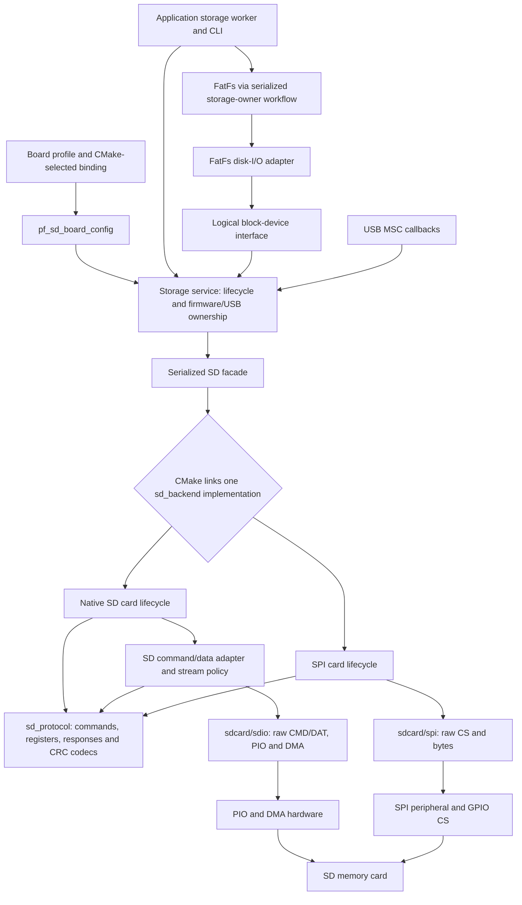
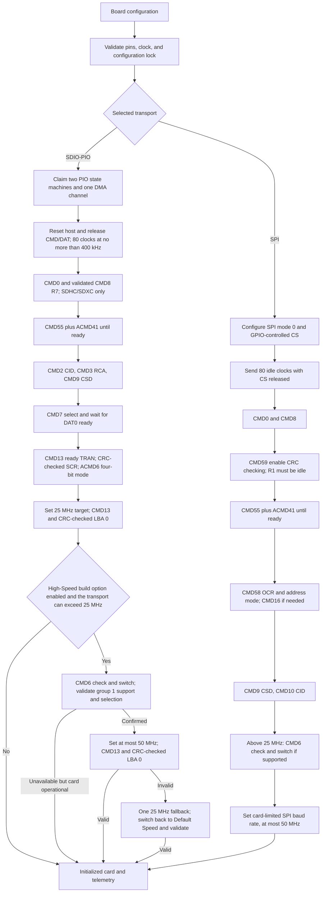
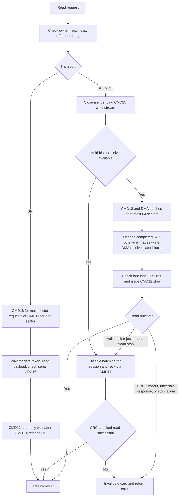
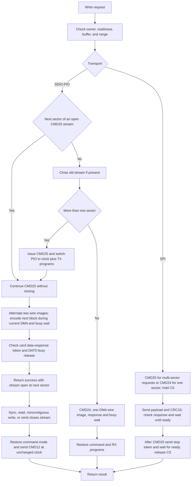
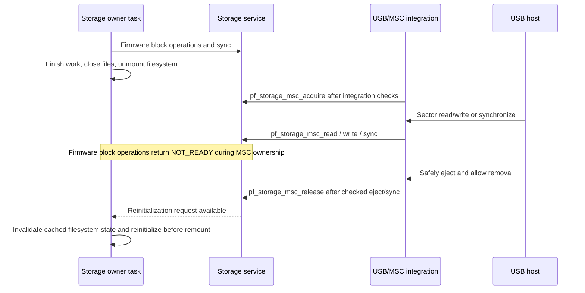

# SD-Card Driver Design

This document describes the implemented SD memory-card driver for RP2040 and
RP2350. It is the reference for driver interfaces, transport workflows, and
resource ownership. Wiring and electrical requirements remain in the
[SD-card driver guide](sdcard-physical-links.md#memory-and-storage-connections); filesystem
commands and mounting policy remain in [the CDC CLI guide](../usb/usb-cdc-cli.md). Use the
[SD-card documentation index](README.md) for related design and test references.

## Guide

| Need | Go to |
| --- | --- |
| Layers and interfaces | [Architecture](#architecture), [block-device boundary](#filesystem-block-device-boundary), [transport and port selection](#interfacing-with-the-driver) |
| Protocol workflows | [Initialization](#initialization-workflow), [reads](#read-workflow), [writes](#write-workflow), [ownership](#ownership-workflow) |
| Resources and performance | [Hardware resources](#hardware-resource-inventory), [status and MSC batching](#performance-controls-and-status) |
| Test scope | [Validation limits](#validation-and-limits), [SD-card performance test](sdcard-performance-test.md) |
| Review status | [SD remediation matrix](../../tests/sd-design-remediation.md) |
| History and measurements | [Historical records](#historical-records) and [test records](../../tests/records/README.md) |

Sections above describe current implementation; dated measurements and review narratives live only in test records.

## Architecture

One configured card is exposed through a transport-neutral, synchronous block
API. Native SDIO-PIO uses four data lanes; SD-SPI uses a Pico SDK SPI controller.
Here, SDIO means native SD memory-card signaling, not support for SDIO I/O cards.

Read the driver from the public facade down to the hardware. Each boundary has one job:

| Layer | Contract | Responsibility |
| --- | --- | --- |
| Storage integration | `middleware/storage/storage.h` | Filesystem lifecycle and exclusive firmware/USB ownership; applications stop here. |
| Public SD facade | `sd.h` | Configuration, reservations, serialized block operations and diagnostics. |
| Selected card protocol | `sd_backend.h` | Card identification, addressing, transfers and recovery; calls require serialization. |
| Physical link | `sd_link.h`, `sdio/sd_link_sdio.h`, `spi/sd_link_spi.h` | Resource lifecycle, clocks and raw SPI or CMD/DAT operations; no card protocol. |
| Execution port | `sd_port.h` | Reservations and optional scheduler waits, independently selected from the transport. |

Board composition supplies a persistent physical context, saved speed and card detect; it is not another transfer
layer. CMake selects one complete transport path:

| Boundary | Native SDIO-PIO | SD-SPI |
| --- | --- | --- |
| Board binding (`sd_board_internal.h`) | `sdio/sd_board_sdio.c` | `spi/sd_board_spi.c` |
| Card protocol (`sd_backend.h`) | `sdio/sd_backend_sdio.c`, with `sdio/sd_sdio_host.c` for sequencing | `spi/sd_backend_spi.c` |
| Raw operations | `sdio/sd_link_sdio.h` | `spi/sd_link_spi.h` |
| Physical engine | `sdio/sdio_pio.c` and PIO programs | `spi/spi.c` |

The two columns are build alternatives, not runtime branches. Root files hold shared code and contracts, including
the common `sd_link.h` lifecycle contract and descriptor helpers. Each transport directory contains its
protocol implementation, board binding, diagnostics, raw-operation contract and physical engine:

```text
sdcard/
  sd.c / .h                   Serialized facade; public configuration, block operations and telemetry
  sd_backend.h                Shared internal protocol contract; one implementation linked
  sd_board.c / .h              Shared saved-speed and card-detect setup
  sd_board_internal.h          Internal board-binding contract
  sd_protocol.c / .h           Command/register helpers, native responses and data codecs
  sd_port.h                   Execution-environment contract
  sd_port_freertos.c           FreeRTOS reservations and optional waits
  sd_port_baremetal.c          Single-foreground-context integration
  sd_link.c / .h              Physical lifecycle contract, descriptor and presence helpers
  sdio/
    sd_link_sdio.h            Raw CMD/DAT contract implemented by sdio_pio.c
    sd_backend_sdio.c         Native implementation of sd_backend.h
    sd_board_sdio.c           Native implementation of sd_board_internal.h
    sd_sdio_internal.h        Native-specific diagnostics and constants
    sd_sdio_host.c / .h       Native command/data sequencing and streams
    sdio_pio.c / .h           Native SD PIO/DMA engine
    sdio_pio_pins.h           Native physical pin types
    sdio_pio.pio              Generated PIO programs
    sdio_pio_wait_freertos.c  Optional bounded PIO completion waits
  spi/
    sd_link_spi.h             Raw SPI contract implemented by spi.c
    sd_backend_spi.c          SPI implementation of sd_backend.h
    sd_board_spi.c            SPI implementation of sd_board_internal.h
    sd_spi_internal.h         SPI-specific diagnostics
    spi.c / .h                Pico SDK SPI controller engine
    spi_pins.h                SPI physical pin types
```

The native and SPI implementations use one protocol module but retain their distinct initialization,
response formats, data framing, and recovery sequences. Native requires modern SDHC/SDXC; SPI retains its existing
legacy/SDSC handling. Both implement the same `pf_sd_backend_*` functions declared only in
`sd_backend.h`; CMake links `sdio/sd_backend_sdio.c` or `spi/sd_backend_spi.c`, never both.
Implementation filenames carry a transport suffix while shared function names remain identical.
The transport-local `sd_sdio_internal.h` and `sd_spi_internal.h`
contain protocol-specific diagnostics and constants, not duplicate backend APIs. PIO and DMA implementation belongs
to the `sdio/sdio_pio.c` physical link engine, not the native protocol files.

Production filenames use the short `sd` prefix, including `sd_port_freertos.c` and `sd_port_baremetal.c`.
Facade functions/types use `pf_sd_*` and constants/header guards use `PF_SD_*`. Both card implementations export
`pf_sd_backend_*`. SDIO host/diagnostic interfaces use `pf_sd_sdio_*` / `PF_SD_SDIO_*`;
SPI-only diagnostics use `pf_sd_spi_*` / `PF_SD_SPI_*`.
Shared native-response and data-codec helpers retain `pf_sd_native_*` / `PF_SD_NATIVE_*`: these names describe
SD signaling and register formats, not a concrete transport implementation.
The `pf_sdio_pio_*` namespace belongs to the physical PIO transport, not the SD protocol.
`PF_SDIO_PIO_HIGH_SPEED` and `PF_SDIO_PIO_FUSED_COPY` remain CMake options and set the C definitions
`PF_SD_SDIO_HIGH_SPEED` and `PF_SD_NATIVE_FUSED_COPY`.
Host tests retain their existing behavior-oriented names, including native-init and SPI protocol suites.

Header/implementation pairing follows ownership rather than requiring one C file per header:

| Declaration | Implementation owner |
| --- | --- |
| `sd.h` public operations | `sd.c`; `pf_sd_set_idle_hook()` lives with shared polling state in `sd_protocol.c`. |
| `sd_backend.h` | One CMake-selected `sd_backend_sdio.c` or `sd_backend_spi.c`. |
| `sd_board_internal.h` | One CMake-selected board binding, plus its inline GPIO encoding helper. |
| `sd_port.h` | One CMake-selected execution port. |
| `sd_link.h` | Descriptor helpers in `sd_link.c`; hardware lifecycle/timing in the selected physical engine. |
| Transport-local `sd_link_sdio.h` / `sd_link_spi.h` | `sdio_pio.c` / `spi.c`. |
| `sd_sdio_internal.h` / `sd_spi_internal.h` diagnostics | The corresponding selected protocol backend. |
| `sd_sdio_host.h` | `sd_sdio_host.c`, with small response-checking helpers inline in the header. |

The idle hook is configured before transfers and deliberately has no facade forwarding wrapper or locking.
It does not change transport selection, ownership or polling behavior.

The SDIO host is non-reentrant even with separate host structs: its 64-sector receive scratch buffer is shared.
All command/data, diagnostic and physical-engine access requires the SD reservation or equivalent single-context
serialization. The optional FreeRTOS adapter binds one PIO and one waiter, reserves notification slot 1, and keeps
its startup-core shared IRQ handler installed for firmware lifetime, including engine deinit/reinit.

PIO instruction allocation uses the SDK's signed acquisition result directly, without redundant preliminary
space queries. Failed TX setup releases a partially acquired clock program and leaves command-mode restoration
required; loaded flags track only successful acquisitions. Resource failure never authorizes payload replay.
The concrete engine API remains available for board composition and engine tests; protocol code uses the
SDK-independent link contract rather than the concrete context.
Architecture checks enforce this boundary for both qualified and short concrete header names.
The SDIO diagnostic header depends directly on public SD types, not on the backend-operation contract.

Clock-planner rejection leaves the bus unchanged. A later RX-program allocation failure can occur after the divider
has changed: the engine becomes unhealthy and requires command-mode restoration or deinitialization. Restoration
uses the newly selected clock/timing mode; it is not transactional rollback to the previous clock.

Both backends use the same configuration shape, borrowing a `pf_sd_link_t` descriptor plus the protocol
transfer-clock target. The descriptor's mode is validated against the build-selected backend. Configuration contains
no GPIO, PIO/SPI controllers, DET settings, or concrete backend state.
See [pin allocation and runtime state](sdcard-physical-links.md#pin-allocation-and-runtime-state)
for authoritative physical ownership and configuration details.
The execution port requests optional waits through `pf_sd_link_enable_wait`, without PIO/IRQ knowledge.
`pf_sd_port_init` returns `bool`; callers must handle failure when optional waits were requested. Application
startup reports this as a fatal setup error rather than silently ignoring a failed wait binding.

The native host owns negotiated bus width, stream state, and response diagnostics; CID and capacity are retained
directly in card information rather than duplicated in separate globals. Native transfer helpers take sector addresses
only, because native initialization rejects SDSC. Shared CRC, command, and register helpers are called directly.
Diagnostic and idle callbacks are bound once during host initialization, not on every wire operation.
SPI token handling stays local to its driver, which shares one CID/CSD register-read path. A failed SPI selection
invalidates the card and returns immediately without exchanging bytes, issuing commands, or attempting deselection.

### Physical Link

The [SD-card driver guide](sdcard-physical-links.md#physical-link) owns the physical
engine layout, lifecycle, typed transfer interfaces, and shared-pin restrictions. This document covers the SD protocol
and its integration above those engines.

SD-SPI uses raw CS/byte operations; native SD uses raw CMD bytes and separately armed DAT DMA. The native host builds
command frames, selects 400 kHz and 80 startup clocks, supplies command/data deadlines, interprets responses and owns
stream recovery. Transport snapshots expose wire availability, actual/maximum clock and DAT0 level, not physical clock
ownership or packed response words. The existing packed-response diagnostic API is preserved by the SD host.



### Filesystem Block-Device Boundary

The driver layout above ends at raw sectors. Integration above it lives in these modules:

| Responsibility | Implementation |
| --- | --- |
| Worker and file benchmark / CLI command executor | [app/storage/](../../../firmware/src/app/storage/), [cli_storage.c](../../../firmware/src/app/cli/cli_storage.c) |
| Media lifecycle, automount/recovery, diagnostics and firmware/USB ownership | [storage.c](../../../firmware/src/middleware/storage/storage.c), [storage.h](../../../firmware/src/middleware/storage/storage.h) |
| Filesystem-independent sectors and geometry | [block_device.h](../../../firmware/src/middleware/storage/block_device.h) |
| FatFs lifecycle / disk-I/O binding | [fatfs_volume.c](../../../firmware/src/middleware/storage/fatfs_volume.c), [fatfs_disk.c](../../../firmware/src/middleware/storage/fatfs_disk.c) |

Application policy lives in [app/storage/](../../../firmware/src/app/storage/): the sole storage-owner task handles USB
command sessions and runs the storage service's debounce/automount and recovery policy. The fixed-file benchmark lives
alongside it; command execution lives in [app/cli/](../../../firmware/src/app/cli/). The worker accepts the CLI executor
as a callback, without depending on CLI headers. CMake builds the worker and benchmark as `pf_app_storage`,
which depends on reusable `pf_storage`, not the reverse.
The generic volume module owns FatFs mount/unmount state
and cached format telemetry (`middleware/storage/fatfs_volume.c/.h`, `pf_fatfs_volume_*` APIs). It has no SD
dependency and does not include application headers or own media ownership, benchmark status, command replies or
queues.
The generic interface is `block_device.c/.h`. The FatFs disk adapter exposes `pf_fatfs_disk_bind()`.

FatFs disk I/O uses a borrowed `pf_block_device_t`, not SD commands or the physical link. Its operations provide
media metadata, sector reads, sector writes, and sync with device-independent results. Geometry includes sector
count, byte size, erase granularity, and write protection. Shared dispatch rejects incomplete descriptors, invalid
geometry, empty or overflowing batches, and out-of-range sectors before data transfer. Read-only media still permits
reads and sync. Backend errors propagate without retries, uncertain-write replay, or success-shaped substitutions.

The [FatFs binding](../../../firmware/src/middleware/storage/fatfs_disk.h) selects drive zero explicitly. Its borrowed
descriptor, operation table, and context must outlive the binding. Bind only before mounting or after unmounting,
serialized with FatFs calls; there is no runtime device registry or automatic discovery. Unbound drives report
`STA_NOINIT`/`RES_NOTRDY`. The current fixed-sector FatFs configuration accepts only its configured sector size;
incompatible geometry is not mounted. Write protection maps to `STA_PROTECT` and `RES_WRPRT`.
The project-owned adapter and binding live together as `middleware/storage/fatfs_disk.c/.h`. The upstream-named
`diskio.h` and library configuration `ffconf.h` remain in `integration/fatfs/`. The adapter implements FatFs's required
`disk_*` callbacks; those library-specific interfaces are not part of the generic block contract.

The storage service initializes SD and supplies its static block descriptor to `pf_fatfs_volume_mount()`. The volume
service has no SD dependency: it binds the caller's initialized logical device before `f_mount` and unbinds after
a successful unmount or failed mount cleanup. The borrowed descriptor, operation table, and context must remain
valid until unbound. A failed unmount retains the binding. The storage service is the only SD block device: it reads geometry under the
driver lock and wraps firmware I/O and sync with owner checks and retained diagnostics. The storage service binds
`pf_storage_firmware_device()`. Geometry remains
queryable while USB owns initialized media, matching the previous disk-I/O behavior, but firmware reads, writes, and
sync remain rejected by the storage service. Geometry validation does not replace the backend's checks at transfer time.
The interface adds no lock and does not hold a reservation across a filesystem transaction.
Geometry success indicates available metadata, not permission to perform I/O. FatFs checks sector compatibility
before generic transfer validation queries geometry again; this deliberate duplication is retained rather than
weakening either boundary without evidence of a performance problem.

Volume lifecycle calls and FatFs operations require caller serialization through the existing
storage-owner task/reservation. `pf_fatfs_volume_is_mounted()` is an atomic snapshot of the last completed registration
transition, not physical presence. Registration and filesystem-format telemetry are independent atomic snapshots;
reading either grants no media access and does not serialize check-and-act operations or a filesystem transaction.
The service manages one volume over a caller-supplied logical device, not a device registry or multi-volume manager.
The application requests lifecycle operations through the storage service rather than binding the SD driver itself.

SD telemetry, board configuration, media initialization, filesystem mounting/formatting, and USB ownership transitions
remain outside the generic contract. MSC uses the storage service's owner-specific block API; it must not use the firmware-owned
descriptor to bypass those transitions.

CMake selects SDIO-PIO or SD-SPI transport; both modes use the consolidated protocol library. Native protocol helpers
retain their `pf_sd_native_*` names; SPI also reuses its transport-independent CMD6 arguments and switch-status
decoders.
`PF_SDIO_PIO_FUSED_COPY` configures this library, where the data codec is compiled.
Per-function/data sections let the firmware linker discard unused protocol helpers and tables. SPI-only
builds omit native SDIO code, including its 33,280-byte receive buffer and 8 KiB
CRC tables. Filesystem mounting, formatting policy, and RTOS scheduling do not
belong in the reusable driver. The driver does not allocate its own task or
heap buffers.
In the FreeRTOS application, USB starts before card initialization. The selected
port is initialized and its optional wait adapter installed
before the storage worker is created; that worker owns the single card-init and
mount path. Background MSC transitions use a nonblocking card reservation and
defer while another task holds it; an idle MSC task does not acquire the card
mutex. HID memory reports are skipped while that reservation is unavailable
(GET_REPORT returns no report), rather than blocking USB on initialization or
recovery. Self-test starts reject a busy reservation without waiting. Actual
MSC data/sync callbacks remain synchronous and can still delay USB servicing
for the duration of host-requested card I/O.

## Interfacing With The Driver

### Transport Selection

The CMake cache variable `PF_SDCARD_TRANSPORT` selects `SDIO_PIO` (default) or
`SPI`; CMake selects the protocol implementation, physical engine and matching board binding source.
The common facade calls `sd_backend.h` functions directly. Shared board setup calls the internal board-binding
contract implemented by `sdio/sd_board_sdio.c` or `spi/sd_board_spi.c`. No production transport-selection macro or runtime
operation table is needed. The backend still reports its signaling mode so the facade rejects a mismatched descriptor.
Board data describes both transports' wiring, and the storage middleware learns the selected bus from
`pf_sd_board_pins()`. Use `tools/firmware/build.sh --sdcard-transport SPI`
or `-DPF_SDCARD_TRANSPORT=SPI` for a direct CMake build. Board support fills
`pf_sd_config_t.transport` and `clock_hz`; pin assignments belong in
board support, not application code or reusable protocol helpers.

| Interface | Native SDIO-PIO | SD-SPI |
| --- | --- | --- |
| Physical interface | `transport` (`NATIVE_SD` mode) | `transport` (`SPI` mode) |
| Zero clock request | Fixed 25 MHz transfer target | 25 MHz |
| Requested clock bounds | 0 (default), 25 or 50 MHz; initialization at 400 kHz | 400 kHz to 50 MHz; CMD6 required above 25 MHz |

Native SD locks a valid configuration before attempting physical setup. SPI locks it only after physical setup
succeeds, so a failed SPI physical acquisition does not prevent a different configuration on retry. Once locked,
settings survive card-identification failures and removal; repeating initialization with identical settings retries
card identification.

The facade's `backend_configured` flag only records a valid backend initialization attempt and permits later backend
dispatch. It does not establish configuration locking or media readiness; the selected backend performs those checks.
The legacy public `pf_sd_transport_t` enum is retained solely for source compatibility, not runtime selection.
Its numeric values are not interchangeable with the descriptor's `pf_sd_link_mode_t`.
There is no public
runtime transport-switch or card-deinitialization API. Switching a card from SPI
back to native mode can require removing card power, not just resetting the MCU.

### Execution-Environment Ports

`PF_SDCARD_PORT=FREERTOS|BAREMETAL` explicitly selects exactly one port,
independently of the transport. The default is `FREERTOS`, preserving the current
application. There is one shared facade, protocol implementation, and selected
transport backend, not separate RTOS and bare-metal drivers. Only
[sd_port_freertos.c](../../../firmware/src/drivers/sdcard/sd_port_freertos.c) depends on
FreeRTOS; [sd_port_baremetal.c](../../../firmware/src/drivers/sdcard/sd_port_baremetal.c)
uses the Pico SDK backend without importing or linking the kernel. These are
execution-environment ports, not filesystem/application integration.

| Contract | `FREERTOS` | `BAREMETAL` |
| --- | --- | --- |
| Callers | Tasks with the scheduler running; no ISR callers | One foreground context; no ISR, callback reentry, or second-core callers |
| Facade reservations | Static recursive mutex; try-lock never waits for its owner | No-ops; try-lock always succeeds because concurrency is forbidden |
| Native data waits | Polling by default; optional bounded notification waits | Polling only |
| Interrupt masking | Only short mutex/IRQ setup critical sections, not card transfers | No interrupt masking by the port |

Call `pf_sd_port_init(&config)` once before card access or starting any
card-using worker. It installs optional native FreeRTOS waits; it does not
initialize or access the card and is a no-op in bare metal. It can run before the
scheduler starts; subsequent facade operations in the FreeRTOS port require the
scheduler to be running. The existing USB startup performs this step before
creating the storage worker. Bare-metal startup must provide the board-approved
configuration and call `pf_sd_init()` itself.

Driver diagnostics, the synchronous block API, checked sync, and persistent
native CMD25 behavior are identical in both ports. Firmware/USB ownership belongs to storage middleware, not the port.
Bare metal does not make a
write self-contained: explicitly sync before handing off the card or shutting
down. A no-op reservation is not multicore protection. Interrupts can run during
I/O, but their handlers must not call the driver.

The USB/storage-worker application remains FreeRTOS-only. Selecting `BAREMETAL`
in this repository builds the driver and
[pf_sdcard_baremetal_smoke](../../../firmware/tests/ports/sdcard_baremetal_smoke.c),
not a replacement USB, storage-worker, or filesystem application. The smoke
executable links the production driver and checks unconfigured API paths without
initializing hardware or touching media.

```sh
# Standard FreeRTOS application.
tools/firmware/build.sh --board pico2 --sdcard-transport SDIO_PIO

# Developer-only driver link check; also supports pico and SPI.
cmake -S firmware -B build/driver-smoke-pico2-sdio \
  -DPICO_BOARD=pico2 -DPF_SDCARD_PORT=BAREMETAL -DPF_SDCARD_TRANSPORT=SDIO_PIO
cmake --build build/driver-smoke-pico2-sdio
```

The standard builder supports only FreeRTOS application images. Direct CMake builds may select
`-DPF_SDCARD_PORT=BAREMETAL` for the driver smoke target.
Invalid port names and bare metal with `PF_SDCARD_INTERRUPT_WAIT=ON` are rejected;
SPI also rejects that native-only option. There is no scheduler auto-detection
or fallback to an unsynchronized port. `load.sh` builds the FreeRTOS application;
it does not automatically select the bare-metal smoke target.

Ceedling tests run both bare-metal facade transports on the host, including
byte-preserving transfers, recursive reservations, sync, and ownership rejection.
See [firmware test guidance](../../../firmware/tests/README.md#host-behavior-regressions).
[test_sd_ports.py](../../../tests/artifacts/test_sd_ports.py) inspects cross-build artifacts.
`validate.sh` also builds both ports and transports for RP2040/RP2350 and inspects
the bare-metal compilation database and ELF for kernel dependencies and a single
selected port. These are host/build checks, not physical-card qualification.

### Block API

Applications use `middleware/storage/storage.h` rather than bypassing its ownership gate with raw driver calls.
`pf_storage_setup()` obtains the board configuration and initializes the execution port before task startup.
The sole storage worker drives initialization and mounting; the storage service binds its firmware-gated
`pf_storage_firmware_device()` to `pf_fatfs_volume_mount()`. USB uses the separate `pf_storage_msc_*` entry points.
Both boundaries return `pf_block_result_t` and keep SD types out of application code.

Below middleware, the public driver exposes `pf_sd_init()`, `pf_sd_read_blocks()`, `pf_sd_write_blocks()`,
`pf_sd_sync()` and `pf_sd_get_info()`. These return SD-specific results and diagnostics. A standalone driver user
supplies board configuration and initializes the execution port before using this facade; it must also provide its own
filesystem serialization and media-ownership policy. Never mix raw-sector writes with a mounted filesystem.

The following rules describe this raw SD facade, not the generic logical-block API (which rejects empty batches):

- Blocks are always 512 bytes, with 32-bit sector addresses and capacity.
- Buffers are caller-owned and can have any alignment. Reserve at least
  `block_count * PF_SD_BLOCK_SIZE` bytes for the entire call.
- Nonempty requests require a non-NULL buffer, an in-capacity sector range, and
  a byte length representable by `size_t`. Zero-block calls are no-ops only
  after ownership/configuration/readiness checks.
- Facade calls are synchronous. The FreeRTOS port serializes them with a recursive
  mutex; bare metal requires the single-context contract above. Direct SPI/SDIO
  backend and protocol calls bypass port reservations and require external
  serialization, including lazy CRC-table initialization.
  The owner flag controls access eligibility; it does not reserve a sequence of calls.
- Reserve multi-call check/action sequences with `pf_sd_lock()` and
  `pf_sd_unlock()` where needed. Per-call locking does not serialize a
  FatFs transaction: `FF_FS_REENTRANT` is disabled, and all FatFs operations
  must remain in the storage-owner workflow with its busy/ownership reservation.
- Use `pf_block_sync()` on the firmware-gated device in storage integration, or `pf_storage_msc_sync()` for USB.
  The raw driver operation is `pf_sd_sync()`.
  A successful SDIO multi-block write can
  leave a CMD25 stream open; sync ends the stream and checks stop completion.
- On read failure, buffer contents may be partially updated or invalid. A failed
  write can have committed some sectors; do not blindly replay it.
- Native card data-response rejection records `PF_SD_DETAIL_DATA_CRC` for a CRC-error token, incrementing the data
  CRC counter; other rejected tokens record `PF_SD_DETAIL_CARD_STATUS`. Cleanup retains the original failure
  diagnostic even if command-mode restoration or CMD12 also fails.
- `pf_sd_get_info()` reports presence, initialization, effective clock,
  capacity, and CID. Without card detect, presence is not independently known.
- `pf_storage_get_status()` retains the most recent failed storage operation
  and its block result. A later successful call does not erase it; a later
  failure replaces it.
- `pf_sd_set_idle_hook()` installs an optional short callback for long
  polling waits. Configure it before transfers; it is not synchronized and does
  not make all SDK calls nonblocking.

Result codes distinguish invalid arguments, locked configuration, unconfigured
backend, unready media, initialization failure, and I/O failure. Ownership rejection belongs to storage middleware.
Neither initialization nor recovery formats media or writes card sectors.
Native initialization diagnostics distinguish SCR failures: stage 24 is CMD55
prefix/response validation, 25 is ACMD51 response validation, 26 is SCR data
completion, 27 is SCR CRC validation, and 28 is unsupported SCR bus width.
Stage 17 remains the generic SCR setup failure; existing stage numbers are
unchanged.

## Initialization Workflow

Both transports begin identification at 400 kHz and determine whether sector
arguments are SDHC/SDXC block addresses. Only the SPI backend retains SDSC
byte-addressing compatibility.



Any command, resource, or validation failure returns an initialization error;
there are no repeated clock-step retries. SPI initialization sends CMD59 with CRC_ON_OFF=1 after a valid CMD8 classification and
before ACMD41 (SD Physical Layer Simplified Specification 3.01, 7.2.2). The card is still idle, so R1 must be exactly
IDLE (`0x01`); ready (`0x00`), any other R1, or an absent or short response fails with init stage `CRC_ENABLE`, because
write payloads carry CRC16 that the card must then check. Native mode requires SCR-advertised four-bit
support; there is no one-bit sector-I/O fallback. SPI accepts its supported
ready/idle responses and checks OCR power-up and voltage compatibility.

### SPI Transfer Clock

SPI initialization sends only HCS in ACMD41 for a version-2 card (zero for a legacy card); the native-mode voltage
window occupies reserved bits in the SPI argument. The saved storage profile requests 25 or 50 MHz. An API clock request
of zero still selects 25 MHz for compatibility, and explicit requests at or below 25 MHz do not attempt CMD6.

After reading CSD/CID, the driver limits Default Speed to the lesser of CSD `TRAN_SPEED`, 25 MHz, and the request.
For requests above 25 MHz, CSD command class 10 enables CMD6 capability checking at the initialization clock.
Only a CRC-checked status advertising group-1 function 1, not busy, permits the switch command. The clock is raised
only after a CRC-checked switch status confirms function 1 and not busy. Missing capability, an explicitly illegal
check command, or a switch retaining function 0 leaves the card at its Default-Speed limit. Transport, CRC, unexpected
R1, invalid selection, and switch-busy failures return initialization failure rather than assume a safe mode.
SPI initialization stage 10 identifies CMD6 failures; existing stage numbers are unchanged.

The SDK chooses the highest realizable SPI rate not exceeding the selected ceiling, using `clk_peri` and an even
prescaler multiplied by an integer post-divider. With `clk_peri` equal to SYSCLK, a 50 MHz ceiling yields 37.5 MHz at
150 MHz, exactly 50 MHz at 200 MHz, and 41.67 MHz at 250 MHz. These are divider calculations, not hardware qualification
of High-Speed SPI. HID and `storage status` report the actual configured rate, not the requested ceiling.
Class 10 is a write-performance class, not a guarantee of 50 MHz SPI support. Runtime I/O errors do not lower clocks
or replay uncertain writes.

### Native Transfer Clock

Native initialization requires a valid CMD8 R7, OCR ready/CCS and a compatible
3.3 V voltage window, CSD structure 1, nonzero RCA, and ready TRAN state.
Legacy/SDSC cards are rejected, sectors are always 512 bytes with direct block
addressing, and CMD16 is never sent. CID/CSD CRC7 and SCR data CRC16 are checked.
The host switches its bus-width state only after ACMD6 succeeds.

Initialization uses at most 400 kHz and 80 released-line clocks before CMD0,
then validates a 25 MHz transfer target before optional High-Speed negotiation. CMD13 and a CRC-checked read of LBA 0 are
required before initialization succeeds. There is no large startup sector scan
or runtime clock reduction. The target media are Class 10 or newer
cards; speed class is a usage requirement, not a guarantee of electrical
compatibility or application throughput, and is not detected/enforced by this
driver. CSD must advertise a default transfer rate of at least 25 MHz.

`PF_SDIO_PIO_HIGH_SPEED` defaults to ON for new SDIO builds, including release builds.
The saved storage profile supplies the target for both SDIO and SPI. A 25 MHz target never negotiates High Speed.
For a 50 MHz target at or below 100 MHz SYSCLK, where SYSCLK / 4 cannot exceed 25 MHz, the driver stays at Default
Speed and records the host limit. Above 100 MHz it requests 50 MHz and the transport clamps to its PIO ceiling (SYSCLK / 4):
at most 37.5 MHz at 150 MHz CPU and up to 50 MHz at 250 MHz CPU. Negotiation and divider calculations do not
qualify a board, card, wiring, or overclock; see [release qualification](../../deployment/release.md).
Otherwise it sends CMD6 check `0x00fffff1` and switch `0x80fffff1`, checks
group-1 support, busy status and selected function. After DAT0 is ready, it leaves
CLK running at the old rate for 1 ms before targeting up to 50 MHz. This bounded
settling interval was required by the lab card; other cards still require qualification.
CMD13 and CRC-checked LBA 0 validate the faster bus. A failure permits
exactly one 25 MHz attempt, including a CMD6 switch back to Default-Speed
timing and repeat validation; failure of that attempt aborts initialization.
Unsupported/rejected High Speed is nonfatal only while card operation can be
confirmed. Runtime read/write errors never trigger speed negotiation or replay.

Existing CMake caches retain their option value. Set `-DPF_SDIO_PIO_HIGH_SPEED=ON` explicitly to adopt the default,
or `OFF` to select the safe Default-Speed policy. Release builds set ON explicitly.
This option does not change SYSCLK or qualify an overclock. Historical measurements are in the
[test records](../../tests/records/README.md).

The Default-Speed clock divider is a whole number of system cycles, rounded up so the bus never exceeds 25 MHz. At 150 and
250 MHz SYSCLK, the transfer bus is exactly 25 MHz; at 125 MHz it is
20.833 MHz. High-Speed dividers are even and limited to 3.0 so the cycle-locked TX and shortened RX programs stay valid;
the [clock planning table](sdcard-physical-links.md#clock-planning) lists each rule. This deterministic divider
rounding is not adaptive speed selection.
Use SDK-supported clock settings and check
effective-clock telemetry; an accepted divider does not qualify an overclock.
Failures are reported rather than hidden by lower-speed reinitialization.
Set SYSCLK before initialization; do not change it during a transfer. An idle
clock change requires card reinitialization so the host can recalculate timing.

Public block-operation result values and HID report layouts remain unchanged.
The native host records a detailed error and an initialization/runtime phase
alongside always-on error counters; these remain internal driver state.
Initialization has one failure exit that aborts host I/O and releases the bus.
Runtime failures likewise invalidate the card and abort the host; failed reads
and writes are never replayed. The startup 50-to-25 MHz fallback is the only automatic
transfer-speed fallback.

## Read Workflow



The native host falls back to CMD17 only after a valid bulk rejection and a
successful stop. CRC errors, timeouts, missing/malformed responses, and failed
stops return an I/O error without latching batching off or changing the clock.
The card is invalidated after a failed read; a later initialization request
starts again at 400 kHz and returns to the same fixed target. The failed read
is not replayed. SPI holds CS across a CMD18 transaction,
stops with CMD12, discards CMD12's stuff byte, and waits for ready before release.
An explicit illegal-command response permits single-sector fallback; other
failures are not replayed.

The PIO programs have no timeouts of their own: the command, data, and busy
waits are bounded by the host (100 ms for a command response, 1 s for data
transfer and for DAT0 busy release), after which the state machines are
restarted. A command that gets no response costs 100 ms; this affects only
initialization and failure paths. Native mode rejects unsupported CMD8; a silent legacy card is
rejected: the host's boolean completion result cannot distinguish silence from a
partial frame, so neither timeout nor CRC/framing failure is accepted as compatibility.
A
command that completes before a delayed poll is not reported as a timeout.
In-PIO timeouts are not used because the command (20) and receive (12) programs
use all 32 PIO instructions. Receive start detection qualifies DAT0 at the same
settled edge used for payload rather than treating any asynchronous low level as
the start bit. The [physical transport reference](sdcard-physical-links.md#physical-link)
defines Default-Speed and High-Speed sampling phases. Command responses retain
falling-edge sampling and framing/CRC validation; see the historical
[Class 4 read-only check](sdcard-physical-links.md#class-4-read-only-bring-up-2026-10-15).

## Write Workflow

A failed native single-sector write invalidates readiness, even if restoring the
host's command programs succeeds. CMD24 response loss, interrupted payload, and
DAT0 timeout cannot prove the card completed the write. Sync and subsequent
transfers return `NOT_READY` until explicit reinitialization; no payload is
replayed automatically. This conservatively also invalidates ordinary rejection.

CMD24 and CMD25 share TX DMA control-bit setup. CMD25 constructs those invariant
bits once per call; payload DMA addresses/counts and completion/abort handling
remain per sector. This reduces setup work but has no measured throughput claim.
Successful native CMD25 streams remain open across consecutive facade writes.
The [same-card A/B benchmark](../../tests/records/2026-10-15-cmd25-persistence.md)
measured 40.93% higher median write throughput with persistence, so this is
unconditional behavior rather than a build option. Non-contiguous operations,
synchronization, failures, removal, and reinitialization retain checked stream
recovery.



DMA byte-swaps 32-bit words so each 520-byte native wire image reaches the PIO
in transmission order. PIO sends data/CRC nibbles, captures the write-response
token, and waits for card busy release. Multi-block writes overlap CPU encoding
of the next image with transmission/programming of the current sector, but use
only one DMA channel. Failed writes are not automatically replayed. Stop-command
recovery is not a guarantee against data loss on power failure.

Every failed native multi-block write returns an error without replay,
invalidates initialization and aborts the host, even if stream cleanup succeeds.
Unresolved CMD25 state is retained for checked recovery during explicit
reinitialization. Successful cleanup does not mean the failed write was atomic
or that no data reached the card. Earlier accepted blocks, and possibly the
failing block, may already be programmed. CMD12 terminates the stream; it is not the first point
at which blocks can reach media. Every failed native CMD24 write invalidates
initialization, including ordinary card rejection, even if command-mode
restoration succeeds; explicit reinitialization is required. In SPI, a
single-block command that returns a non-zero R1 keeps initialization (the card
is known to be in command mode), but a lost R1 or any failed read data phase
(token timeout/error, short read, CRC mismatch) invalidates it because the
card's transfer state cannot be proven restored; failed writes follow the rules
above. Recovery is reinitialization; failed transfers are not retried. Failed host
restoration explicitly invalidates readiness, including after a single-block write;
sync cannot report success. `pf_sd_sdio_host_recover()` resolves both pending
streams and host restoration failure. Its false result retains either unresolved
stream state or the explicit unusable-host flag. Reinitialization retries restoration
before identification, without replaying the uncertain write. Single-sector and
CMD6 reads share RX setup/cleanup and response checks; SCR keeps its one-bit CRC
and command sequence.

Raw card-detect absence immediately invalidates readiness and blocks transfers,
sync, and initialization, while preserving unresolved protocol state. A bounce
back requires reinitialization to close that state before CMD0. Only the serialized
storage worker's debounced removal notification abandons streams and restores host
mode without sending CMD12 to the absent card. This notification precedes unmount.
The worker continues presence debounce under USB ownership, but never initializes
or mounts while USB owns the card. MSC disable permits release before host eject
only when the worker has confirmed absence and raw detect still reports absence;
removal prevention still blocks release. Present media still requires eject and
successful sync. Ownership return requests reinitialization, and debounced
reinsertion permits the firmware worker to initialize and mount again.

CMD18 response timeout or malformed response does not prove the command was never
sent. Every validated multi-block read attempt cleans up RX/DMA and attempts CMD12,
including those response failures. A failed stop retains an unresolved read flag;
the host rejects new reads and non-stop commands. Card-layer recovery first closes
that state successfully before identification or retry. Exhausted stop recovery
leaves initialization invalid and subsequent I/O blocked. A confirmed removal may
abandon this state without a card command.

SPI multi-block writes use the 0xFC block token and 0xFD stop token. They are
closed within each call, not kept open across calls. Illegal-command fallback
is allowed only before sending payload; partial writes and failed stop/busy
waits return errors without replay. A failed stop invalidates initialization.

## Hardware Resource Inventory

These are driver resources, not the complete firmware budget. UART logging,
USB hardware, RTOS tasks/queues, and FatFs working memory belong to their
respective integrations. Both transports need a compatible 3.3 V card supply,
common ground, and the breakout's required biasing.

### Current Board Profile

The default CMake transport is SDIO-PIO. The saved storage-speed setting requests 25 or 50 MHz for either transport;
it is a target, not a guaranteed bus rate. At 150 MHz SYSCLK, native Default Speed is exactly 25 MHz and a 50 MHz
High-Speed request is limited to 37.5 MHz. Negotiation and the controlled default-speed fallback are described in
[native transfer clock](#native-transfer-clock). SPI's zero clock request selects 25 MHz. See
[board.c](../../../firmware/src/config/board.c) for authoritative pin/controller assignments
and [storage wiring](sdcard-physical-links.md#memory-and-storage-connections) for header
pin numbers and electrical details.

| Resource | SDIO-PIO | SD-SPI |
| --- | --- | --- |
| Controller | PIO0 | SPI0 |
| GP2 | CLK | SCK |
| GP3 | CMD | MOSI / card CMD |
| GP4 | DAT0 | MISO / card DAT0 |
| GP5 | DAT1 | No driver signal; remains connected/reserved by wiring |
| GP6 | DAT2 | No driver signal; remains connected/reserved by wiring |
| GP7 | DAT3 | GPIO-controlled CS / card DAT3 |
| GP8 | Card detect | Card detect |
| Detect polarity and bias | Active high, breakout bias, no MCU pull | Same |

The two columns are alternative configurations, not concurrently active buses.
Native DAT0-DAT3 must be ascending consecutive GPIOs in logical lane order.
The current PIO clock-wait encoding requires CLK = DAT0 - 2; DAT0 must be in
the validated GP2-GP28 range and all used pins must exist below GP32. CMD and
optional detect must not overlap the bus pins. The backend accepts PIO0/PIO1,
not RP2350 PIO2. SPI SCK/MOSI/MISO must match functions of the selected SPI
controller; CS is an ordinary, independently controlled GPIO.

### Peripheral And Memory Budget

| Resource | SDIO-PIO allocation/use | SD-SPI allocation/use |
| --- | --- | --- |
| Bus GPIOs | Six: CLK, CMD, DAT0-DAT3 | Four: SCK, MOSI, MISO, CS |
| Optional detect GPIO | One, polled input | One, polled input |
| PIO state machines | Two dynamically claimed on one PIO: command/clock SM and data RX/TX SM | None |
| PIO instruction memory | Selected PIO's 32-word budget reserved for this host; programs replaced between modes | None |
| PIO programs in command/read mode | Command program plus normal or fast RX program | None |
| PIO programs in write mode | Clock program plus normal or fast TX program; same two SMs | None |
| PIO FIFO resources | TX/RX FIFOs of both claimed SMs; data FIFO supplies DMA DREQ | None |
| PIO completion flags | Internal flags 0: command, 1: receive, 2: transmit; polled by CPU | None |
| CPU interrupt handlers | Default: none. Optional FreeRTOS adapter uses one shared handler on the selected PIO's IRQ0; no DMA IRQ handler | None |
| DMA channels | One dynamically claimed channel, reused for RX and TX with 32-bit transfers and byte swap | None; CPU uses blocking SDK SPI calls |
| SPI peripheral | None | One controller, 8-bit mode 0, MSB first; GPIO CS spans command, data, and busy phases |
| GPIO input synchronization | Bypassed for the six native bus pins in selected PIO; previous settings saved/restored by host teardown | No PIO synchronization changes |
| Internal pulls | CMD and all four DAT pins pulled up | MISO pulled up; CS initialized high |
| Clock source | `clk_sys` drives SM dividers; effective rate is reported in telemetry | SDK SPI baud-rate configuration; actual rate is reported |
| Timing source | SDK microsecond timer for bounded polling; SDK sleeps during identification | Same; no dedicated timer/alarm claimed |
| Static native receive/transfer wire buffer | 64 x 130 words x 4 bytes = 33,280 bytes | None |
| Static initialization probe buffer | None; LBA 0 validation uses a 512-byte stack buffer plus the single-sector wire image below | None |
| Single-sector wire image | 520 bytes on stack for native single-block read/write paths | No full-sector bounce buffer |
| Multi-block write wire images | Two x 520 bytes = 1,040 bytes on stack | None |
| Other stack/static data | SCR/switch-status buffers, command responses, host/configuration state, CID and capacity; additional stack beyond images required | Small command/CSD/CID buffers and configuration/telemetry state |
| Protocol lookup tables | 8,192 bytes of lazily initialized SRAM tables for four-lane CRC, plus the shared read-only CRC16 table; software CRC | Shared read-only CRC16 table; software CRC |
| Main native buffer plus CRC tables | 41,472 bytes (40.5 KiB), excluding metadata and stack; the separate self-test buffer adds 32 KiB | SPI-only builds omit these 40.5 KiB of native SRAM |
| Caller transfer buffers | Caller owns logical payload storage independently of wire buffers | Caller owns logical payload storage |
| Core/task/heap allocation | No dedicated core, driver task, or heap allocation | Same |

SM and DMA numbers are allocated at runtime, not fixed to SM0/SM1 or DMA0.
The selected PIO should not be shared with unrelated programs: mode switching
depends on available instruction memory and owns the listed completion flags.
Resource-allocation failure returns initialization failure; internal host teardown
unclaims its DMA/SMs and removes its programs. The public singleton retains its
connection configuration and does not expose general resource hand-back.
Only the selected backend is linked, so an SPI-only image omits the native
wire buffer and CRC tables. Use the link map for total image SRAM, not just
this active-transport table.

## Performance Controls And Status

The driver has no phase-profiling instrumentation. Above the driver, `pf_storage_get_status()` in
`middleware/storage/storage.h` reports a backend-neutral snapshot: state, medium, bus and pins, presence,
negotiated High-Speed timing, effective bus clock, capacity, CID, and the last failed storage operation with its block
result. Both SPI and native SD report negotiated timing independently of the achieved clock; a clamped clock does
not imply Default-Speed timing. SPI clears this status when media is not initialized. The CLI
`storage status` and HID storage report are built from that snapshot only. Measure throughput with the
[file benchmark](sdcard-performance-test.md) and an external trace; the driver's always-on CRC, timeout and
stall counters remain internal error evidence, not latency measurements.

After debounced removal, the storage service invalidates cached filesystem-format telemetry and unregisters any
mounted volume. Failed unregistering is logged and retried on subsequent absent-media polls while the volume remains
registered; USB acquisition stays blocked by that registration. Unregistering is cleanup, not a successful flush.

### MSC Batching And Validation Boundary

Pinned TinyUSB 0.18.0 `msc_device.c` uses
`min(CFG_TUD_MSC_EP_BUFSIZE, remaining_command_bytes)` for READ10 and WRITE10
staging; WRITE10 passes the actual received byte count. This repository sets
`CFG_TUD_MSC_EP_BUFSIZE=512`. A SCSI command can contain multiple sectors, but
its current callbacks carry at most one sector, with offsets for short transfers.
The callback interface itself accepts larger buffers; complete 512-byte multiples
at offset zero now reach the existing block backend as one count-preserving call.
Partial calls must fit one sector and use synchronous RMW; zero-byte valid calls
perform no I/O. Size is bounded by signed callback return range and card capacity.

MSC reserves the recursive facade lock across validation, RMW and completion;
firmware/FatFs I/O remains excluded by USB ownership. Diskio validates drive,
nonzero count and address width and forwards multi-sector firmware requests through the logical block interface;
both logical-device and transport validation enforce card capacity. Both transports accept unaligned
caller buffers: native SDIO encodes into the existing aligned double TX workspace
and decodes from its bounded RX workspace; SPI blocking I/O consumes bytes.
MSC retains only its existing aligned single-sector RMW scratch, with no new
allocation, DMA buffer or cached callback pointer.

Native multi-block writes can leave CMD25 open after accepted/busy-complete
blocks. MSC therefore checks sync/STOP after a successful multi-block backend
write and before returning success. A failed write is never replayed or synced
as a recovery attempt. Sync errors return failure and write-error sense. Current
one-sector callbacks retain their existing synchronous completion behavior.

Cached READ10/WRITE10 sense is invalidated after TinyUSB handles an accepted BOT reset at SETUP and after its MSC
driver bus-reset processing. GNU linker wrappers in `firmware/src/app/usb/usb_msc.c` interpose the driver's external
references from `usbd.c`; the vendored stack is unchanged and no ISR or enqueue-time hook mutates the cache. Rejected
requests, skipped SETUP events, and DATA/ACK stages do not clear it. `python3 -m pytest tests -m contracts` checks
the pinned source ordering; the Ceedling model does not link TinyUSB. Review details:
[2026-10-15 follow-up](../../tests/records/2026-10-15-static-sd-review-followup.md).

Cross-callback write aggregation is not implemented: TinyUSB's completion hook
runs after CSW is queued, too late to fail the command on a flush error, and the
application has no pre-CSW command boundary with total write input validity.
Acknowledging cached data early would weaken the error/durability contract.
Current 512-byte BOT staging remains a performance ceiling; no USB throughput
gain is claimed from accepting larger callback inputs.

Ceedling MSC batch tests execute production MSC, facade and diskio against a
data-bearing backend seam (actual bytes, ownership, RMW, batch counts, sense and
checked completion). It does not execute TinyUSB's BOT state machine or physical
SD transport. Existing SDK TinyUSB tests require an external test environment;
there is no configured runnable full-stack host BOT integration in this repository.
BOT reset/short-transfer/CSW error integration and real USB-to-card completion
remain HIL validation gaps, including the review's GIL/integration gap; no Python
GIL behavior is inferred from these C host tests. No dependencies were installed.

For a future authorized controlled measurement, use the same board/card,
firmware options, clock and contiguous LBA range on both revisions; record
artifact hashes and actual bus clock, SCSI command sector counts and observed
backend counts. Record total wall time and bytes per run, repeat read/write runs with matched sync and
cache policy, and report distributions/errors. Changing staging requires its own
BOT/short-input/abort validation before an A/B performance claim. Do not run this
recipe on media without separate explicit authorization.

The historical target records identify earlier artifacts, not this remediation.
Software models cannot measure PIO/DMA scheduling, command gaps, or card busy time.
No controlled before/after benchmark or HIL run is available for these changes,
including the new low-end candidate. No hardware qualification or throughput gain
is claimed. Measure command gaps, CRC/copy, filesystem allocation (normal versus
preallocated files), and card busy time before choosing further optimizations.

| Review improvement | Current status |
| --- | --- |
| Phase profiling and failure diagnostics | Removed: phase profiling had overlapping windows and no product consumer; the last failure is reported through `pf_storage_get_status()` |
| Preserve batching after transient faults | Not implemented: a runtime failure invalidates the card, aborts the host, and refuses replay; later explicit or worker initialization resolves open streams only after a successful stop |
| Remove initialization-only payload storage | Implemented for payload storage; initialization keeps its single-sector LBA 0 validation, and transfer CRC checks are retained |
| Fuse CRC and payload copying | Opt-in `PF_SDIO_PIO_FUSED_COPY` CMake option, OFF by default; both variants host-tested; target speed unmeasured |
| Interrupt-backed synchronous native waits | Opt-in `PF_SDCARD_INTERRUPT_WAIT`, OFF by default; adapter and notification races host-tested; target scheduling unqualified |
| SPI CMD18/CMD25 | Implemented with CS, stop, busy, and no-write-replay checks; SB128 filesystem tests qualified at 25 MHz, not 50 MHz |
| Cross-call native CMD25 persistence | Retained unconditionally; [same-card HIL](../../tests/records/2026-10-15-cmd25-persistence.md) measured 40.93% median write-throughput gain at 25 MHz with contiguous preallocation |
| Contiguous-file comparison | Opt-in `PF_STORAGE_SELF_TEST_PREALLOCATE`, OFF by default; see [SD-card performance test](sdcard-performance-test.md) |
| Chained native receive buffers | Not implemented: enable only after profiles demonstrate meaningful inter-batch gaps, with overflow/cancellation/stop tests and an SRAM/DMA budget |
| SPI bulk DMA | Not implemented: evaluate after CMD18/CMD25 measurements show CPU-bound payload transfers; requires RX/TX servicing and a defined completion/abort policy |

The FreeRTOS [SD port](../../../firmware/src/drivers/sdcard/sd_port_freertos.c) requests the optional adapter through
the common transport interface. Its physical implementation lives in
[sdio_pio_wait_freertos.c](../../../firmware/src/drivers/sdcard/sdio/sdio_pio_wait_freertos.c). It reserves
task-notification slot 1 (slot 0 remains available), enables only the active data
completion source, and blocks for at most one RTOS tick per wait, plus scheduler
latency. It masks the IRQ source but leaves the PIO flag for the driver to clear.
The host still requires both PIO completion and DMA completion. Boot without a
running scheduler retains polling. Waiter registration, notification and timeout cleanup use paired task/ISR
kernel critical sections, including the SMP kernel lock when enabled. The ISR notifies and clears the waiter
before releasing its critical section, so cleanup cannot race a notification to an expired waiter.
Initialization and IRQ ownership remain on the startup core; the serialized waiting task need not own that core.
Host tests cover cross-core timeout exclusion and duplicate/early completion; target SMP scheduling remains
unqualified. Concurrent card operations are still unsupported without the execution-port reservation.

`PF_SDIO_PIO_FUSED_COPY` and `PF_SDCARD_INTERRUPT_WAIT` are independent
compile-time axes: the former fuses CRC/payload copying in the protocol data
path; the latter selects the FreeRTOS completion-wait policy. They are not
alternatives and may interact through CPU, DMA, PIO and scheduler timing.
To compare their main effects and interaction, use the same source revision,
hardware configuration, and card. Repeat equivalent workloads for all four
combinations, alternating order where practical; vary only these two options:

| Fused copy | IRQ wait | Completion policy |
| --- | --- | --- |
| OFF | OFF | Polling |
| ON | OFF | Polling |
| OFF | ON | FreeRTOS IRQ wait |
| ON | ON | FreeRTOS IRQ wait |

Keep the supported clock, card, filesystem, file size, and timing boundary fixed.
The saved [CMD25 persistence A/B](../../tests/records/2026-10-15-cmd25-persistence.md)
uses fused OFF and IRQ wait OFF in both variants (150 MHz CPU, 25 MHz SDIO,
Release, preallocation ON); it measures persistence only. Earlier throughput
records compare other source/configuration changes and do not supply a matched
fused/polling or full 2x2 control. Host codec/race tests and builds establish
behavior and compilation, not which combination is faster. Hardware comparison
requires separate authorization; keep both defaults OFF until measured results
justify a change. Record effective clocks, error/recovery counts,
CRC integrity, SRAM and stack high-water marks, CPU availability, and latency,
not only average MB/s. Keep normal and preallocated filesystem results separate.
CRC checks and bounded cleanup remain mandatory. Chained DMA and a faster bus
are not assumed improvements, and no new hardware throughput claim is made.

## Ownership Workflow



The raw SD driver exposes serialized card operations without application ownership policy.
Acquire/release, owner-specific transfers and retained diagnostics live in `middleware/storage/storage.h`;
there is no arbitrary public owner setter. The storage service checks readiness and mounted state on acquisition.
Application USB reserves the storage reservation across worker-idle and mount-state checks and acquisition.
Release similarly requires checked host eject/synchronization. In the FreeRTOS
application, a statically
allocated FreeRTOS recursive mutex
serializes those integration checks with the ownership transition.
Explicit fault recovery is the exception to clean eject: the confirmed
[CDC recovery workflow](../usb/usb-cdc-cli.md#faulted-msc-recovery) detaches faulted MSC
before returning ownership and queues worker-only reinitialization. It never
reports sync/eject success or replays writes. Its separate release operation rejects healthy media. Automatic mounting remains
inhibited until a successful explicit `fs mount`; presence debounce continues.
The recovery latch is runtime-only and resets on reboot. The workflow cannot
repair filesystem damage or guarantee recovery from an unresolved card stream.
The same mutex serializes all facade operations for both transports, including
telemetry and removal cleanup. Presence service and ownership handoff reserve their whole
check/action sequences; reconnect delays and command replies run outside the
reservation. These reservations protect those specific sequences, not every
FatFs transaction. The storage worker's exclusive workflow and busy gating
protect filesystem operations across multiple facade calls; the per-call mutex
alone cannot do that. Profile snapshots use the same mutex. Returning ownership sets a reinitialization
request because the host may have changed the filesystem. See
[HID report contract and MSC lifecycle](../usb/usb-hid-report-reference.md) for transition rules.

Backend headers remain available to their implementation and focused transport
tests. Application filesystem and MSC I/O must use the storage service; telemetry may query the serialized raw driver.
Raw driver calls do not enforce application ownership. Backend calls additionally bypass task serialization.

## Validation And Limits

Host checks cover shared protocol arithmetic, native wire encoding/CRC, SPI
tokens, native initialization/recovery/transfer routing, DMA batch decoding,
and PIO timing models. C behavior regressions live in the mirrored
[firmware tests](../../../firmware/tests), with runner commands and placement described
in [test guidance](../../../firmware/tests/README.md#host-behavior-regressions).
[test_sdio_pio_timing.py](../../../tests/pio/test_sdio_pio_timing.py) remains
a separate assembled-instruction model.
The Ceedling USB responsiveness tests exercise production
memory-report/self-test-start functions with an unavailable
reservation. The serialization check verifies nonblocking reservations against
concurrent slow backend calls in both transports, and the automount check covers
explicit MSC fault recovery, rejection, and the no-automount latch. These are
host control-flow checks, not USB enumeration/scheduling or physical BOT tests.
Use the existing [test guidance](../../../firmware/tests/README.md) and
[project validation entry point](../../../tools/validation/validate.sh).

Host tests and timing models do not establish electrical margins or target
hardware safety. Physical qualification is card, board, wiring, and clock
specific; see [hardware records](sdcard-physical-links.md#sd-card-breakout),
[SD-card performance test](sdcard-performance-test.md), and [test records](../../tests/records).
Read-only initialization success does not qualify high-speed writes. Power-loss
recovery, complete MSC lifecycles, and sustained endurance require separate
qualification. CSD v1/v2 capacity must fit the 32-bit block contract; SDUC,
64-bit LBAs, asynchronous requests, and a one-bit native block backend are not
implemented.

Release qualification must record, for each supported board/card/transport
combination, card initialization stability, read/write self-test results,
effective clock, stack high-water marks, card removal during active I/O, checked
USB host eject and BOT reset behavior, and power interruption during data and
filesystem-metadata writes. Host regressions are prerequisites, not substitutes,
for those hardware records.

## Historical Records

Dated, configuration-specific observations and review follow-ups are kept out of this reference in
[test records](../../tests/records/README.md); they may describe earlier clocking, recovery, and qualification algorithms and
do not qualify the current firmware or other cards. Most relevant:

- [Earlier SDIO observations (undated)](../../tests/records/earlier-sdio-qualification-undated.md): card/clock throughput
  table and why 50 MHz needs high-speed TX.
- [2026-10-16 fixed-25-MHz follow-up](../../tests/records/2026-10-16-sdio-fixed-25mhz-followup.md): receive-integrity failures.
- [2026-10-15 static SD review follow-up](../../tests/records/2026-10-15-static-sd-review-followup.md): MSC reset-sense review.
- [2026-10-18 speed matrix](../../tests/records/2026-10-18-sdio-speed-matrix.md) and
  [repeat](../../tests/records/2026-10-18-sdio-speed-matrix-repeat.md): latest controlled comparisons.
