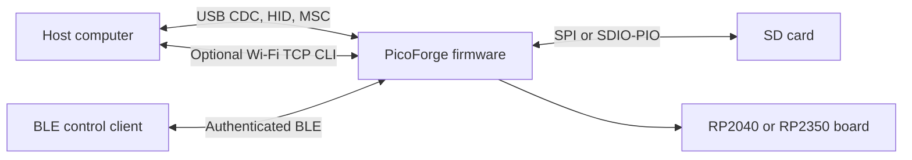
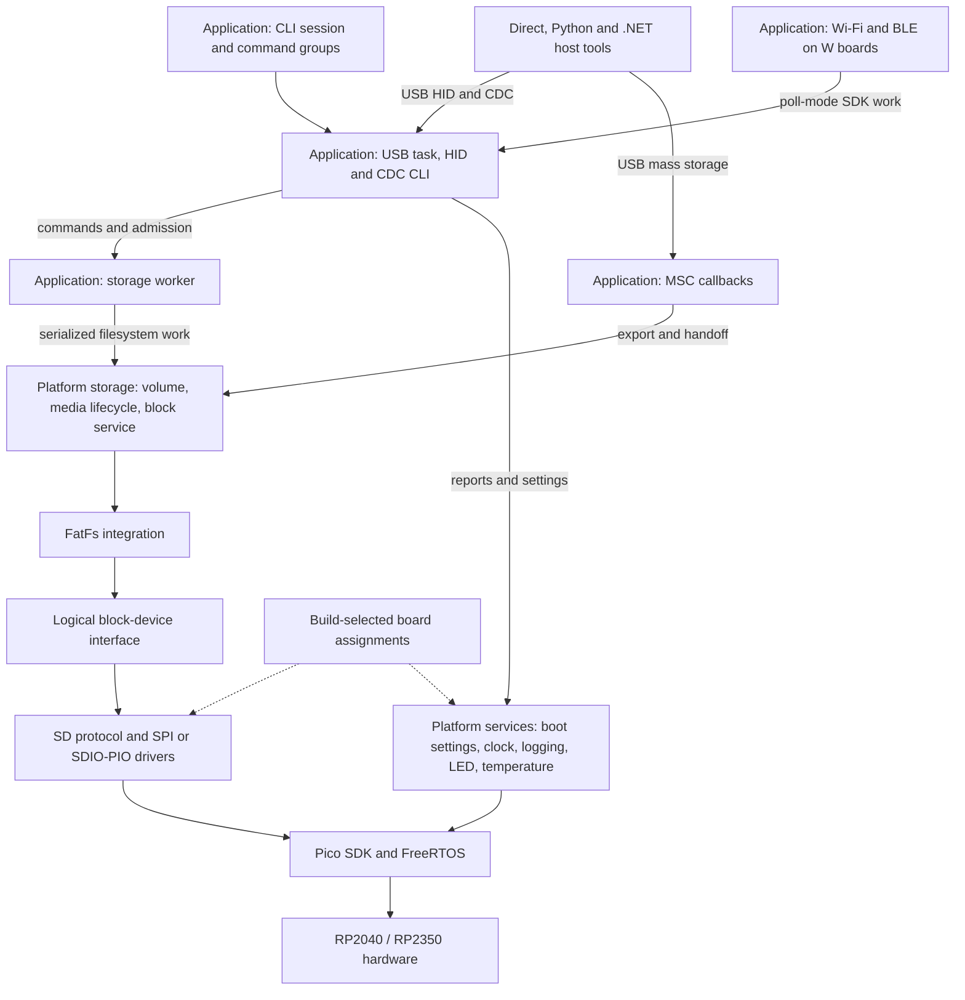
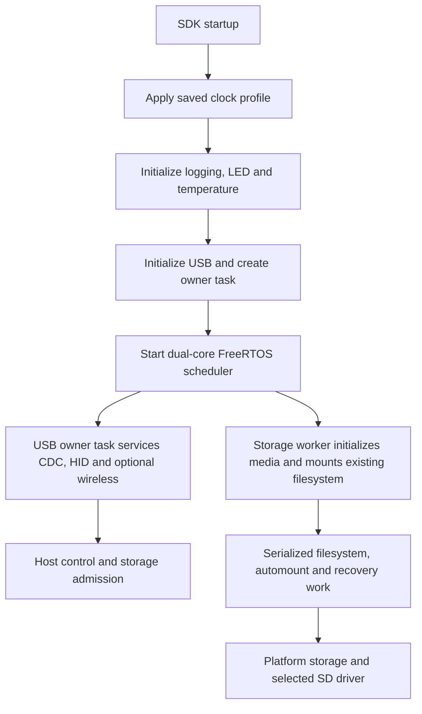
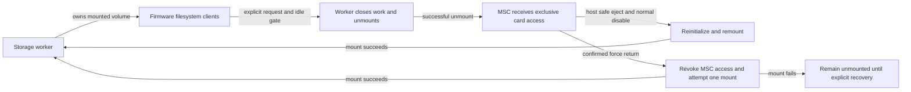
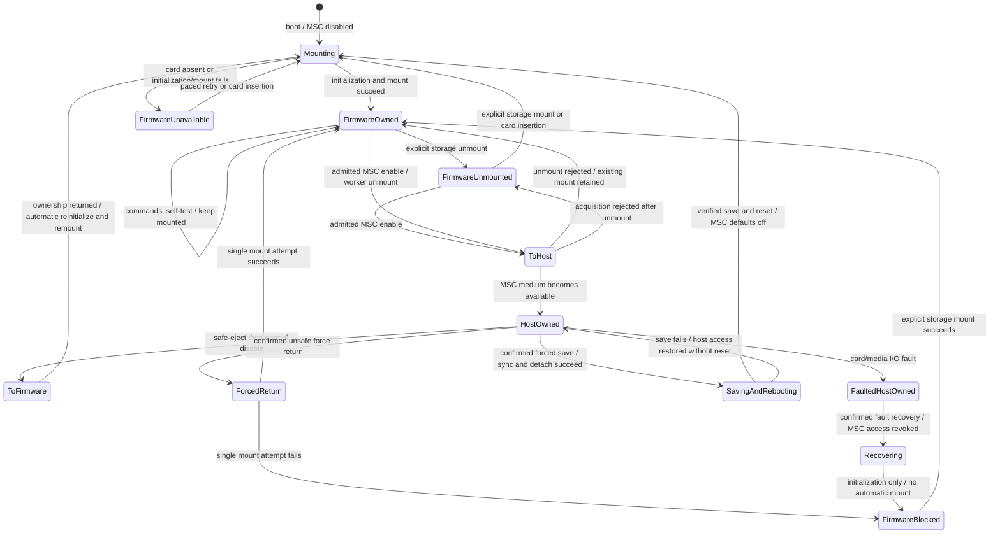

# PicoForge Firmware Architecture

PicoForge is firmware for RP2040 and RP2350 boards. It provides board management, USB control, optional SD-card
storage, and optional wireless services for W boards. This document describes the top-level structure and the
runtime ownership rules that connect those capabilities. The linked references own protocol layouts, hardware
requirements, settings persistence, and detailed driver behavior.

## System Context

USB management works without an SD card or wireless network. The USB device configuration exposes CDC, vendor HID,
and MSC interfaces. PicoForge keeps all three interfaces present; MSC reports no medium while firmware owns the
card. W-board builds can additionally provide Wi-Fi and Bluetooth LE. Wi-Fi TCP CLI requires Wi-Fi to be enabled and
connected; BLE control requires a configured Control key. See the [USB HID reference](usb-hid.md), the
[wireless guide](../guides/wireless.md), and the [Bluetooth protocol](bluetooth.md) for user-visible behavior.

## Top-Level Design

The firmware is organized by responsibility. Application code composes services and owns product policy; platform
services provide reusable device-level behavior; integrations adapt external components; drivers implement reusable
hardware operations. Build-selected board configuration supplies immutable pin and peripheral assignments.

Arrows show the main dependency and service paths, not every include or callback. Important ownership boundaries:

- The **USB owner task** services TinyUSB, HID requests, CDC sessions, and optional SDK poll-mode wireless work. It
  admits storage commands and coordinates MSC transitions but does not execute filesystem operations.
- The **storage worker** is the sole FatFs executor. It serializes filesystem commands, benchmark work, automount,
  recovery, and media lifecycle operations.
- **Platform storage** owns the singleton volume, SD configuration, media state, logical block dispatch, and
  firmware/MSC ownership. Application layers use its service API rather than accessing the SD driver directly.
- **Drivers** and **platform services** do not depend on application headers. Project-specific policy stays above
  those reusable interfaces.

The [SD-card driver design](sdcard/driver.md) details the storage driver and its ports. The
[boot settings design](settings.md) owns settings storage and application. The [USB HID reference](usb-hid.md)
owns report layouts and command semantics.

## Firmware Layers

### Application

`firmware/src/app/` owns PicoForge product behavior and coordinates the services below it:

- `usb/` owns interface descriptors, the USB task, HID command handling, CDC transport sessions, and MSC callbacks.
- `cli/` owns the command session and command groups. The CLI engine is transport-independent; the USB task provides
  CDC, and on supported W boards may provide a Wi-Fi TCP transport.
- `storage/` owns the FreeRTOS storage worker and file benchmark. The worker serializes all FatFs calls and media
  lifecycle work.
- `wireless/` owns the W-board Wi-Fi/BLE integration and its application policy.

### Platform

`firmware/src/platform/` contains reusable device services, including logging, system/clock setup, LED, temperature,
boot settings, and storage. `platform/storage/` adapts the logical block interface to FatFs and owns media lifecycle
and ownership policy. Its public interfaces avoid exposing a specific SD transport to callers.

### Integrations

`firmware/src/integration/` adapts external libraries to PicoForge interfaces. It contains TinyUSB configuration and
the project-owned USB DCD concurrency guard, FreeRTOS configuration, FatFs configuration and disk interface, and
wireless SDK integration. Integration code is where upstream APIs meet project policy; application modules should
not duplicate these adapters.

### Drivers and board configuration

`firmware/src/drivers/` contains reusable peripheral drivers. SD-card protocol logic is separated from physical SPI
and SDIO-PIO engines. CMake selects one transport and its matching board assignment source for each firmware image.
The [hardware guide](../guides/hardware.md) documents wiring and board constraints; the
[physical-links reference](sdcard/physical-links.md) documents low-level SD transport timing and resources.

Board assignments live in `firmware/src/config/`. They are selected at build time and are treated as trusted
configuration by the firmware, not dynamically probed pin maps. Keep application-specific pin choices there rather
than embedding them in reusable drivers.

## Boot and Runtime

`main()` applies the saved system clock before initializing the remaining services. It then initializes logging,
the board LED, and temperature, starts USB, and starts the FreeRTOS scheduler. The USB task owns management
interfaces and starts or coordinates application services. On startup, the storage worker prepares the configured
SD interface and attempts to mount existing media without formatting it. An absent or unusable card does not block
USB management.

The scheduler runs on both MCU cores. Tasks may migrate unless explicitly pinned; resource ownership does not follow a
task to a core. USB, wireless SDK state, and filesystem/media access therefore use explicit task and resource
ownership. FatFs is configured without cross-task locking, so serialization by the storage worker is required.
Two-core scheduling does not provide a hard real-time guarantee.

On W boards, the SDK poll-mode radio work shares the USB owner task so the required SDK context remains controlled.
USB DCD operations have a separate low-level cross-core guard; application callbacks and synchronous MSC media I/O
do not run while that guard is held. This is an integration constraint, not a general lock for application code.
Changes to USB classes, event sources, or callback latency require rechecking the guard's bounded event queue under
the resulting workload.

## Main Runtime Flows

### Management and commands

The host tools use the stable USB identity and management reports to discover board capabilities and read telemetry.
HID carries structured control and status; CDC carries the terminal session. Both are served by the USB owner task.
The CLI command engine can also be attached to a TCP client on supported W boards, but only one transport owns the
CLI session at a time. BLE provides a separate authenticated control path for supported LED and benchmark commands.

HID and CLI commands call application/platform interfaces; they do not manipulate peripheral registers directly.
Settings are staged and persisted for the next boot rather than reconfiguring active services. See the
[settings design](settings.md), [console guide](../guides/console.md), and [Bluetooth protocol](bluetooth.md).

### Storage

The storage worker is the single executor for filesystem and media lifecycle work. The platform storage service
provides a mounted filesystem to firmware and an exclusive logical-block export to USB MSC. The host never shares
the mounted filesystem concurrently with firmware.

The complete default-mounted policy, exceptional paths, and state diagram are in
[Storage Ownership Lifecycle](#storage-ownership-lifecycle). The [USB HID reference](usb-hid.md) owns the command
wire behavior and forced-return safeguards.

## Layer Responsibilities

Keep dependencies flowing toward hardware-facing services:

1. **Host applications** implement their own UI and host OS integration. Direct remains independent from the Python
   and .NET dashboard components; Python and .NET may share their web frontend.
2. **Application** owns product policy, command admission, and composition. It can depend on platform services and
   integrations, but reusable lower layers do not depend on application code.
3. **Platform services** own reusable device behavior and stable service interfaces, including storage lifecycle.
   Platform storage adapts FatFs and the logical block-device interface to the selected media driver.
4. **Drivers** implement reusable peripheral operations and hardware access. They do not own dashboard, command, or
   product-specific policy.
5. **Integrations** connect the Pico SDK and pinned external components to project-owned interfaces.
6. **Board configuration** provides build-selected assignments and hardware identity; it is not a runtime backend
   registry.

For board-specific pin choices, use `firmware/src/config/`. For a reusable peripheral driver, use
`firmware/src/drivers/`. Keep platform services flat under `firmware/src/platform/`; group a driver only when its
multiple implementation files justify a named subdirectory. Avoid circular dependencies: when a lower layer needs
application behavior, use a narrow explicit interface rather than including application headers.

### Storage Handoff Invariants

- Only the storage worker executes firmware FatFs operations; per-block reservations do not serialize file
  transactions.
- MSC acquisition reserves media across the worker-idle and unmounted checks and the ownership transition. Worker
  admission and transition coordination run on the USB task; these APIs are not arbitrary multi-task entry points.
- Owner-gated I/O holds the same recursive reservation through backend completion; USB partial-sector read-modify-write
  holds it across the full operation.
- Normal release requires checked eject/sync. Fault release requires revoked access to unavailable USB-owned media
  and queues worker recovery without claiming a clean eject. Recovery logs its result and never mounts automatically.
- Confirmed force return revokes MSC access before normal owner release and holds worker admission through one mount
  attempt; failure leaves the volume unmounted and blocks automatic retries. It never claims host-cache durability.
- [Confirmed forced settings save/reboot](settings.md#forced-save-and-reboot) syncs and detaches before flash save,
  keeping media USB-reserved and unavailable until successful reset; failures do not schedule reboot.
- Uncertain failed writes are not replayed.

### Storage Ownership Lifecycle

This section owns the product's default-mounted storage policy. Worker admission and operation completion details
are in [Storage Worker State](#storage-worker-state); the
[HID report reference](usb-hid.md#msc-force-return-safety) owns USB command semantics.

- **Startup:** MSC is disabled. The storage worker asynchronously initializes the configured card and mounts its
  existing FAT/exFAT filesystem without requiring a dashboard connection, CDC session, or self-test click.
  Startup does not wait for a usable card; absent, unsupported, or damaged media must not block USB management.
- **USB interfaces:** CDC, HID and MSC remain present regardless of ownership. While Pico owns the card, MSC reports
  no medium; the OS may show an empty removable drive. Ownership changes do not disconnect USB or reset the serial
  console. When media becomes available to the host, SCSI Unit Attention (`06/28/00`) requests a media/cache refresh.
  Reboot and confirmed forced settings save still disconnect USB.
- **Firmware use:** keep the filesystem mounted and ready for serialized reads/writes whenever firmware owns healthy
  media. Self-test operates on this existing mount, checks the reserved path and free space, then writes and verifies
  its temporary file. It never mounts or unmounts; cleanup leaves the filesystem mounted.
- **USB sharing:** only an explicit user request exports the card. Finish storage work and close/sync files before
  the worker unmounts; transfer exclusive ownership only after successful unmount. Reject conflicting work as busy
  rather than interrupting it. Firmware file access is unavailable while the USB host owns the card.
- **Safe return:** after host safe eject and normal MSC disable, release USB ownership, discard host-invalidated
  filesystem state, reinitialize, and automatically remount. No second user action or self-test click is required.
  A connected HID interface or cleared transition flags alone do not establish mounted readiness.
- **Mount failure or insertion:** startup, insertion, and normal-return mount failures remain visible and retry at
  the existing five-second interval after each failed attempt completes. With board-provided card detect, debounce
  presence before acting. Never format, repair, or replay a failed write automatically.

Explicit maintenance is an exception to the default: `storage unmount` suppresses automatic mounting until an
insertion or normal USB return; `storage mount` permits deliberate manual mounting. Faulted-MSC recovery and failed
forced return leave automatic mounting blocked for inspection until an explicit successful mount. These runtime-only
safeguards are not persistent boot settings. A safe return does not clear an existing fault-recovery block.

Start requires fresh mounted-state telemetry and idle firmware ownership. One **Start benchmark** request runs
preflight before accepting the test; it never performs a mount-only step. The protocol has no distinct mounting or
free-space-checking state; the command remains pending during preflight and the previous result may remain visible.
Current dashboard **Return to Pico** uses confirmed force return; it is not host safe eject.

The diagram shows ownership and mount policy, not every request state; normal return retains a pre-existing recovery
block even though that exceptional path is omitted. Worker admission remains held through file cleanup, command reply
draining, and the relevant ownership transition. A failed force-return mount leaves firmware owning the card but the
volume unmounted; it must not be interpreted as a successful return to a usable filesystem. Fault recovery is
distinct: it revokes access to faulted host-owned media and reinitializes without claiming a clean eject or
automatically mounting the filesystem.

### Storage Worker State

Admission and ownership transitions are coordinated by the USB task, not arbitrary concurrent callers. The worker
and USB task publish admission/completion state under critical sections; command cancellation is atomic.

| Activity | Admission state | Completion rule |
|---|---|---|
| Idle | `busy=false`, `media_service_busy=false` | USB may admit a request or transfer ownership under reservation. |
| Background media service | `media_service_busy=true`, `busy=false` | Worker releases the service gate after the serialized lifecycle operation. |
| Command queued/executing/reply draining | `busy=true`, `benchmark_active=false` | USB must drain the done reply, even for a disconnected session. |
| Benchmark queued/executing/cleanup | `busy=true`, `benchmark_active=true`, `benchmark_finished=false` | Cancellation requests cleanup; it does not release admission. |
| Benchmark completion published | `busy=true`, `benchmark_active=true`, `benchmark_finished=true` | USB polling observes completion and clears all three flags; the result persists. |
| Explicit recovery queued/executing | `busy=true`, `benchmark_active=false` | Worker reports recovery outcome and releases admission without a command reply. |
| Forced return queued/executing | `busy=true`, `benchmark_active=false` | Worker attempts one mount; USB pending/rejected reflects completion. |

`busy` and `media_service_busy` exclude each other. `benchmark_finished` implies `benchmark_active`, which implies
`busy` until USB observes completion. Recovery and commands share the admission gate but not reply completion:
recovery has no CDC session. Mount-policy flags are independent of operation admission. Recovery sets
`auto_mount_blocked`; a successful explicit `storage mount` or confirmed force-return mount clears it. A failed
initialization or mount leaves it set. Per-block reservations alone never authorize USB takeover while file cleanup
or reply draining is outstanding.

## External Components

PicoForge pins the Pico SDK, FreeRTOS-Kernel, FatFs, and Embedded CLI in `firmware/third_party/`. TinyUSB is supplied
through the Pico SDK. The build selects the supported MCU port and SD transport; it does not add a second SDK
checkout or runtime transport registry. Dependency versions, build options, and test procedures are maintained in
the [firmware testing guide](../development/firmware-testing.md) and source manifests.

## Core and Runtime Policy

FreeRTOS runs in SMP mode on both MCU cores. The Pico port starts core 1 with the scheduler; application code must
not create an independent core entry point. Interrupt routing stays on the core where it was initialized, and tasks
must not infer peripheral ownership from their current core. The wireless owner task is pinned on W boards where the
SDK context requires it. Project assertions remain active in Release builds.

The USB DCD guard serializes low-level controller mutations across cores and moves bounded controller events to the
USB task before TinyUSB dispatch. Event order is retained and consecutive SOFs may be coalesced. Queue overflow is an
explicit fault, not a silently dropped event. The guard adds no heap allocation and is not held across application
callbacks or media I/O. See
[dcd_guard.c](../../firmware/src/integration/usb/dcd_guard.c) for the implementation and its constraints.

## Stack Observations

`INCLUDE_uxTaskGetStackHighWaterMark=1` enables the existing FreeRTOS stack-fill scan. USB and Storage sample only
their own task (`NULL` handle), at 30-second intervals in their normal loops, and log the minimum untouched stack
in **StackType_t words**, not bytes. Sampling does not scan a concurrently executing task on the other core. It does
not reset the watermark, allocate memory, or add a new task. Existing overflow checking remains enabled.
Sampling can be delayed by a long storage operation; UART logging and scanning add occasional service overhead.
Unused fill bytes are an observation, not certified margin because unwritten stack reservations can remain filled.

## Testing and Validation

Use [firmware testing](../development/firmware-testing.md) for builds and hardware acceptance,
[host development](../development/host-tools.md) for dashboard tests, and the
[test ownership index](../../tests/README.md) for fixtures and suite boundaries. The
[release guide](../deployment/release.md) owns current CI matrices, package contents, and publication. Historical
software checks belong in [review records](../validation/records/static-review-remediation.md); their old matrix and
command results are not current build instructions.
