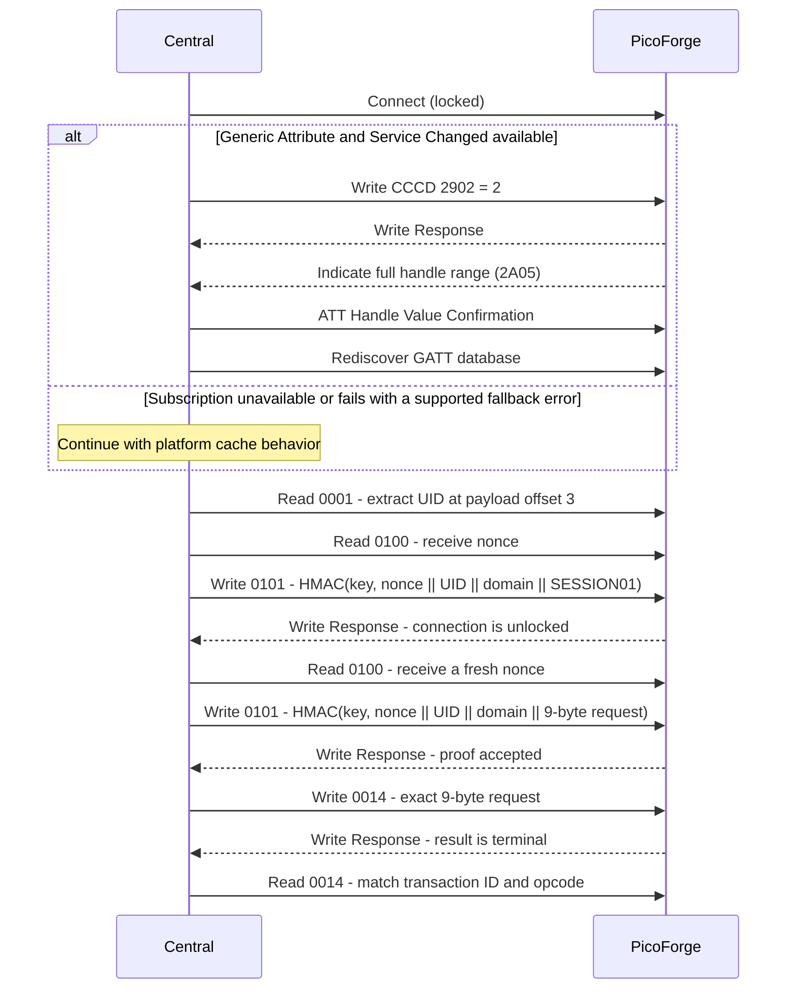

# Bluetooth LE Protocol

This reference owns the Bluetooth LE wire protocol of Pico W and Pico 2 W images: startup gating, advertising, the GATT
layout, session unlock, per-command proofs, the 9-byte control form, and ATT error codes. Breaking wire changes use a
new service UUID; compatible additions MAY retain this UUID. Byte 0 of each report and control payload remains its
payload version. Payload layouts reused from USB and cross-transport command semantics are defined once in the [USB HID
reference](usb-hid.md). Radio execution, credential persistence and the shared key store are in the [wireless
integration](../development/wireless-integration.md). For user setup, see the [wireless guide](../guides/wireless.md).

The key words **MUST**, **MUST NOT**, **SHOULD**, **SHOULD NOT**, and **MAY** are to be interpreted as described
in BCP 14 (RFC 2119, RFC 8174) when, and only when, they appear in all capitals.

## Availability

BLE is present only when Report `1` capability bit 7 is set. At boot the firmware loads the saved Control key and
then starts the controller only when the Report `2` Bluetooth switch is on **and** a key is saved. Enabling the
switch without a key logs a warning and leaves the controller off. Saving or clearing the key takes effect at the
next boot; clearing it also disables the TCP CLI listener.

Report `12` byte 3 (`ble_state`) publishes the controller state:

| Value | State | Meaning |
| ---: | --- | --- |
| `0` | Off | Bluetooth disabled, no key saved, initialization failed, or the controller is not yet working. |
| `1` | Advertising | Controller working and discoverable; no central connected. |
| `2` | Connected | One central is connected. |

A controller power-on failure sets Report `12` detail `1` (initialization error). Dashboards show `0` with BLE
enabled and a key saved as "starting". State `0` intentionally conflates off, missing key, startup and failure; it
is not an exact reason code, and no separate Starting state is published.

## Advertising

| Item | Value |
| --- | --- |
| Advertising type | Connectable undirected (`ADV_IND`) on all three advertising channels. |
| Interval | 96 units (60 ms) for 30 seconds after startup/disconnect, then 800 units (500 ms). |
| Address | Fixed controller public Bluetooth address; it does not rotate. |
| Advertising data | Flags `0x06` (LE General Discoverable, BR/EDR not supported); complete list of 128-bit service UUIDs containing the PicoForge service. |
| Scan response | Complete Local Name `PicoForge-<USB serial>`: 16 uppercase hexadecimal digits of the board unique ID. |

The GAP Device Name characteristic returns the same name without unlocking. Advertising starts when the controller
reaches the working state and restarts after every disconnect. Fast discovery is temporary; the slower interval
reduces idle radio use. The firmware does not re-advertise while connected, so it serves one central at a time.
The scan-response name includes the full stable board UID for dashboard selection. The fixed public address is a
second stable tracking identifier. Anyone scanning can correlate observations using either; this is an accepted
privacy tradeoff for a local development tool.

## Pairing and Bonding

Pairing is not required: [session unlock](#session-unlock) and [command proofs](#command-proofs) authorize
application access. The security manager is configured for no input/output and no bonding. A central-initiated
Just Works pairing may still complete, depending on the peer and stack; it does not unlock PicoForge and is not
persisted. The SDK BTstack flash-TLV initializer is interposed to select the nonpersistent TLV implementation before
any bank access, because its default Pico W flash banks overlap the settings sector. Bluetooth never writes flash.

## GATT Layout

Service UUID: `50fc0000-7c91-4d70-8b32-6e856443f502` (wire revision 2). The final byte increments for breaking
wire changes; revision 1 used `...f501`. Report characteristics use the hexadecimal USB report ID and return that
report's payload **without** the report ID byte. Suffixes `0001`–`00ff` are reserved for report mirrors; `0100`
and above are BLE-specific. Clients MUST reject an unsupported payload version for a known report or control
characteristic. Clients MAY ignore unknown characteristics unless they are required for an operation they use.

The Generic Attribute service includes Service Changed (`0x2A05`) and Database Hash (`0x2B2A`). The database is
static during a boot, but firmware updates can change it. The Database Hash is public for clients that compare it;
the server does not implement Robust Caching or Client Supported Features. Cache invalidation behavior is described
below. The PicoForge service UUID remains unchanged because these standard GATT attributes do not change its wire
contract. The GAP Appearance is Unknown; Device Information exposes manufacturer `PicoForge` and the firmware
revision.

### Service Changed and Caching

The Bluetooth Core Specification v5.4 (Vol 3, Part G, §2.5.2) limits an unbonded client's attribute cache to the
current connection. This server nevertheless sends one full-range (`0x0001`–`0xFFFF`) Service Changed indication
after subscription on each connection as a compatibility measure for stacks retaining caches across connections.
Clients MUST honor the indication and rediscover the database; they MUST NOT reuse cached handles across
connections. This avoids persisting per-peer cache state.

The firmware marks the indication sent only after the client confirms it, and does not send another on that
connection even if the CCCD is toggled. If confirmation times out (BTstack's 30-second ATT transaction timeout),
the firmware stops indication retries for that connection and requests a link disconnect; it retries the
disconnect request if BTstack initially rejects it. The timeout failure remains latched even after BTstack accepts
the disconnect request, so a CCCD write during the interval before link teardown cannot queue another indication.
The disconnect can interrupt a concurrent control exchange; if a state-changing request may have been admitted,
follow [Uncertain Outcomes](#uncertain-outcomes).

The Direct client subscribes before PicoForge discovery when Generic Attribute and Service Changed are available.
If lookup or subscription fails with `NotAllowedError`, `NotFoundError`, `NotSupportedError` or `SecurityError`, it
warns and continues with the platform's own cache behavior; other errors abort setup.

The UUID table's **Access while locked** column lists permitted operations before session unlock; `Denied` entries
return ATT error `0x80`.

| UUID suffix | Properties | Access while locked | Size | Value |
| --- | --- | --- | ---: | --- |
| GAP `0x2A00` | Read | Read | 26 | Device name, as in the scan response. |
| GAP `0x2A01` | Read | Read | 2 | Appearance `0` (Unknown). |
| GATT `0x2A05` | Indicate | N/A | 4 | Full-range Service Changed indication; submission errors are retried on later polls while subscribed, without a retry limit. A timed-out indication is not retried on that connection. |
| GATT `0x2902` | Read, Write, Write Without Response | Read/write | 2 | Service Changed CCCD; `0` disables, `2` enables indication. Write Requests report validation errors; Write Without Response does not. |
| GATT `0x2B2A` | Read | Read | 16 | BTstack-generated GATT Database Hash. |
| Device Information `0x2A29` | Read | Read | 9 | Manufacturer name `PicoForge`. |
| Device Information `0x2A26` | Read | Read | 5–9 | Firmware revision `major.minor.patch`, ASCII without NUL. |
| `0001` | Read | Read | 26 | [Report `1`](usb-hid.md#report-id-1-device-identity--capabilities) identity; carries the UID that proofs bind. |
| `0002` | Read | Denied (`0x80`) | 17 | [Report `2`](usb-hid.md#report-id-2-board-configuration) board configuration. |
| `0003` | Read | Denied (`0x80`) | 22 | [Report `3`](usb-hid.md#report-id-3-board-telemetry) telemetry. |
| `000a` | Read | Denied (`0x80`) | 34 | [Report `10`](usb-hid.md#report-id-10-storage-status) storage status. |
| `000b` | Read | Denied (`0x80`) | 32 or 0 | [Report `11`](usb-hid.md#report-id-11-storage-benchmark-status) benchmark status; empty when the build has no benchmark. |
| `000c` | Read | Denied (`0x80`) | 48 | [Report `12`](usb-hid.md#report-id-12-wireless-status) wireless status, including saved SSID and IPv4 address. |
| `0014` | Read, Write | Denied (`0x80`) | 9 | [Control request/result](#control-characteristic). |
| `0100` | Read | Read | 16 | Fresh challenge nonce; each read replaces the previous one. |
| `0101` | Write Request | Write | 16 | Session or command proof. |

`0014` is also Write Request only; Write Without Response is not advertised for `0014` or `0101`. Such commands
are rejected by the stack before the application callback, and Write Without Response has no ATT response for a
client to inspect. The Control key is exactly 32 raw bytes (64 hexadecimal digits in the dashboard). Report `1`
UID bytes are at payload offset 3, length 8, in report order. The `0101` proof write is 16 bytes and the `0014`
request is 9 bytes; both fit in the default ATT MTU of 23. Clients MUST use Write Requests, not Write Without
Response or Prepare/Execute (long) writes.

### Read Snapshots

A read at offset `0` builds a new snapshot of the characteristic; ATT Read Blob requests at later offsets return
bytes from that same snapshot, so long reads are consistent without a larger MTU. A blob read whose handle differs
from the last offset-`0` read, or whose offset exceeds the snapshot length, returns ATT error `0x07` (Invalid
Offset); clients MUST restart at offset `0`. Every offset-`0` read of `0003`, `000a` or `000b` advances a BLE
report sequence that is independent of the USB Input-report sequences. The default ATT MTU is 23, so the 26-byte
identity and 48-byte wireless reports require Read Blob requests at that MTU. BTstack's configured maximum is
181 bytes (`HCI_ACL_PAYLOAD_SIZE` 185 less the 4-byte L2CAP header). Clients that control MTU negotiation SHOULD
request at least 51; Web Bluetooth does not expose a manual MTU request.

## Session Unlock

Each connection starts locked. Only the GAP name, Appearance, Service Changed CCCD, Database Hash, Device
Information, `0001`, `0100` and `0101` are accessible; other reads and every `0014` write return ATT error `0x80`.
To unlock:

1. Clients MUST read `0001` and keep its 8-byte UID field (raw bytes, in report order).
2. Clients MUST read `0100` to obtain a 16-byte nonce. If the read is empty or has any other size, clients MUST
   NOT write a proof; clients SHOULD retry the challenge read or reconnect. This check is defensive: the current
   firmware nonce generator succeeds for a valid output buffer.
3. Clients MUST write to `0101` the first 16 bytes of
   `HMAC-SHA256(key, nonce[16] || UID[8] || "PFBLECTL1" || "SESSION01")`.

An accepted proof unlocks the connection until it disconnects. Disconnect clears the unlock, nonce, proof and any
frozen read snapshot. For the `0101` validation order and failure behavior, see [Proof Rules](#proof-rules).

The 16-byte challenge is assembled from two Pico SDK `get_rand_64()` outputs. The pinned SDK uses a
non-cryptographic PRNG and mixes configured entropy sources: the default RP2040 build uses ROSC, timer and bus
performance-counter inputs; RP2350 uses its hardware TRNG and timer. The API does not guarantee cryptographic
unpredictability or uniqueness. The protocol relies on fresh, unpredictable challenges and does not detect repeats;
the 16-byte length alone is not an entropy guarantee.

## Command Proofs

LED requests (opcode `1`) on an unlocked link need no further proof and leave any pending nonce, proof and rate
limit untouched. Every other valid-envelope write to `0014`, including an unsupported opcode, consumes a fresh
proof:

1. Clients MUST read `0100` for a new nonce.
2. Clients MUST write to `0101` the first 16 bytes of
   `HMAC-SHA256(key, nonce[16] || UID[8] || "PFBLECTL1" || request[9])`, where `request` is the exact 9-byte
   control request below.
3. Clients MUST write that request to `0014`.
4. A successful ATT Write Response means the command was admitted and its BLE result is already terminal. Clients
   MUST read `0014` and match `transaction_id` and `opcode`.

Proof consumption and retry-delay behavior are defined in [Proof Rules](#proof-rules). The Direct dashboard
disconnects after a rejected session proof.

The board does not enforce transaction-ID uniqueness; clients MUST advance the nonzero ID for every command and
serialize writes. The result is synchronous: `Pending` is not a BLE command outcome.

## Proof Rules

Every read of `0100` creates a fresh challenge and invalidates any earlier proof. Proof validation depends on the
operation:

- A `0101` Write Request checks length (`0x0D`), retry delay (`0x82`), and key/challenge availability (`0x83`), in
  that order, before staging the 16-byte proof. On a locked connection, the staged proof is immediately checked
  against the session request. Otherwise it is checked against the next valid non-LED `0014` request. The
  missing-key check is defensive: BLE starts only after the control key is loaded, and the key is not cleared while
  BLE is running.
- For a non-LED `0014` write, after the locked-link and envelope checks in [Validation Order](#validation-order),
  authentication checks retry delay (`0x82`), key/challenge availability (`0x83`), proof presence (`0x80`), and
  then the MAC (`0x80`), in that order. Once the retry-delay check passes, if no nonce was read the missing
  challenge returns `0x83`; if a fresh nonce exists but no proof was written, the missing proof returns `0x80`
  without consuming the challenge or starting the delay.

A bad MAC returns `0x80`, consumes the challenge and proof, and starts a two-second delay that persists across
disconnects; a bad session MAC leaves the link locked. The delay applies globally to BLE proof attempts, not just
to one connection. MAC comparison does not exit early. The ASCII domain and request strings have no terminator.

## Worked Proof Vector

These bytes are a public conformance vector, not a production key:

| Input | Hex |
| --- | --- |
| Key | `000102030405060708090a0b0c0d0e0f101112131415161718191a1b1c1d1e1f` |
| Nonce | `000102030405060708090a0b0c0d0e0f` |
| UID | `0001020304050607` |
| Session request | ASCII `SESSION01` |
| Session proof | `7c583e03087e013dc444f219fa69cfe4` |
| Command request | `010702010000000000` (confirmed reboot) |
| Command proof | `c090cfe4b5d641b4dd4f8d710c7dad6d` |

Proofs are the first 16 bytes of HMAC-SHA256 as defined above. The executable vector is checked by
`tests/contracts/test_wireless_auth.py`.

## Exchange Sequence

Mermaid `sequenceDiagram` message lines treat semicolons as statement separators; use a dash in message text instead.

## Control Characteristic

Writes to `0014` use a 9-byte form, not a truncated USB Feature `20` report. Status, error and detail values match
[Feature `20`](usb-hid.md#report-id-20-control-command--result).

### Request

| Offset | Size | Field | Meaning |
| -----: | ---: | ----- | ------- |
| 0 | 1 | `version` | `1`. |
| 1 | 1 | `transaction_id` | Nonzero; independent of the USB sequence. |
| 2 | 1 | `opcode` | `1` LED, `2` confirmed reboot, or `5` save settings and reboot. |
| 3 | 1 | `flags` | As USB Feature `20` for the opcode; forced-save and wireless-commit bits are forbidden. |
| 4 | 5 | `arguments` | Opcode arguments; unused bytes zero. |

For opcode `1`, byte 4 is `0` off or `1` on. Opcode `2` has zero arguments and requires flag bit 0. For opcode `5`,
bytes 4-5 are the system clock in MHz (little-endian), byte 6 the SD-card profile, byte 7 the switch mask (bit 0
Wi-Fi, bit 1 BLE, bit 2 TCP CLI) and byte 8 zero. A BLE save MAY change the TCP CLI bit but MUST keep both radio
bits equal to the saved mask; otherwise it returns Invalid/error `3` with detail `0`.

### Result

| Offset | Size | Field | Meaning |
| -----: | ---: | ----- | ------- |
| 0 | 1 | `version` | `1`. |
| 1 | 1 | `transaction_id` | ID of the latest BLE result; `0` before any request. |
| 2 | 1 | `opcode` | Opcode of that result; `0` before any request. |
| 3 | 1 | `status` | Feature `20` status. |
| 4 | 1 | `error_reason` | Feature `20` error. |
| 5 | 4 | `data` | Invalid, Busy or Failed: byte 0 is the detail, bytes 1-3 zero. Successful opcode `5`: clock MHz (little-endian), SD-card profile, saved switch mask. Otherwise zero. |

The wireless commit mask is USB-only and is never present in a BLE result. The BLE result slot is one global
in-memory slot shared across connections: a new BLE command replaces it, disconnect does not clear it, and reset
does. It has no client attribution and transaction IDs are not globally unique, so a reconnect can inspect a result
only if the board has not reset and no later admitted BLE command has replaced it; a matching ID and opcode do not
prove which connection produced it.

### Validation Order

1. Locked link: ATT error `0x80`. The envelope is not checked.
2. Invalid envelope (length other than 9, version other than `1`, or transaction ID `0`): ATT error `0x81`. The
   result slot, nonce and proof are unchanged.
3. Non-LED requests follow the proof lifecycle and failure mapping in [Proof Rules](#proof-rules). LED requests
   skip authentication.
4. Opcodes `3`, `4` and `6`-`13` (assigned but USB-only): Unsupported/error `4` in the result slot.
   Unassigned opcodes: Unsupported/error `7`.
5. Opcodes `1`, `2` and `5` follow the shared [error precedence](usb-hid.md#get-result) for their arguments and
   state. Otherwise-valid opcodes `2` and `5` return Busy/error `5` with detail `1` while a forced USB save is in
   flight, otherwise with detail `28` while unexpired USB-staged wireless values exist. Other resource conflicts
   return Busy as over USB. Opcode `1` remains available.

USB and BLE keep separate result slots and transaction sequences; a request on one never replaces the other's result,
and BLE requests never clear a pending USB TCP CLI proof. See [Feature `20` result semantics](usb-hid.md#get-result).

### Uncertain Outcomes

Clients MUST serialize control requests. A timeout before the `0014` Write Response leaves admission uncertain; a
disconnect after a successful response but before the result read can hide the terminal result. Clients MUST
reconnect and inspect the result or resulting device state; clients MUST NOT replay a state-changing request with
an uncertain outcome. The result-slot lifetime and limitations are described in [Result](#result). BTstack's ATT
transaction timeout is 30 seconds; clients MUST abandon the transaction and reconnect on timeout.

Accepted reboot and save-and-reboot commands are followed by a reset after the firmware's 1000 ms
`PF_HID_REBOOT_DELAY_MS` grace period, intended to allow the result read. This is not a guarantee that a slow
connection can finish reading before reset.

## ATT Errors

| Code | Name | Cause |
| --- | --- | --- |
| `0x80` | Application: control rejected | Locked read/write, or missing or rejected proof. |
| `0x81` | Application: invalid envelope | `0014` write with wrong length, version or transaction ID on an unlocked link. |
| `0x82` | Application: rate limited | Proof operation attempted during the two-second delay after a rejected proof. |
| `0x83` | Application: challenge unavailable | Missing key or no fresh nonce for the requested proof (defensive checks; neither is expected during normal BLE operation). |
| `0x02` | Read Not Permitted | Stack rejects a read of write-only `0101`. |
| `0x03` | Write Not Permitted | Write to a read-only characteristic. |
| `0x06` | Request Not Supported | Prepared (long) or offset writes; defensive rejection if the already-validated BLE control dispatcher rejects an envelope. |
| `0x07` | Invalid Offset | Read Blob uses a different handle than the active snapshot, or an offset exceeds the snapshot length. |
| `0x0D` | Invalid Attribute Value Length | `0101` write that is not 16 bytes or Service Changed CCCD Write Request that is not 2 bytes. |
| `0x13` | Value Not Allowed | Service Changed CCCD Write Request value other than disabled (`0`) or indication enabled (`2`). |

These ATT errors apply to requests that receive an ATT response. The CCCD also accepts Write Without Response, but
invalid values are not applied and the client receives no validation error. PicoForge never returns Insufficient
Authentication (`0x05`): that standard error can trigger OS pairing, which is not the application authorization
mechanism.

## Security Properties

| Threat | Existing controls | Residual risk |
| --- | --- | --- |
| Passive traffic observation | The Control key never crosses the link. | Pairing is optional and not required by PicoForge; without peer-initiated Just Works pairing, observers within radio range can read unlocked status (including SSID and IPv4 address) and command traffic. |
| Cross-session result disclosure | None. The BLE result slot is shared across connections and survives disconnects. | A later central can read the previous central's last admitted command result. Successful opcode `5` results include the saved clock, SD-card profile and switch mask; transaction IDs do not identify the originating connection. |
| Proof replay or alteration | One-use challenges and HMAC request binding prevent reuse of a proof for a different request. | The pinned Pico SDK generator has no formal cryptographic unpredictability or uniqueness guarantee; repeated or predictable nonces weaken replay protection. See [Session Unlock](#session-unlock). |
| Cross-board or cross-protocol proof reuse | The proof binds the board UID and uses the `PFBLECTL1` domain, distinct from TCP CLI's `PFTCPCLI1` ([TCP CLI authorization](../development/wireless-integration.md#tcp-cli-authorization)). | There is no board-authentication proof; the client SHOULD verify the selected UID before trusting status. |
| Active attacker on a live link | A command proof is bound to one exact request and is accepted once. | An attacker able to inject traffic into an unlocked connection can race an observed proof and its exact bound command, or control/proxy the live link. Proofs do not provide link security. |
| Session left unattended | Authorization is cleared on disconnect. | There is no idle relock; clients SHOULD disconnect when finished. |
| Device tracking | None. | The stable advertised name and public address permit tracking. |
| Denial of service | One central is served at a time; disconnecting frees the slot. | A central can hold that connection, and radio jamming can prevent communication. |
| Online brute force | A global two-second retry delay applies after a rejected MAC and persists across reconnects. | At continuous uptime, this permits about 43,200 failed guesses per day. If the key is uniformly random and each guess is independent against an ideal 128-bit HMAC tag, the success probability is about 1.3×10^-34 per day. The firmware accepts any 32-byte key; key quality is the user's responsibility. A reboot resets the volatile delay. |

These security properties and residual risks are accepted tradeoffs for a local development tool.

## Operational Notes

Connection interval and supervision timeout are negotiated by the BLE stacks; PicoForge does not request custom
values or promise a disconnect-detection deadline. Diagnostic notifications are intentionally omitted: the
dashboard polls reports every 250 ms, and Service Changed is the only indication. Its subscription is ephemeral
and used only for cache invalidation. The browser chooses MTU negotiation for Web Bluetooth clients.

BLE cannot stage credentials, test or scan Wi-Fi, produce TCP CLI proofs, run benchmarks, change radio switches,
force a save, or change USB storage ownership.

## Conformance

| Test ID | Requirement | Verification |
| --- | --- | --- |
| BT-001 | Startup/auth, indication confirmation/timeout disconnect, reconnect-persistent rate limit, CCCD, snapshots, isolation and timers. | `tests/contracts/test_bluetooth.py` |
| BT-002 | HMAC-SHA256 BLE and TCP proof vectors, including the worked vector above. | `tests/contracts/test_wireless_auth.py` |
| BT-003 | Service Changed subscription/fallback, UUID lookup, proof signing and the restricted 9-byte command envelope. | `host/direct/tests/wireless.test.mjs` |

## Implementation

`bluetooth.c` owns BLE state and callbacks; `bluetooth_profile.gatt` defines the attributes. `wireless_auth.c` owns the
key and proofs. `usb_hid.c` dispatches BLE controls through `pf_hid_ble_control` and shared admission helpers. BLE work
runs on the shared wireless owner task (see [execution and storage
safety](../development/wireless-integration.md#execution-and-storage-safety)). The Direct client is in `host/direct/web/js`;
Python and .NET hosts do not use BLE. The current controller event handler consumes the legacy LE Connection Complete
event emitted by CYW43; add Enhanced Connection Complete handling if controller privacy or a controller that emits
enhanced events is introduced.
