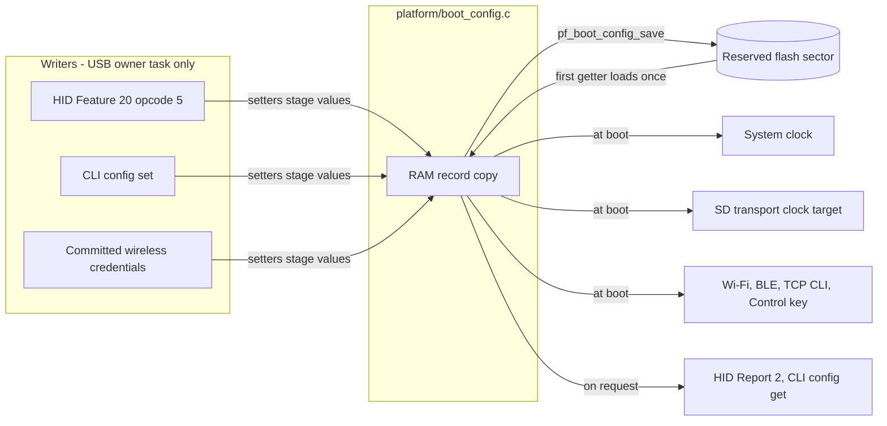
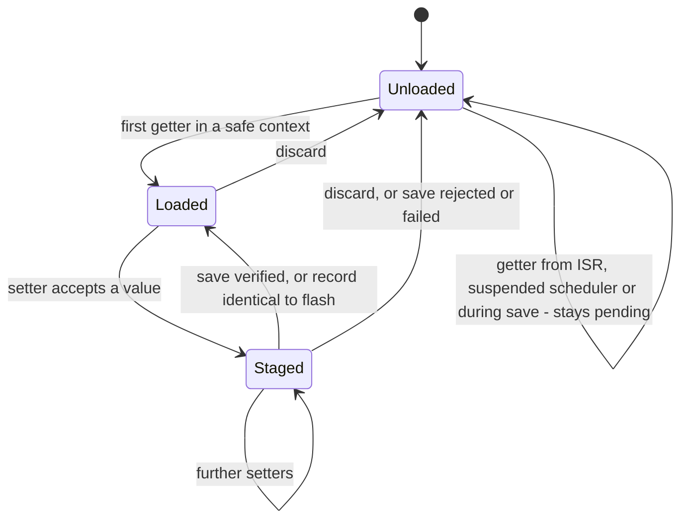
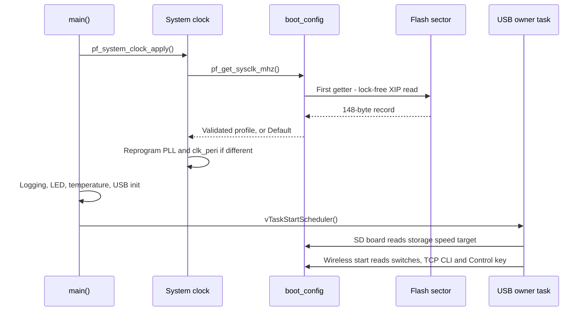
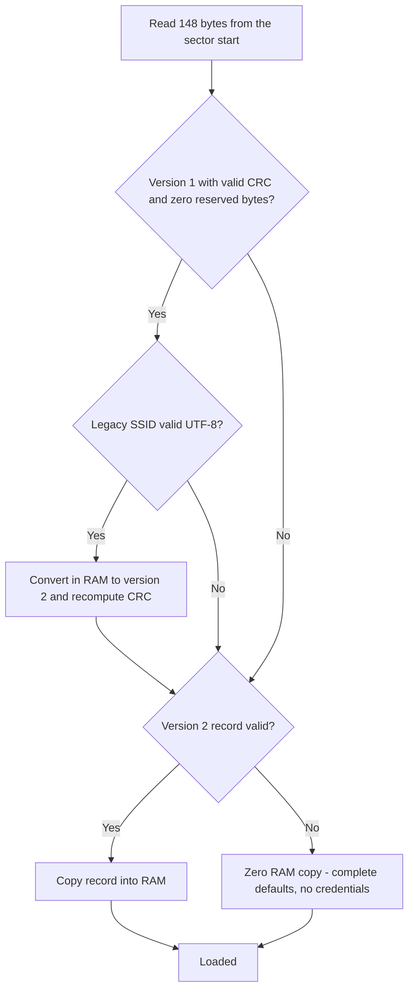
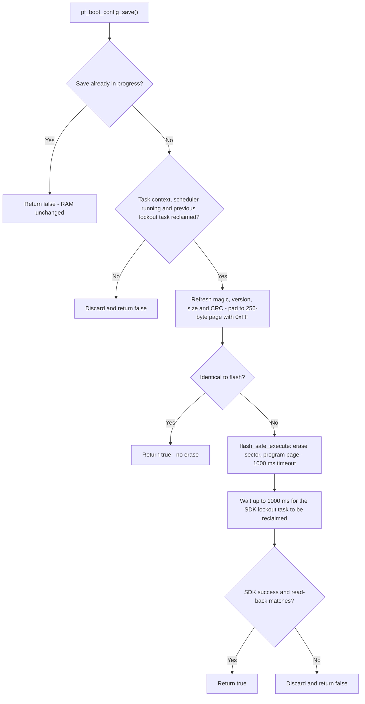
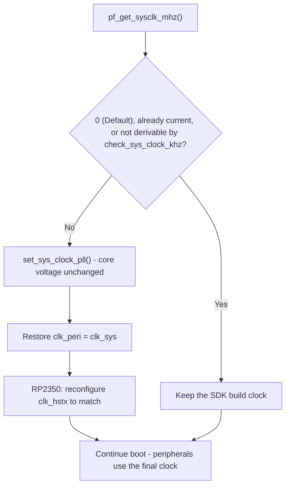
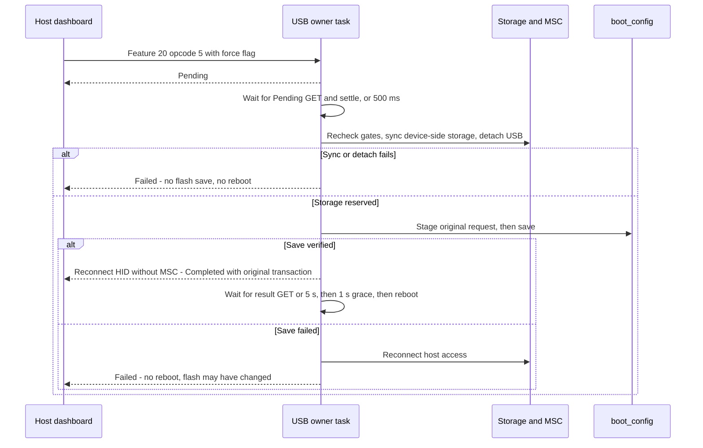

# Boot Settings Design

PicoForge keeps a small set of **next-boot settings** in one reserved flash sector: the system clock profile, the
shared SD-card speed profile, the wireless service switches and the private wireless credentials. They are changed at
runtime, saved as one verified record, and take effect only at the next boot. This document owns the record format,
the load/stage/save lifecycle, flash safety and how each setting is applied. The wire encoding of the settings
commands is owned by the [USB HID reference](usb-hid.md); radio behavior is in
[wireless integration](../development/wireless-integration.md).

| Setting | Values | Default | Applied by |
| --- | --- | --- | --- |
| System clock (`pf_sysclk_profile_t`) | Default (SDK stock clock), 150, 200 or 250 MHz | Default | `pf_system_clock_apply()` at the start of `main()` |
| SD-card speed (`pf_storage_speed_t`) | Default (25 MHz target), High-Speed (50 MHz target) | Default | SD board setup when the transport is prepared |
| Wi-Fi / Bluetooth switches (W boards) | Enabled or disabled | Enabled | Wireless owner start-up |
| TCP CLI switch (W boards) | Enabled or disabled | Enabled | Wireless owner start-up |
| Wi-Fi SSID, passphrase and auth state; Control key (W boards) | See [record format](#record-format) | None | Wireless owner start-up |

## Architecture

All settings pass through one RAM copy owned by the platform facade
[boot_config.c](../../firmware/src/platform/boot_config.c). Writers only stage values in RAM; one save call commits
the complete record to flash. Consumers read the RAM copy at boot, so a saved change never alters running hardware.



The design rules are:

- **One record, one CRC.** Profiles, switches and credentials commit together or not at all.
- **Next boot only.** The SD drivers lock their first configuration and the clock is set before peripherals start,
  so setters change only RAM and saved values apply after reboot.
- **Single writer.** Runtime reads and saves belong to the USB owner task (HID and CLI both run there). This is not a
  general multi-task settings API.
- **Boot never depends on flash.** Any missing or invalid record loads complete defaults.
- **No generic store.** The fixed record is read directly and written as one padded page; record validation and RP2
  flash access are private to `boot_config.c`.

## RAM Copy Lifecycle

The RAM copy has three states. Setters require a loaded copy; `pf_boot_config_discard()` clears it so that the next
getter reloads what flash actually contains.



A setter called while loading is still pending returns `false` and changes nothing. A setter that rejects an
out-of-range value also returns `false` without changing the copy.

### Transactional staging

Each writer stages every requested value and then saves once. Any outcome other than a verified save discards the
RAM copy, so no partial request survives:

- **HID opcode `5`:** the handler stages clock, SD profile, radio and TCP CLI switches and, when the commit flag is
  set, the staged wireless credentials. Any result other than Completed (Invalid, Busy, Pending or Failed) calls
  `pf_boot_config_discard()`. A pending forced save re-stages its original request when it runs. Success schedules
  the deferred reboot.
- **CLI `config set`:** stages clock, storage speed and radio switches, discards on any setter or save failure and
  reboots only after a verified save. See the [console guide](../guides/console.md#board-configuration).

A failed save does not prove that flash is unchanged: an SDK safe-zone exit timeout can occur after programming.
Because discard reloads from flash, the RAM copy then reflects whatever was actually written, and a later reboot may
apply the new values despite the failed command. Failed commands never reboot automatically.

## Boot Sequence



The first getter runs before the scheduler starts, so the record is loaded through a direct flash read with no
locking. Every later consumer reads the same RAM copy.

### Loading and validation



A record is valid only if all of these hold: magic `PFCF`, version `2`, size `148`, matching CRC-32, clock profile
`0`–`3`, SD profile `0`–`1`, no unknown service bits, Wi-Fi auth state `0`–`3`, SSID length at most 32, an empty or
8–63 character printable-ASCII passphrase, zero reserved bits, and a zero key whenever the key-present flag is clear.
Fields are never applied partially. Loading never writes flash; the next explicit save writes version 2.

## Saving

`pf_boot_config_save()` is the only flash writer in PicoForge.



`flash_safe_execute()` disables interrupts and holds the other core for roughly 50 ms. USB can miss frames during
that window, so active MSC access must stop and USB must detach before a forced save.

PicoForge disables FreeRTOS dynamic allocation, so the SDK reuses one static lockout task control block. The module
waits for the idle task to reclaim it, using an elapsed-tick deadline with a one-tick polling delay; scheduling can
delay return beyond the deadline. If reclamation does not finish, the next save is refused until it does. This module
must remain the only `flash_safe_execute()` caller, and tasks must not be created or deleted during a save or while
reclamation is pending.

## Record Format

Little-endian, 148 bytes, padded with `0xFF` to one 256-byte page at the start of the reserved sector:

| Offset | Size | Content |
| --- | --- | --- |
| 0 | 4 | magic `PFCF` |
| 4 | 2 | format version (`2`) |
| 6 | 2 | record size (`148`) |
| 8 | 1 | System clock profile (`0` Default, `1` 150 MHz, `2` 200 MHz, `3` 250 MHz) |
| 9 | 1 | Shared SD-card speed profile (`0` Default, `1` High-Speed) |
| 10 | 1 | Disabled services: bit 0 Wi-Fi, bit 1 Bluetooth, bit 2 TCP CLI; other bits invalid |
| 11 | 1 | Wi-Fi authentication state (`0` try WPA2, `1` try WPA3-SAE, `2` WPA2, `3` WPA3-SAE) |
| 12 | 1 | Wi-Fi SSID length (`0`–`32`) |
| 13 | 32 | Raw Wi-Fi SSID bytes; unused bytes zero |
| 45 | 64 | Wi-Fi passphrase, NUL-terminated printable ASCII; empty or 8–63 characters |
| 109 | 32 | Raw Control key; presence is recorded separately |
| 141 | 1 | Credential flags: bit 0 Control key present; other bits zero |
| 142 | 2 | Reserved, zero |
| 144 | 4 | CRC-32 (IEEE, reflected) of bytes 0–143 |

The record stores profiles, not MHz, and has no separate SPI and SDIO speeds; the HID system-clock field still
carries MHz. Service bits are stored as *disabled* flags so an erased or zeroed record enables every service. The TCP
CLI bit is independent of the radio bits returned by Report `2` and is preserved by ordinary clock, speed and radio
updates. Any 32-byte key value is supported, including all zero; clearing a key removes its presence flag. Flash is
**unencrypted**: physical or debug access can recover credentials, and erasing settings clears them.

**Version 1 migration.** A version 1 record with a valid CRC loads through an in-RAM conversion: its NUL-terminated
SSID becomes a length-prefixed byte string, and a nonzero key is marked present.

**Power loss.** There is a single copy. A power loss during erase or program leaves a record that fails validation
and loads as complete defaults with no credentials, so Wi-Fi and BLE stay off until provisioned again.

ponytail: one sector and no wear levelling. This is acceptable because saves are infrequent user actions. If old
values must survive a power loss, or writes become frequent, upgrade to a dual-sector journal.

## Flash Reservation

The last 4 KiB sector (`PICO_FLASH_SIZE_BYTES - FLASH_SECTOR_SIZE`: 2 MiB on Pico, 4 MiB on Pico 2) is reserved;
its offset is derived from the SDK board definition, not hard-coded. No other project data lives in flash.

- The `pico_forge` target shortens only the linker `FLASH` region by one sector through a
  `pico_add_linker_script_override_path()` override of `pico_flash_region.ld` (the map shows `0x1ff000` /
  `0x3ff000`), so an oversized image fails to link. `PICO_FLASH_SIZE_BYTES` keeps the physical size;
  `pico_override_flash_size()` is not used because it would change it.
- A post-link step ([check_settings_sector.cmake](../../firmware/check_settings_sector.cmake)) compares
  `__flash_binary_end` with the reserved sector before UF2/BIN/HEX outputs are generated.
  `tests/contracts/test_settings_sector.py` runs it with images ending at, before and after the sector start for
  both flash sizes.

A board with less flash than its SDK definition is unsupported.

## System Clock

The saved profile is applied by the first statement of `main()` in [main.c](../../firmware/src/main.c), after SDK
startup and before the monitor UART, application peripherals, USB and FreeRTOS start. `pf_system_clock_apply()`
([system.c](../../firmware/src/platform/system.c)) reads the profile through `pf_get_sysclk_mhz()` and never writes
flash.



- The SDK moves `clk_peri` to 48 MHz in `set_sys_clock_pll()`, which would cap SPI at 24 MHz, so `clk_peri` is
  restored to `clk_sys` (the SDK boot behavior). A 50 MHz SPI target therefore needs at least 100 MHz SYSCLK.
- Ticks run from `clk_ref`, which is unchanged, so SDK timer and alarm timing is preserved. The FreeRTOS port reads
  the new `clk_sys` for SysTick at scheduler start.
- Automatic SDK UART/USB stdio initialization is disabled; the monitor UART is initialized after the clock change, so
  every peripheral divider uses the final clock. Keep this call before peripheral initialization.
- The core voltage is never changed, so profiles above the SDK default (including 250 MHz) run at the voltage the
  SDK already set.

`SYS_CLK_HZ`, the `main.c` static assertion and the artifact name describe the **build** clock, not the runtime
speed. Builds always use the SDK stock clock; select another clock through the saved profile, not a build override.

**Clock safety.** The selector offers values, not a guarantee that each one works on every board/MCU combination.
150 MHz on RP2040 and 200/250 MHz are outside the respective MCU specifications, and QSPI flash is clocked from
`clk_sys`, so higher profiles also affect flash timing. Treat out-of-spec profiles as experimental. Do not advertise a
profile as supported for a product until that exact board, MCU, flash, clock and peripheral combination has been
qualified. Host model tests do not qualify any runtime clock profile.

## SD-Card Speed

Each image has a compile-time SPI or SDIO-PIO transport; there is no runtime transport selector. Both transports take
their requested clock from `pf_get_storage_speed_mhz()` in [sd_board.c](../../firmware/src/drivers/sdcard/sd_board.c).

The 25/50 MHz value is a **target**, not a guaranteed rate: the hardware chooses the closest safe supported clock at
or below it. SPI above 25 MHz requires card CMD6 High-Speed support; otherwise the CSD-limited Default-Speed rate is
kept. SDIO High-Speed is limited by SYSCLK/4 and the card: for example, a 50 MHz SDIO request at 150 MHz SYSCLK
achieves 37.5 MHz. Status reports the actual bus clock separately. Board data supplies wiring and controller
selection, not a separate speed.

## Using the API

```c
#include "platform/boot_config.h"

pf_sysclk_profile_t clk = pf_boot_config_sysclk();            /* saved value, or PF_SYSCLK_DEFAULT */
pf_storage_speed_t speed = pf_boot_config_storage_speed();    /* saved value, or PF_STORAGE_SPEED_DEFAULT */
uint16_t sysclk_mhz = pf_get_sysclk_mhz();                    /* configured MHz; 0 keeps the build clock */
uint8_t storage_mhz = pf_get_storage_speed_mhz();             /* configured 25/50 MHz target, not achieved */
pf_boot_config_set_sysclk(PF_SYSCLK_200MHZ);                  /* RAM copy only; false for unknown profiles */
pf_boot_config_set_storage_speed(PF_STORAGE_SPEED_HIGH);      /* RAM copy only */
if (!pf_boot_config_save()) pf_boot_config_discard();         /* USB owner task; true after read-back verifies */
```

The header also exposes the radio, TCP CLI and private wireless accessors. `pf_get_sysclk_mhz()` and
`pf_get_storage_speed_mhz()` read the RAM copy through the profile getters; neither measures hardware. The inline
`pf_sysclk_profile_mhz()` (`0` for Default) and `pf_storage_speed_mhz()` (`25` or `50`) conversions accept arbitrary
profiles, including during HID input validation.

## Host Dashboard Settings

HID Feature report `2` reads the saved settings as transport-neutral profiles; Feature report `20`, opcode `5`, saves
them and reboots. The profile payload is a two-byte little-endian `system_clock_mhz`, one-byte `sdcard_profile`
(`0` Standard, `1` High-Speed) and one-byte service switches (bit 0 Wi-Fi, bit 1 BLE, bit 2 TCP CLI). Report `2` also
returns the board's GPIO configuration. Exact offsets and validation are in the [USB HID reference](usb-hid.md).

The Python, .NET and Direct dashboards map these values to selectors and verify the saved values returned in the
Feature `20` completion result:

- **Save&Reboot** sends opcode `5`; firmware queues its deferred reboot only after a verified save. Failed or rejected
  saves do not reboot. Opcode `2` remains the standalone reboot. Reconnection refreshes Feature `2`.
- **SD Card** is one speed selector. High-Speed is a request; the negotiated timing is reported separately because a
  card or transport may stay at Standard speed.
- On W boards (capability bit 7) the dashboards also show **Wi-Fi**, **Bluetooth** and **TCP CLI** next-boot
  controls, enabled by default. Pico/Pico 2 builds hide all three and must send `radios` as `0`.
- **TCP CLI** is greyed out while Wi-Fi is disabled, and until the board's wireless status has been read (for example
  while connected through Bluetooth); it keeps its selection until saving. Its usage hint is shown on hover and is
  also available as a screen-reader description. TCP CLI authentication has no setting: it is required exactly when
  a Control key is saved, and without a key the listener does not serve.
- Bluetooth **Enabled** needs a saved or staged key; disabling Bluetooth erases the key on save.

The Python/.NET `GET /api/status` response includes nullable `settings` and `settings_supported` fields.
`POST /api/settings` requires the system clock, `sdcard_profile` and `radios`, and returns the values confirmed by the
device. Unsupported values return HTTP 400; unsupported firmware or busy storage returns HTTP 409. Normal writes are
rejected while MSC or storage work owns the media; confirmed forced saving is the only exception.

### Forced Save and Reboot

Profiles can be edited while the computer owns the USB drive, but normal saving and standalone reboot remain blocked.
Firmware that supports forced saving advertises capability bit 6. **Save&Reboot** then becomes available after an
edit, and its confirmation dialog warns that rebooting disconnects host storage, may lose cached host writes and may
corrupt the filesystem. Safely eject through the host OS first whenever possible. Cancel or Escape sends no command.
Confirmation rechecks ownership, capability and idle storage, requires the same ownership state shown in the
warning, and never silently changes the operation.



`POST /api/settings` accepts an optional boolean `confirm_data_loss`, default `false`; only explicit `true` requests
the forced path. Confirmation does not bypass busy work, self-tests, ownership transitions, sync failures or detach
failures. Hosts verify the original transaction after reconnect without resending the save. The wire details are in
the [confirmed save lifecycle](usb-hid.md#confirmed-save-and-reboot-while-shared).

Device-side sync cannot flush the computer's cached writes. This is an explicitly accepted unsafe interruption, not
a safe-eject guarantee or filesystem repair. After a successful reboot, MSC defaults off and automatic mounting
resumes.

## Tests

Host tests run with `ceedling test:all`; the focused check is `ceedling test:test_boot_config`. They cover defaults,
the CRC-32 check value, malformed metadata and profiles, version 1 migration, round trips, unchanged-save detection,
failed and partially completed programming, rejected ISR and scheduler contexts, re-entrant saves, safe loading
retries, and lockout-TCB reclamation including elapsed-tick wraparound. The SDK fake distinguishes failure before task
creation, after task creation but before programming, and after programming during safe-zone exit. Partial-program
tests interrupt the record at every byte boundary, check complete defaults with no credentials after reboot, then
verify recovery through a successful save. Separate system-clock tests exercise modelled clock and regulator APIs.

Real flash erase/program, power loss, clock changes and bus speeds on hardware are not covered and need a board.

### Board qualification (pending)

This procedure has not been executed as part of the host checks. Run it on both RP2040 and RP2350 boards before
claiming hardware qualification; use only clock profiles already qualified for the exact board.

1. Record the firmware commit, SDK/FreeRTOS revisions, board/MCU/flash model, transport, build clock, selected
   profiles, and host OS. Use expendable media and disable MSC and storage work before saves.
2. In a temporary diagnostic build, count erase/program callback entries and observe task counts and reclamation
   timeouts without printing inside the flash callback. Keep this module the sole safe-execute caller and keep the
   application task population fixed.
3. From the USB task, alternate two distinct settings for 100 saves without rebooting between saves. Verify each
   result, no stuck reclamation state, and the task count returning to its baseline. Repeat with normal CDC/HID
   traffic active (MSC still disabled), then reboot and verify the final profiles. Use a diagnostic caller for the
   no-reboot loop: the normal successful HID save command intentionally requests reboot.
4. Save identical settings 100 times. Verify every call succeeds without increasing the erase/program counters.
5. With SD writes stopped, interrupt board power at varied points during 20 changing-setting saves. Prevent USB or
   probe back-powering. After each restart, verify boot succeeds and settings are either a valid old/new complete
   record or complete defaults, never an invalid mixed record. Save again to confirm recovery.
6. Record actual counts, timings, USB disconnects/timeouts, reboot results, and any failures. Mark unexecuted or
   interrupted steps pending; host-model passes are not substitutes for these results.
