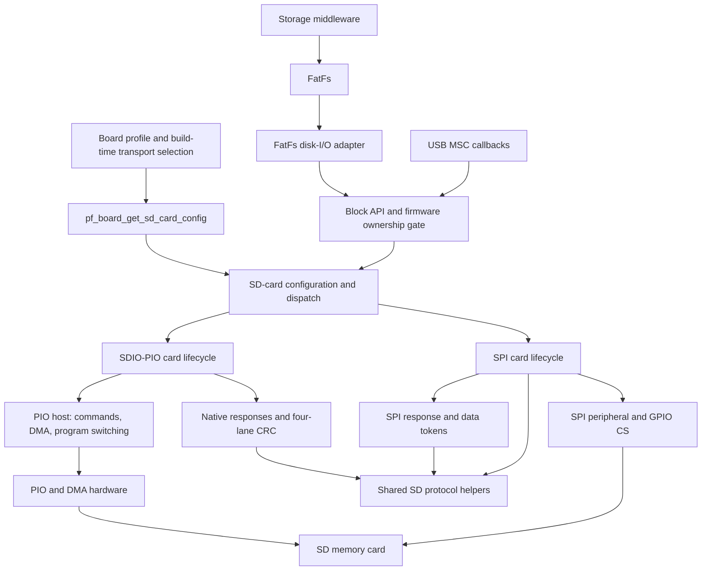
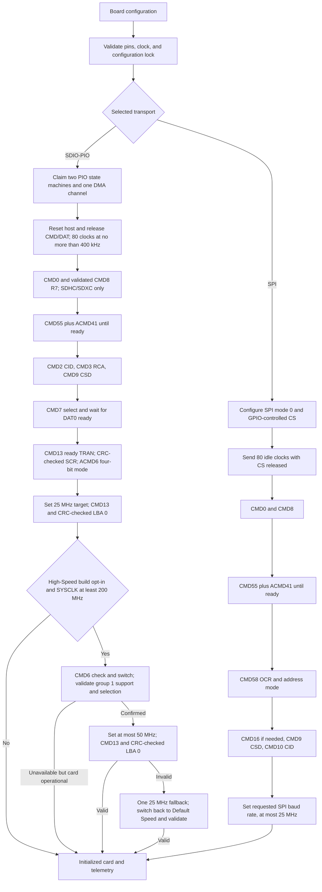
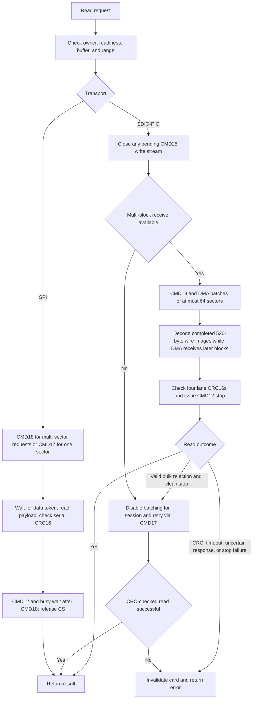
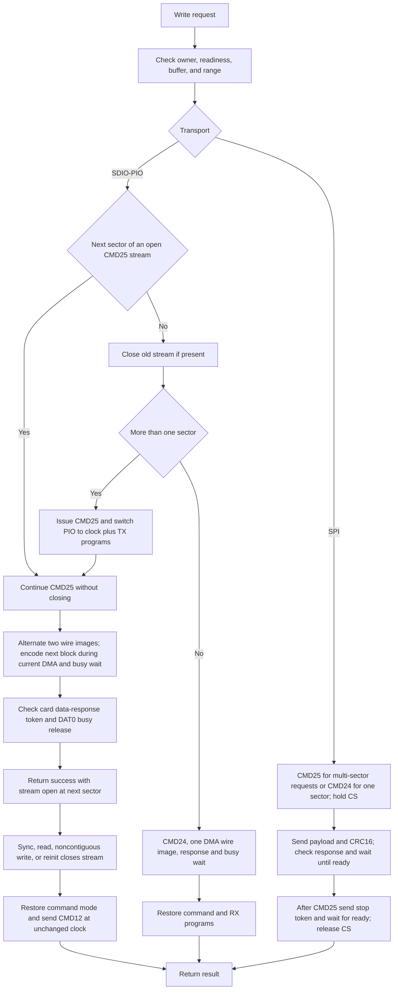
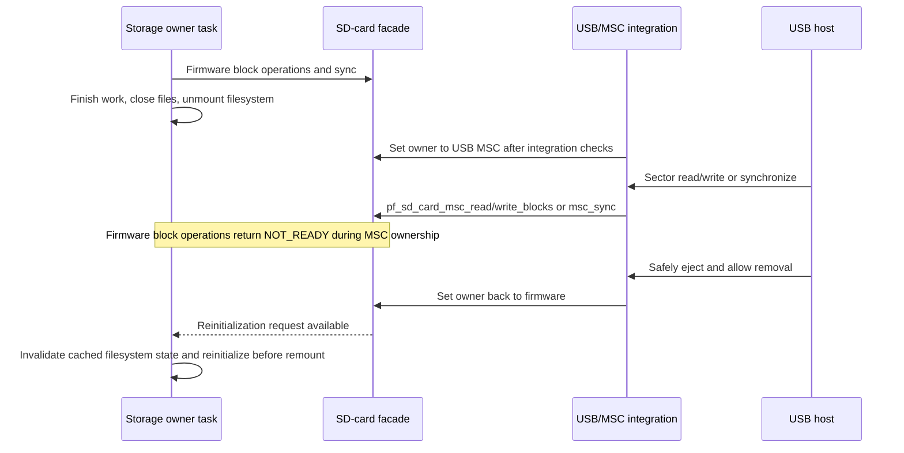

# SD-Card Driver Design

This document describes the implemented SD memory-card driver for RP2040 and
RP2350. It is the reference for driver interfaces, transport workflows, and
resource ownership. Wiring and electrical requirements remain in
[hardware setup](hardware-setup.md#memory-and-storage-connections); filesystem
commands and mounting policy remain in [the CDC CLI guide](cdc-cli.md).

## Architecture

One configured card is exposed through a transport-neutral, synchronous block
API. Native SDIO-PIO uses four data lanes; SD-SPI uses a Pico SDK SPI controller.
Here, SDIO means native SD memory-card signaling, not support for SDIO I/O cards.



| Responsibility | Implementation |
| --- | --- |
| Board-approved pins and controller selection | [board.c](../firmware/src/board/board.c), [board_profile.c](../firmware/src/board/board_profile.c) |
| Singleton configuration, dispatch, diagnostics, and firmware/USB ownership | [sd_card.c](../firmware/src/drivers/sd_card/sd_card.c) |
| Execution-environment selection, reservations, and optional waits | [sd_card_port.h](../firmware/src/drivers/sd_card/sd_card_port.h), [ports/](../firmware/src/drivers/sd_card/ports/) |
| Block operations, result codes, and telemetry | [sd_card_block.h](../firmware/src/drivers/sd_card/sd_card_block.h) |
| USB-only ownership and block capabilities | [sd_card_msc.h](../firmware/src/drivers/sd_card/sd_card_msc.h) |
| CRC7, command framing, CMD8 classification, CSD decoding, serial CRC16, address conversion, and transfer bounds | [sd_card_protocol.c](../firmware/src/drivers/sd_card/sd_card_protocol.c) |
| Native card initialization and transfer policy | [sdio_pio.c](../firmware/src/drivers/sd_card/sdio_pio/sdio_pio.c) |
| Native response parsing and four-lane data encoding/CRC | [sdio_pio_protocol.c](../firmware/src/drivers/sd_card/sdio_pio/sdio_pio_protocol.c) |
| PIO/DMA engine and wire timing | [sdio_pio_host.c](../firmware/src/drivers/sd_card/sdio_pio/sdio_pio_host.c), [sdio_pio_host.pio](../firmware/src/drivers/sd_card/sdio_pio/sdio_pio_host.pio) |
| SPI initialization and blocking transfers | [sd_spi.c](../firmware/src/drivers/sd_card/spi/sd_spi.c) |
| SPI response/token validation and pin-function checks | [sd_spi_protocol.c](../firmware/src/drivers/sd_card/spi/sd_spi_protocol.c) |
| FatFs result/status conversion and CTRL_SYNC | [diskio.c](../firmware/src/integration/fatfs/diskio.c) |

The build selects one backend; it reuses the shared protocol library. SPI-only
builds omit native SDIO code, including its 33,280-byte receive buffer and 8 KiB
CRC tables. Filesystem mounting, formatting policy, and RTOS scheduling do not
belong in the reusable driver. The driver does not allocate its own task or
heap buffers.
In the FreeRTOS application, USB starts before card initialization. The selected
port is initialized and its optional wait adapter installed
before the storage worker is created; that worker owns the single card-init and
mount path. Background MSC transitions use a nonblocking card reservation and
defer while another task holds it; an idle MSC task does not acquire the card
mutex. HID memory reports are skipped while that reservation is unavailable
(GET_REPORT returns no report), rather than blocking USB on initialization or
recovery. Self-test starts reject a busy reservation without waiting. Actual
MSC data/sync callbacks remain synchronous and can still delay USB servicing
for the duration of host-requested card I/O.

## Interfacing With The Driver

### Transport Selection

The CMake cache variable `PF_SD_CARD_TRANSPORT` selects `SDIO_PIO` (default) or
`SPI`; the build defines `PF_CONFIG_SD_CARD_TRANSPORT` consistently for board,
facade, and backend code. Use `tools/firmware/build.sh --sd-card-transport SPI`
or `-DPF_SD_CARD_TRANSPORT=SPI` for a direct CMake build. Board support fills
the selected member of `pf_sd_card_config_t.bus`; pin assignments belong in
board support, not application code or reusable protocol helpers.

| Interface | Native SDIO-PIO | SD-SPI |
| --- | --- | --- |
| Configuration member | `bus.sdio_pio` | `bus.spi` |
| Configuration type | `pf_sdio_pio_config_t` | `pf_sd_spi_config_t` |
| Hardware selector | `pio0` or `pio1` | `spi0` or `spi1` |
| Backend API prefix | `pf_sdio_pio_` | `pf_sd_spi_` |
| Zero clock request | Fixed 25 MHz transfer target | 25 MHz |
| Requested clock bounds | Only 0 or 25 MHz; initialization at 400 kHz | 400 kHz to 25 MHz |

Transport and connection settings are locked after setup; repeating initialization
with the same configuration retries card identification. There is no public
runtime transport-switch or card-deinitialization API. Switching a card from SPI
back to native mode can require removing card power, not just resetting the MCU.

### Execution-Environment Ports

`PF_SD_CARD_PORT=FREERTOS|BAREMETAL` explicitly selects exactly one port,
independently of the transport. The default is `FREERTOS`, preserving the current
application. There is one shared facade, protocol implementation, and selected
transport backend, not separate RTOS and bare-metal drivers. Only
[ports/freertos/](../firmware/src/drivers/sd_card/ports/freertos/) depends on
FreeRTOS; [ports/baremetal/](../firmware/src/drivers/sd_card/ports/baremetal/)
uses the Pico SDK backend without importing or linking the kernel. These are
execution-environment ports, not filesystem/application integration.

| Contract | `FREERTOS` | `BAREMETAL` |
| --- | --- | --- |
| Callers | Tasks with the scheduler running; no ISR callers | One foreground context; no ISR, callback reentry, or second-core callers |
| Facade reservations | Static recursive mutex; try-lock never waits for its owner | No-ops; try-lock always succeeds because concurrency is forbidden |
| Native data waits | Polling by default; optional bounded notification waits | Polling only |
| Interrupt masking | Only short mutex/IRQ setup critical sections, not card transfers | No interrupt masking by the port |

Call `pf_sd_card_port_init(&config)` once before card access or starting any
card-using worker. It installs optional native FreeRTOS waits; it does not
initialize or access the card and is a no-op in bare metal. It can run before the
scheduler starts; subsequent facade operations in the FreeRTOS port require the
scheduler to be running. The existing USB startup performs this step before
creating the storage worker. Bare-metal startup must provide the board-approved
configuration and call `pf_sd_card_init()` itself.

The owner gate, diagnostics, synchronous block API, checked sync, and persistent
native CMD25 behavior are identical in both ports. Bare metal does not make a
write self-contained: explicitly sync before handing off the card or shutting
down. A no-op reservation is not multicore protection. Interrupts can run during
I/O, but their handlers must not call the driver.

The USB/storage-worker application remains FreeRTOS-only. Selecting `BAREMETAL`
in this repository builds the driver and
[pf_sd_card_baremetal_smoke](../firmware/tests/ports/sd_card_baremetal_smoke.c),
not a replacement USB, storage-worker, or filesystem application. The smoke
executable links the production driver and checks unconfigured API paths without
initializing hardware or touching media.

```sh
# Existing full application (default port).
tools/firmware/build.sh --board pico2 --sd-card-port FREERTOS

# Driver-only bare-metal link check; also supports --board pico and transport SPI.
tools/firmware/build.sh --board pico2 --sd-card-port BAREMETAL \
    --sd-card-transport SDIO_PIO
```

Bare-metal builds use `build/firmware-BOARD-baremetal` by default, separate from
the application directory. Direct CMake builds use `-DPF_SD_CARD_PORT=BAREMETAL`.
Invalid port names and bare metal with `PF_SD_CARD_INTERRUPT_WAIT=ON` are rejected;
SPI also rejects that native-only option. There is no scheduler auto-detection
or fallback to an unsynchronized port. `load.sh` builds the FreeRTOS application;
it does not automatically select the bare-metal smoke target.

Ceedling tests run both bare-metal facade transports on the host, including
byte-preserving transfers, recursive reservations, sync, and ownership rejection.
See [firmware test guidance](../firmware/tests/README.md#host-behavior-regressions).
[test_sd_ports.py](../tests/artifacts/test_sd_ports.py) inspects cross-build artifacts.
`validate.sh` also builds both ports and transports for RP2040/RP2350 and inspects
the bare-metal compilation database and ELF for kernel dependencies and a single
selected port. These are host/build checks, not physical-card qualification.

### Block API

Applications should normally use the facade rather than bypassing its ownership
gate with direct backend calls. This example initializes and reads without
mounting a filesystem or writing media:

```c
#include "board.h"
#include "sd_card.h"

pf_sd_card_result_t read_first_sector(uint8_t sector[PF_SD_CARD_BLOCK_SIZE])
{
    pf_sd_card_config_t config;

    if (!pf_board_get_sd_card_config(&config)) {
        return PF_SD_CARD_NOT_CONFIGURED;
    }
    pf_sd_card_result_t result = pf_sd_card_init(&config);
    if (result != PF_SD_CARD_OK) {
        return result;
    }
    return pf_sd_card_read_blocks(0u, sector, 1u);
}
```

For filesystem access, pass the board configuration to `pf_storage_mount()` and
use FatFs through the storage-owner workflow. Do not mix raw-sector writes with
a mounted filesystem.

- Blocks are always 512 bytes, with 32-bit sector addresses and capacity.
- Buffers are caller-owned and can have any alignment. Reserve at least
  `block_count * PF_SD_CARD_BLOCK_SIZE` bytes for the entire call.
- Nonempty requests require a non-NULL buffer, an in-capacity sector range, and
  a byte length representable by `size_t`. Zero-block calls are no-ops only
  after ownership/configuration/readiness checks.
- Facade calls are synchronous. The FreeRTOS port serializes them with a recursive
  mutex; bare metal requires the single-context contract above. Direct SPI/SDIO
  backend and protocol calls bypass port reservations and require external
  serialization, including lazy CRC-table initialization.
  The owner flag controls access eligibility; it does not reserve a sequence of calls.
- Reserve multi-call check/action sequences with `pf_sd_card_lock()` and
  `pf_sd_card_unlock()` where needed. Per-call locking does not serialize a
  FatFs transaction: `FF_FS_REENTRANT` is disabled, and all FatFs operations
  must remain in the storage-owner workflow with its busy/ownership reservation.
- Use `pf_sd_card_sync()` after writes. A successful SDIO multi-block write can
  leave a CMD25 stream open; sync ends the stream and checks stop completion.
- On read failure, buffer contents may be partially updated or invalid. A failed
  write can have committed some sectors; do not blindly replay it.
- `pf_sd_card_get_info()` reports presence, initialization, effective clock,
  capacity, and CID. Without card detect, presence is not independently known.
- `pf_sd_card_get_diagnostics()` retains the most recent failed facade operation,
  result, owner, selected transport, backend initialization stage, and a snapshot
  of the profiling event counters. `sd diagnostics` exposes this without
  changing profiling state; counters remain zero unless profiling was enabled
  when those events occurred. A successful call does not erase the failure;
  clear it explicitly after collection. The sequence remains monotonic across
  clears so field logs can distinguish a cleared record from a fresh boot.
- `pf_sd_card_set_idle_hook()` installs an optional short callback for long
  polling waits. Configure it before transfers; it is not synchronized and does
  not make all SDK calls nonblocking.

Result codes distinguish invalid arguments, locked configuration, unconfigured
transport, unready media/ownership, initialization failure, and I/O failure.
Neither initialization nor recovery formats media or writes card sectors.
Native initialization diagnostics distinguish SCR failures: stage 24 is CMD55
prefix/response validation, 25 is ACMD51 response validation, 26 is SCR data
completion, 27 is SCR CRC validation, and 28 is unsupported SCR bus width.
Stage 17 remains the generic SCR setup failure; existing stage numbers are
unchanged.

## Initialization Workflow

Both transports begin identification at 400 kHz and determine whether sector
arguments are SDHC/SDXC block addresses. Only the SPI backend retains SDSC
byte-addressing compatibility.



Any command, resource, or validation failure returns an initialization error;
there are no repeated clock-step retries. Native mode requires SCR-advertised four-bit
support; there is no one-bit sector-I/O fallback. SPI accepts its supported
ready/idle responses and checks OCR power-up and voltage compatibility.

Native initialization requires a valid CMD8 R7, OCR ready/CCS and a compatible
3.3 V voltage window, CSD structure 1, nonzero RCA, and ready TRAN state.
Legacy/SDSC cards are rejected, sectors are always 512 bytes with direct block
addressing, and CMD16 is never sent. CID/CSD CRC7 and SCR data CRC16 are checked.
The host switches its bus-width state only after ACMD6 succeeds.

Initialization uses at most 400 kHz and 80 released-line clocks before CMD0,
then sets a 25 MHz transfer target. CMD13 and a CRC-checked read of LBA 0 are
required before initialization succeeds. There is no large startup sector scan
or runtime clock reduction. The target media are Class 10 or newer
cards; speed class is a usage requirement, not a guarantee of electrical
compatibility or application throughput, and is not detected/enforced by this
driver. CSD must advertise a default transfer rate of at least 25 MHz.

`PF_SDIO_PIO_HIGH_SPEED=ON` is an explicit CMake opt-in, OFF by default.
At SYSCLK below 200 MHz the driver stays at 25 MHz and records the host limit.
Otherwise it sends CMD6 check `0x00fffff1` and switch `0x80fffff1`, checks
group-1 support, busy status and selected function, and only then targets up to
50 MHz. CMD13 and CRC-checked LBA 0 validate the faster bus. A failure permits
exactly one 25 MHz attempt, including a CMD6 switch back to Default-Speed
timing and repeat validation; failure of that attempt aborts initialization.
Unsupported/rejected High Speed is nonfatal only while card operation can be
confirmed. Runtime read/write errors never trigger speed negotiation or replay.

For an existing Pico 2 build directory, enable the experimental path explicitly:

```sh
cmake -S firmware -B build/validation-pico2-fixed25-250 -DPF_SDIO_PIO_HIGH_SPEED=ON
cmake --build build/validation-pico2-fixed25-250
```

This does not change SYSCLK or qualify an overclock. Leave the option OFF for
the default design. Neither mode is evidence that the current card's observed
native receive/framing fault has been fixed on hardware.

The integer clock divider rounds down to avoid exceeding 25 MHz. At 150 and
250 MHz SYSCLK, the transfer bus is exactly 25 MHz; at 125 MHz it is
20.833 MHz. This deterministic divider rounding is not adaptive speed selection.
SYSCLK must be at least 100 MHz. Use SDK-supported clock settings and check
effective-clock telemetry; an accepted divider does not qualify an overclock.
Failures are reported rather than hidden by lower-speed reinitialization.
Set SYSCLK before initialization; do not change it during a transfer. An idle
clock change requires card reinitialization so the host can recalculate timing.

Public block-operation result values and HID report layouts remain unchanged.
Native `sd info` adds a detailed error and an initialization/runtime phase,
alongside counters that remain enabled when performance profiling is off.
Initialization has one failure exit that aborts host I/O and releases the bus.
Runtime failures likewise invalidate the card and abort the host; neither reads
nor writes are replayed. The startup 50-to-25 MHz fallback is the only automatic
transfer-speed fallback.

## Read Workflow



The native host falls back to CMD17 only after a valid bulk rejection and a
successful stop. CRC errors, timeouts, missing/malformed responses, and failed
stops return an I/O error without latching batching off or changing the clock.
The card is invalidated after a failed read; a later initialization request
starts again at 400 kHz and returns to the same fixed target. The failed read
is not replayed. SPI holds CS across a CMD18 transaction,
stops with CMD12, discards CMD12's stuff byte, and waits for ready before release.
An explicit illegal-command response permits single-sector fallback; other
failures are not replayed.

The PIO programs have no timeouts of their own: the command, data, and busy
waits are bounded by the host (100 ms for a command response, 1 s for data
transfer and for DAT0 busy release), after which the state machines are
restarted. A command that gets no response costs 100 ms; this affects only
initialization and failure paths. Native mode rejects unsupported CMD8; a silent legacy card is
rejected: the host's boolean completion result cannot distinguish silence from a
partial frame, so neither timeout nor CRC/framing failure is accepted as compatibility.
A
command that completes before a delayed poll is not reported as a timeout.
In-PIO timeouts are not used because the command (20) and receive (12) programs
use all 32 PIO instructions. Receive start detection qualifies DAT0 at a falling
clock edge rather than treating any asynchronous low level as the start bit.
This avoids including an early-asserted start bit in the SCR or sector payload.
Command responses are also sampled at falling edges, away from rising-edge card
output transitions. Both paths retain framing/CRC validation; see the
[Class 4 read-only check](hardware-setup.md#class-4-read-only-bring-up-2026-10-15).

## Write Workflow

A failed native single-sector write invalidates readiness, even if restoring the
host's command programs succeeds. CMD24 response loss, interrupted payload, and
DAT0 timeout cannot prove the card completed the write. Sync and subsequent
transfers return `NOT_READY` until explicit reinitialization; no payload is
replayed automatically. This conservatively also invalidates ordinary rejection.

CMD24 and CMD25 share TX DMA control-bit setup. CMD25 constructs those invariant
bits once per call; payload DMA addresses/counts and completion/abort handling
remain per sector. This reduces setup work but has no measured throughput claim.
Successful native CMD25 streams remain open across consecutive facade writes.
The [same-card A/B benchmark](tests/records/2026-10-15-cmd25-persistence.md)
measured 40.93% higher median write throughput with persistence, so this is
unconditional behavior rather than a build option. Non-contiguous operations,
synchronization, failures, removal, and reinitialization retain checked stream
recovery.



DMA byte-swaps 32-bit words so each 520-byte native wire image reaches the PIO
in transmission order. PIO sends data/CRC nibbles, captures the write-response
token, and waits for card busy release. Multi-block writes overlap CPU encoding
of the next image with transmission/programming of the current sector, but use
only one DMA channel. Failed writes are not automatically replayed. Stop-command
recovery is not a guarantee against data loss on power failure.

A failed native multi-block write returns an error without replay. Initialization
is invalidated when cleanup leaves the CMD25 stream unresolved (command-mode
restoration or CMD12 response/busy recovery failed). If cleanup succeeds, the
card remains initialized; this does not mean the failed write was atomic or that
no data reached the card. Earlier accepted blocks, and possibly the failing block,
may already be programmed. CMD12 terminates the stream; it is not the first point
at which blocks can reach media. Every failed native CMD24 write invalidates
initialization, including ordinary card rejection, even if command-mode
restoration succeeds; explicit reinitialization is required. In SPI, a
single-block command that returns a non-zero R1 keeps initialization (the card
is known to be in command mode), but a lost R1 or any failed read data phase
(token timeout/error, short read, CRC mismatch) invalidates it because the
card's transfer state cannot be proven restored; failed writes follow the rules
above. Recovery is reinitialization; failed transfers are not retried. Failed host
restoration explicitly invalidates readiness, including after a single-block write;
sync cannot report success. `pf_sdio_pio_host_recover()` resolves both pending
streams and host restoration failure. Its false result retains either unresolved
stream state or the explicit unusable-host flag. Reinitialization retries restoration
before identification, without replaying the uncertain write. Single-sector and
CMD6 reads share RX setup/cleanup and response checks; SCR keeps its one-bit CRC
and command sequence.

Raw card-detect absence immediately invalidates readiness and blocks transfers,
sync, and initialization, while preserving unresolved protocol state. A bounce
back requires reinitialization to close that state before CMD0. Only the serialized
storage worker's debounced removal notification abandons streams and restores host
mode without sending CMD12 to the absent card. This notification precedes unmount.
The worker continues presence debounce under USB ownership, but never initializes
or mounts while USB owns the card. MSC disable permits release before host eject
only when the worker has confirmed absence and raw detect still reports absence;
removal prevention still blocks release. Present media still requires eject and
successful sync. Ownership return requests reinitialization, and debounced
reinsertion permits the firmware worker to initialize and mount again.

CMD18 response timeout or malformed response does not prove the command was never
sent. Every validated multi-block read attempt cleans up RX/DMA and attempts CMD12,
including those response failures. A failed stop retains an unresolved read flag;
the host rejects new reads and non-stop commands. Card-layer recovery first closes
that state successfully before identification or retry. Exhausted stop recovery
leaves initialization invalid and subsequent I/O blocked. A confirmed removal may
abandon this state without a card command.

SPI multi-block writes use the 0xFC block token and 0xFD stop token. They are
closed within each call, not kept open across calls. Illegal-command fallback
is allowed only before sending payload; partial writes and failed stop/busy
waits return errors without replay. A failed stop invalidates initialization.

## Hardware Resource Inventory

These are driver resources, not the complete firmware budget. UART logging,
USB hardware, RTOS tasks/queues, and FatFs working memory belong to their
respective integrations. Both transports need a compatible 3.3 V card supply,
common ground, and the breakout's required biasing.

### Current Board Profile

The default CMake transport is SDIO-PIO; the board profile requests 25 MHz.
At 150 MHz SYSCLK, the slow-mode divider produces an exact 25 MHz bus.
The integer divider can round down for other system clocks; initialization never
selects a lower candidate after errors. SPI's zero clock request selects 25 MHz. See
[board_profile.c](../firmware/src/board/board_profile.c) for authoritative values
and [hardware setup](hardware-setup.md#memory-and-storage-connections) for header
pin numbers and electrical details.

| Resource | SDIO-PIO | SD-SPI |
| --- | --- | --- |
| Controller | PIO0 | SPI0 |
| GP2 | CLK | SCK |
| GP3 | CMD | MOSI / card CMD |
| GP4 | DAT0 | MISO / card DAT0 |
| GP5 | DAT1 | No driver signal; remains connected/reserved by wiring |
| GP6 | DAT2 | No driver signal; remains connected/reserved by wiring |
| GP7 | DAT3 | GPIO-controlled CS / card DAT3 |
| GP8 | Card detect | Card detect |
| Detect polarity and bias | Active high, breakout bias, no MCU pull | Same |

The two columns are alternative configurations, not concurrently active buses.
Native DAT0-DAT3 must be ascending consecutive GPIOs in logical lane order.
The current PIO clock-wait encoding requires CLK = DAT0 - 2; DAT0 must be in
the validated GP2-GP28 range and all used pins must exist below GP32. CMD and
optional detect must not overlap the bus pins. The backend accepts PIO0/PIO1,
not RP2350 PIO2. SPI SCK/MOSI/MISO must match functions of the selected SPI
controller; CS is an ordinary, independently controlled GPIO.

### Peripheral And Memory Budget

| Resource | SDIO-PIO allocation/use | SD-SPI allocation/use |
| --- | --- | --- |
| Bus GPIOs | Six: CLK, CMD, DAT0-DAT3 | Four: SCK, MOSI, MISO, CS |
| Optional detect GPIO | One, polled input | One, polled input |
| PIO state machines | Two dynamically claimed on one PIO: command/clock SM and data RX/TX SM | None |
| PIO instruction memory | Selected PIO's 32-word budget reserved for this host; programs replaced between modes | None |
| PIO programs in command/read mode | Command program plus normal or fast RX program | None |
| PIO programs in write mode | Clock program plus normal or fast TX program; same two SMs | None |
| PIO FIFO resources | TX/RX FIFOs of both claimed SMs; data FIFO supplies DMA DREQ | None |
| PIO completion flags | Internal flags 0: command, 1: receive, 2: transmit; polled by CPU | None |
| CPU interrupt handlers | Default: none. Optional FreeRTOS adapter uses one shared handler on the selected PIO's IRQ0; no DMA IRQ handler | None |
| DMA channels | One dynamically claimed channel, reused for RX and TX with 32-bit transfers and byte swap | None; CPU uses blocking SDK SPI calls |
| SPI peripheral | None | One controller, 8-bit mode 0, MSB first; GPIO CS spans command, data, and busy phases |
| GPIO input synchronization | Bypassed for the six native bus pins in selected PIO; previous settings saved/restored by host teardown | No PIO synchronization changes |
| Internal pulls | CMD and all four DAT pins pulled up | MISO pulled up; CS initialized high |
| Clock source | `clk_sys` drives SM dividers; effective rate is reported in telemetry | SDK SPI baud-rate configuration; actual rate is reported |
| Timing source | SDK microsecond timer for bounded polling; SDK sleeps during identification | Same; no dedicated timer/alarm claimed |
| Static native receive/transfer wire buffer | 64 x 130 words x 4 bytes = 33,280 bytes | None |
| Static initialization probe buffer | None; no startup sector probe | None |
| Single-sector wire image | 520 bytes on stack for native single-block read/write paths | No full-sector bounce buffer |
| Multi-block write wire images | Two x 520 bytes = 1,040 bytes on stack | None |
| Other stack/static data | SCR/switch-status buffers, command responses, host/configuration state, CID and capacity; additional stack beyond images required | Small command/CSD/CID buffers and configuration/telemetry state |
| Protocol lookup tables | 8,192 bytes of lazily initialized SRAM tables for four-lane CRC, plus the shared read-only CRC16 table; software CRC | Shared read-only CRC16 table; software CRC |
| Main native buffer plus CRC tables | 41,472 bytes (40.5 KiB), excluding metadata and stack; the separate self-test buffer adds 32 KiB | SPI-only builds omit these 40.5 KiB of native SRAM |
| Caller transfer buffers | Caller owns logical payload storage independently of wire buffers | Caller owns logical payload storage |
| Core/task/heap allocation | No dedicated core, driver task, or heap allocation | Same |

SM and DMA numbers are allocated at runtime, not fixed to SM0/SM1 or DMA0.
The selected PIO should not be shared with unrelated programs: mode switching
depends on available instruction memory and owns the listed completion flags.
Resource-allocation failure returns initialization failure; internal host teardown
unclaims its DMA/SMs and removes its programs. The public singleton retains its
connection configuration and does not expose general resource hand-back.
Only the selected backend is linked, so an SPI-only image omits the native
wire buffer and CRC tables. Use the link map for total image SRAM, not just
this active-transport table.

## Performance Controls And Status

Profiling is disabled at boot. The storage-owner CLI supports `sd profile on`,
`off`, `reset`, and `status` (or just `sd profile`). Snapshots report cumulative
microseconds/calls for command, data, CRC/copy, busy, stop, and recovery work,
plus CRC failures, batch fallbacks, timeouts, and recovery attempts. Changes
require firmware ownership. Profiling adds measurement overhead; phases overlap
and must not be summed to infer total latency. Native write data timing includes
overlapped next-block encoding and the PIO's response/busy completion; it does
not isolate the card's internal programming time. SPI read DATA includes token
waiting, payload transfer and both wire CRC bytes; CRC covers CPU validation
separately. A token deadline emits one timeout event; I/O failures do not. Snapshots use
`pf_sd_card_get_profile()`; the facade locks each snapshot, while direct backend
profiling access requires external serialization.

### Profile Measurement Boundaries

The existing enum order, `elapsed_us`/`calls` arrays and CLI labels
`command`, `data`, `crc_copy`, `busy`, `stop`, `recovery` are retained for ABI
and historical log compatibility. They are **inclusive instrumentation windows**,
not mutually exclusive stages. Reinterpreting them as exclusive phases would
silently change existing results; no such reinterpretation is made.

| Window | Current boundary and overlap |
| --- | --- |
| COMMAND | Command request/response helper; also counted inside STOP and recovery initialization |
| SDIO CMD24 DATA | After TX starts, until both DMA and PIO completion (or timeout); PIO completion includes response token and DAT0 busy release; no separate BUSY measurement for that program |
| SDIO CMD25 DATA | Per-block interval after TX starts through both completions; includes next-block CPU encoding, measured again under CRC/copy; also includes response and card busy |
| SDIO RX DATA | CMD18 response accepted through DMA + PIO completion/timeout; completed-block decode/CRC/copy inside the wait is counted again as CRC/copy; final decode after completion lies outside DATA |
| SPI DATA | Read token wait + payload + wire CRC; write payload only, excluding response and the separately timed ready wait |
| CRC/copy | CPU encode/decode/CRC validation windows; may run while DMA/PIO is transferring; includes copy only for the native variants that perform it |
| BUSY | Explicit ready wait; native TX PIO busy is already in DATA; explicit stop waits are also inside STOP |
| STOP | Entire multiblock stop helper including command/response and busy, at unchanged clock |
| RECOVERY | Native reinitialization attempt, including its command/data/CRC/busy windows; not all cleanup or retry time |

Do not sum these values to obtain latency, subtract CRC/copy to infer physical
wire time, or compare individual windows across transports. The CMD25 host
regression uses real production encoding with a deterministic clock to assert
nested DATA=119 ticks and CRC/copy=51 ticks for three blocks; these numbers are
instrumentation evidence, not hardware microseconds. Existing CMD24 regression
checks both completion sources and timeout accounting. RX decode and stop/busy
boundaries above were source-reviewed; they have no new hardware timing evidence.

### MSC Batching And Validation Boundary

Pinned TinyUSB 0.18.0 `msc_device.c` uses
`min(CFG_TUD_MSC_EP_BUFSIZE, remaining_command_bytes)` for READ10 and WRITE10
staging; WRITE10 passes the actual received byte count. This repository sets
`CFG_TUD_MSC_EP_BUFSIZE=512`. A SCSI command can contain multiple sectors, but
its current callbacks carry at most one sector, with offsets for short transfers.
The callback interface itself accepts larger buffers; complete 512-byte multiples
at offset zero now reach the existing block backend as one count-preserving call.
Partial calls must fit one sector and use synchronous RMW; zero-byte valid calls
perform no I/O. Size is bounded by signed callback return range and card capacity.

MSC reserves the recursive facade lock across validation, RMW and completion;
firmware/FatFs I/O remains excluded by USB ownership. Diskio validates drive,
nonzero count and address width and forwards multi-sector firmware requests;
transport validation enforces card capacity. Both transports accept unaligned
caller buffers: native SDIO encodes into the existing aligned double TX workspace
and decodes from its bounded RX workspace; SPI blocking I/O consumes bytes.
MSC retains only its existing aligned single-sector RMW scratch, with no new
allocation, DMA buffer or cached callback pointer.

Native multi-block writes can leave CMD25 open after accepted/busy-complete
blocks. MSC therefore checks sync/STOP after a successful multi-block backend
write and before returning success. A failed write is never replayed or synced
as a recovery attempt. Sync errors return failure and write-error sense. Current
one-sector callbacks retain their existing synchronous completion behavior.

Cross-callback write aggregation is not implemented: TinyUSB's completion hook
runs after CSW is queued, too late to fail the command on a flush error, and the
application has no pre-CSW command boundary with total write input validity.
Acknowledging cached data early would weaken the error/durability contract.
Current 512-byte BOT staging remains a performance ceiling; no USB throughput
gain is claimed from accepting larger callback inputs.

Ceedling MSC batch tests execute production MSC, facade and diskio against a
data-bearing backend seam (actual bytes, ownership, RMW, batch counts, sense and
checked completion). It does not execute TinyUSB's BOT state machine or physical
SD transport. Existing SDK TinyUSB tests require an external test environment;
there is no configured runnable full-stack host BOT integration in this repository.
BOT reset/short-transfer/CSW error integration and real USB-to-card completion
remain HIL validation gaps, including the review's GIL/integration gap; no Python
GIL behavior is inferred from these C host tests. No dependencies were installed.

For a future authorized controlled measurement, use the same board/card,
firmware options, clock and contiguous LBA range on both revisions; record
artifact hashes and actual bus clock, SCSI command sector counts and observed
backend counts. Reset/enable profiles per run; record total wall time and bytes
separately from inclusive counters, repeat read/write runs with matched sync and
cache policy, and report distributions/errors. Changing staging requires its own
BOT/short-input/abort validation before an A/B performance claim. Do not run this
recipe on media without separate explicit authorization.

The historical target records identify earlier artifacts, not this remediation.
Software models cannot measure PIO/DMA scheduling, command gaps, or card busy time.
No controlled before/after benchmark or HIL run is available for these changes,
including the new low-end candidate. No hardware qualification or throughput gain
is claimed. Profile command gaps, CRC/copy, filesystem allocation (normal versus
preallocated files), and card busy time before choosing further optimizations.

| Review improvement | Current status |
| --- | --- |
| Phase profiling and recovery diagnostics | Implemented, disabled by default; CLI and C API available |
| Preserve batching after transient faults | Implemented; CRC/timeout/uncertain-stop failures enter bounded card recovery |
| Remove initialization-only payload storage | Implemented; no startup probe; transfer CRC checks retained |
| Fuse CRC and payload copying | Opt-in `PF_SDIO_PIO_FUSED_COPY` CMake option, OFF by default; both variants host-tested; target speed unmeasured |
| Interrupt-backed synchronous native waits | Opt-in `PF_SD_CARD_INTERRUPT_WAIT`, OFF by default; adapter and notification races host-tested; target scheduling unqualified |
| SPI CMD18/CMD25 | Implemented with CS, stop, busy, and no-write-replay checks; hardware qualification outstanding |
| Cross-call native CMD25 persistence | Retained unconditionally; [same-card HIL](tests/records/2026-10-15-cmd25-persistence.md) measured 40.93% median write-throughput gain at 25 MHz with contiguous preallocation |
| Contiguous-file comparison | Opt-in `PF_STORAGE_SELF_TEST_PREALLOCATE`, OFF by default; see [SD self-test](sd-self-test.md) |
| Chained native receive buffers | Not implemented: enable only after profiles demonstrate meaningful inter-batch gaps, with overflow/cancellation/stop tests and an SRAM/DMA budget |
| SPI bulk DMA | Not implemented: evaluate after CMD18/CMD25 measurements show CPU-bound payload transfers; requires RX/TX servicing and a defined completion/abort policy |

The optional native wait integration lives in
[sd_card_wait.c](../firmware/src/drivers/sd_card/ports/freertos/sd_card_wait.c). It reserves
task-notification slot 1 (slot 0 remains available), enables only the active data
completion source, and blocks for at most one RTOS tick per wait, plus scheduler
latency. It masks the IRQ source but leaves the PIO flag for the driver to clear.
The host still requires both PIO completion and DMA completion. Boot without a
running scheduler retains polling. This adapter supports the current serialized,
single-core runtime, not concurrent card callers or a second-core owner.

Measure each option separately at the same supported clock, card, filesystem,
file size, and timing boundary. Record effective clocks, error/recovery counts,
CRC integrity, SRAM and stack high-water marks, CPU availability, and latency,
not only average MB/s. Keep normal and preallocated filesystem results separate.
CRC checks and bounded cleanup remain mandatory. Chained DMA and a faster bus
are not assumed improvements, and no new hardware throughput claim is made.

## Ownership Workflow



The generic block header exposes only firmware operations. USB-only acquire,
release, and block operations live in the dedicated MSC integration header;
there is no arbitrary public owner setter. Acquisition still cannot inspect
FatFs state without creating a cross-layer dependency, so the USB integration
atomically checks worker activity and mount state before acquiring the card.
Release similarly requires checked host eject/synchronization. In the FreeRTOS
application, a statically
allocated FreeRTOS recursive mutex
serializes those integration checks with the ownership transition.
Explicit fault recovery is the exception to clean eject: the confirmed
[CDC recovery workflow](cdc-cli.md#faulted-msc-recovery) detaches faulted MSC
before returning ownership and queues worker-only reinitialization. It never
reports sync/eject success or replays writes. Automatic mounting remains
inhibited until a successful explicit `fs mount`; presence debounce continues.
The recovery latch is runtime-only and resets on reboot. The workflow cannot
repair filesystem damage or guarantee recovery from an unresolved card stream.
The same mutex serializes all facade operations for both transports, including
telemetry and removal cleanup. Presence service and ownership handoff reserve their whole
check/action sequences; reconnect delays and command replies run outside the
reservation. These reservations protect those specific sequences, not every
FatFs transaction. The storage worker's exclusive workflow and busy gating
protect filesystem operations across multiple facade calls; the per-call mutex
alone cannot do that. Profile snapshots use the same mutex. Returning ownership sets a reinitialization
request because the host may have changed the filesystem. See
[USB protocol and MSC lifecycle](usb-protocol.md) for transition rules.

Backend headers remain available to their implementation and focused transport
tests, but application and integration code must use the facade. Backend calls
do not provide ownership or task serialization and are not an application API.

## Validation And Limits

Host checks cover shared protocol arithmetic, native wire encoding/CRC, SPI
tokens, native initialization/recovery/transfer routing, DMA batch decoding,
and PIO timing models. C behavior regressions live in the mirrored
[firmware tests](../firmware/tests), with runner commands and placement described
in [test guidance](../firmware/tests/README.md#host-behavior-regressions).
[test_sdio_pio_timing.py](../tests/pio/test_sdio_pio_timing.py) remains
a separate assembled-instruction model.
The Ceedling USB responsiveness tests exercise production
memory-report/self-test-start functions with an unavailable
reservation. The serialization check verifies nonblocking reservations against
concurrent slow backend calls in both transports, and the automount check covers
explicit MSC fault recovery, rejection, and the no-automount latch. These are
host control-flow checks, not USB enumeration/scheduling or physical BOT tests.
Use the existing [test guidance](../firmware/tests/README.md) and
[project validation entry point](../tools/validation/validate.sh).

Host tests and timing models do not establish electrical margins or target
hardware safety. Physical qualification is card, board, wiring, and clock
specific; see [hardware records](hardware-setup.md#sd-card-breakout),
[SD self-test](sd-self-test.md), and [test records](tests/records).
Read-only initialization success does not qualify high-speed writes. Power-loss
recovery, complete MSC lifecycles, and sustained endurance require separate
qualification. CSD v1/v2 capacity must fit the 32-bit block contract; SDUC,
64-bit LBAs, asynchronous requests, and a one-bit native block backend are not
implemented.

Release qualification must record, for each supported board/card/transport
combination, card initialization stability, read/write self-test results,
effective clock, stack high-water marks, card removal during active I/O, checked
USB host eject and BOT reset behavior, and power interruption during data and
filesystem-metadata writes. Host regressions are prerequisites, not substitutes,
for those hardware records.

### Previously Recorded Qualification

These observations were previously recorded in the architecture guide. They
are retained as historical, configuration-specific results, not as qualification
of this documentation change or every compatible card:

| Card/configuration | Recorded result |
| --- | --- |
| 8 GB Class 10, 250 MHz SYSCLK | 32 MiB self-test exercised lower-clock CMD12 retry, completed near 33 MHz with zero mismatches; 8.48 MB/s write and 9.91 MB/s read |
| 16 GB Class 4, 20 MHz request / 18.75 MHz actual | 32 MiB passed; 7.11 MB/s write and 6.69 MB/s read |
| 8 GB SD8GB, stock 150 MHz SYSCLK / 25 MHz SDIO | 32 MiB passed with zero mismatches; 7.22 MB/s write and 1.45 MB/s read |
| 128 GB SN128, 250 MHz SYSCLK / 50 MHz SDIO | 32 and 128 MiB self-tests recorded zero mismatches; 15.9 MB/s write and 13.7 MB/s read |
| 128 GB SN128, 200 MHz SYSCLK / 50 MHz SDIO | Recorded 12.5 MB/s write and 9.5 MB/s read |
| 128 GB SN128, stock 150 MHz SYSCLK / 25 MHz SDIO | Recorded 9.5 MB/s write and 8.3 MB/s read |
| 128 GB SN128, 280 MHz SYSCLK | Did not work with the card even at 25 MHz SDIO |

All native RX programs sample data on the falling clock edge (mid-bit), and the
slow TX CRC-status read does the same; the busy check runs one bit after the end
bit. This replaces sampling one cycle after the rising edge, which is inside the
card's 2.5-14 ns output-change window. High-speed RX uses a three-instruction
loop; its data divider is half the
command/clock divider with matched fractional timing. High-speed TX starts
the clock and data state machines together and launches at a fixed cycle offset.
The slow TX program is not suitable for 50 MHz: its observed-edge launch left
insufficient setup time and produced card CRC-error tokens. A 50 MHz bus needs
at least 200 MHz SYSCLK; those Pico 2 overclock experiments are diagnostic,
not supported production clock settings. These are historical experiments;
the default driver targets 25 MHz. High-speed PIO programs are selected only
after the explicit build opt-in and a confirmed CMD6 switch. Both former
initialization scans and the later 128 KiB probe have been replaced by a
single-sector validation at each startup timing.

## Fixed-25-MHz Follow-up (2026-10-16)

The connected 128 GB SB128 card was tested with the fixed-clock implementation
at a 25 MHz transfer target. These checks did not establish sustained throughput:

| CPU clock | Observed result |
| --- | --- |
| 250 MHz | Initialization failed at the SCR CRC check, before the transfer clock was selected; self-test rejected because no volume was mounted |
| 150 MHz | Initialized and mounted at 25 MHz; the authorized 32 MiB self-test failed during preparation with `FR_DISK_ERR`, zero payload bytes written/read, and two profiled receive CRC failures |
| 200 MHz | Initialized and mounted at 25 MHz; the same test failed during preparation with `FR_DISK_ERR`, zero payload bytes written/read, and two profiled receive CRC failures |

Receive captures showed both a nibble-shifted boot-sector image and a correctly
positioned `55aa` signature with CRC discrepancies on DAT1-DAT3. A temporary
1 MHz transfer-clock control produced a byte-for-byte identical bad frame to
one captured at 25 MHz. A cold-powered SPI control initialized and mounted the
same card at 25 MHz. This narrows the investigation to native transfer/framing
and its electrical behavior; it does not prove a specific sampling fix. Debugger
capture attempts did not yield a verified SPI-sector comparison.

The diagnostic clock override was removed and the 150 MHz CPU / fixed-25-MHz
SDIO firmware restored. Fully remove card power after the SPI control before
using native SDIO again.
No filesystem format was performed. No valid benchmark rate was obtained.
These observations identify a receive-integrity problem, not its cause; card
speed rating does not distinguish driver sampling/framing faults from wiring,
power, or signal-integrity faults. Neither a 10 MB/s result nor reliable
sustained operation is qualified by these tests.

## Static SD Review Follow-up (2026-10-15)

Application READ10/WRITE10 cached sense is now invalidated after TinyUSB handles
an accepted BOT reset at SETUP, and after its MSC driver bus-reset processing.
GNU linker wrappers in `firmware/src/usb/msc.c` interpose the built-in driver's
external references from `usbd.c`; the vendored stack is unchanged. No ISR or
enqueue-time hook mutates this cache. Earlier queued failures cannot erase a
reset, and failures after handled reset retain their fresh sense. Rejected
requests, skipped SETUP events, and DATA/ACK stages do not clear it.

`python3 -m pytest tests -m contracts` checks pinned
source ordering. Ceedling runs production application callbacks and linker wrappers
against a separate host driver/queue model. TinyUSB itself is not linked in that
host regression; it is not a real BOT integration or hardware qualification.

At that reset-sense review, the data paths were unchanged: SDIO CMD18 already overlaps completed-block
decode/CRC with later RX DMA, CMD25 alternates two wire buffers while preparing
the next block during TX, and fused CRC/copy remains opt-in. FatFs passes
multi-sector requests through and SPI already uses CMD18/CMD25. No safe small
performance simplification was identified in that review. The later MSC callback
batch-boundary repair is described above; the underlying overlap remains. Phase profiling and same-card,
same-clock normal/preallocated and fused-copy A/B comparisons remain pending
HIL; this change makes no throughput claim and changes no clocks or buffers.
